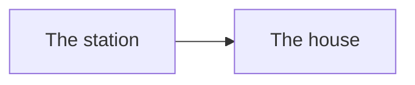

# Diagrams and formulas

A book stores a diagram as its Mermaid source and a formula as its KaTeX
source, not as a picture. A reader draws them in the size and the colours of
its page.

## Writing them in a chapter

Write them in the text you give to `add_chapter`, `write_chapter` or
`edit_chapter`, the way Markdown usually writes them:

````markdown


The train kept $v = s / t$ all the way.

$$
E = mc^2
$$
````

When the text is stored:

- A `mermaid` fence becomes a diagram resource `dia/NNNN.mmd`, and the fence
  becomes a figure: `` in a paragraph of its
  own.
- `$$…$$` becomes a display formula `math/NNNN.tex`, in a paragraph of its
  own. `$…$` inside a line becomes a formula set in the line. A formula the
  book already has is not stored twice.
- `%% alt:` and `%% caption:` at the start of a diagram give its alternative
  text and caption; they are removed from the source.
- The alternative text of a formula is its source. Better is a reference
  with words: ``.
- The answer lists what was made in `figures`, with the line of each, and
  gives the warning `missing_alt` for a diagram without `%% alt:` and for
  every formula written with dollars.
- Code spans, other code blocks and `\$` are left as they are.

Every new diagram and formula is drawn first. One that cannot be drawn
refuses the whole change with `invalid_figure`, the line and the message of
the renderer, and nothing is stored. Fix the source and try again.

After that, the chapter holds references, not fences: `read_chapter` shows
``, and `edit_chapter` matches against that.

## Changing one

- `read_figure` gives the source of a diagram or formula and the lines that
  use it.
- `put_figure` with its `path` replaces the source; every reference keeps
  working. Without `path` it adds a new one and gives its path, which you
  then put into a chapter.
- `remove_figure` removes it, after the person agrees. References to it are
  then problems until you remove them.

## Seeing one

- `render_figure` draws a source without any book and answers with its size
  in pixels, or the error and its line. Use it to try a source.
- Ask `put_figure` with `preview: true`, or `render_figure`, for a PNG image
  when you can look at pictures.
- A diagram wider than about 700 pixels is hard to read on a phone: prefer
  `flowchart TD` to `LR` for long chains.

## Notations

- Mermaid 11 is the reference: `flowchart`, `sequenceDiagram`,
  `classDiagram`, `stateDiagram-v2`, `erDiagram`, `gantt`, `pie`,
  `xychart-beta`, `mindmap`, `timeline` and the rest. `click` does nothing.
- KaTeX 0.16 is the reference: LaTeX in math mode, without the `$` or `\[`
  around it. `\href`, `\url` and `\includegraphics` do nothing.
- A chart of numbers is best a Mermaid `xychart-beta` or `pie`: it stays
  text that can be changed.
