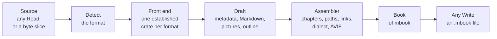

# mbook-converter

| | |
| --- | --- |
| **Crate** | [`mbook-converter`](https://crates.io/crates/mbook-converter) |
| **API documentation** | [docs.rs/mbook-converter](https://docs.rs/mbook-converter) |
| **Source** | [`crates/mbook-converter`](https://github.com/M-Compressors/mbook/tree/main/crates/mbook-converter) |
| **Builds on** | [`mbook`](../mbook/index.md); [RFC 0001](../rfcs/0001-mbook-format.md), format version 1.0 |
| **Minimum Rust** | 1.89; 1.98 with the `export` feature |
| **Status** | Draft: the API may still change |

`mbook-converter` imports books into mbook and exports existing books to
other formats. Its central type, **`Converter`**, has four import entry points:

| | Result: an mbook file written to any `Write` | Result: a `Book` in memory |
| --- | --- | --- |
| **Source: any `Read`** | `convert` | `load` |
| **Source: a byte slice** | `convert_slice` | `load_slice` |

Each import format has a Cargo feature enabled by default. The optional
`export` feature enables all writers. A format is read by an established crate (`unpdf` for PDF, `rbook`
for EPUB, and so on); this crate adds what is a rule of mbook: which chapter
a piece of text belongs to, what a link or a picture is called after
conversion, what the Markdown dialect allows, and that every picture becomes
AVIF.

[What is implemented](conversion.md#what-is-implemented) lists, format by
format, what the crate does not do yet.

```toml
[dependencies]
mbook-converter = "0.3"
```

| Page | What it answers |
| --- | --- |
| [Guide](guide.md) | How is a book converted, corrected and exported? Each task with its code. |
| [API reference](api.md) | Which types, features, options and errors exist, and what each export format keeps. |
| [Conversion rules](conversion.md) | What happens to chapters, links, pictures and metadata, format by format, and what each format cannot do yet. |
| [Design](design.md) | Which crates read each format, what the design costs, and why it looks this way. |

## How a conversion runs



1. The format is detected from the content, unless the caller names it.
2. The *front end* of that format parses the source with its crate and hands
   over a *draft*: metadata, Markdown in source order with the source's own
   names in links and pictures, the pictures, and an outline when there is
   one.
3. The *assembler* is the same for every format. It cuts the text into
   chapters, gives chapters and pictures their paths, re-targets links, brings
   the Markdown into the dialect of RFC 0001, and encodes pictures as AVIF.
4. The result is a `Book` of `mbook`. `convert` writes it; `load`
   returns it.

## What it is for

[RFC 0001](../rfcs/0001-mbook-format.md#how-a-packer-builds-a-book) describes a
packer that starts from FB2, EPUB or a folder, and
[`mbook`](../mbook/index.md#non-goals) leaves conversion to "crates
built on this one". Without such a crate every application that imports books
writes the same code: parse the source, produce Markdown without raw HTML,
re-encode pictures, rename every reference, build the contents.

| Task | Who does it |
| --- | --- |
| Convert a file on disk | A command-line tool, a library manager |
| Convert an upload or a download without a temporary file | A server, a reading application |
| Convert, then correct the metadata before saving | A library manager |
| Ship only the formats an application needs | An embedded or mobile reader |

## Goals

| Goal | How the design meets it |
| --- | --- |
| No file paths in the API | Sources are `Read` or `&[u8]`; the result goes to `Write` or stays a `Book`. |
| A sink that cannot seek is enough | The file is written in one forward pass by `Book::write`. |
| Pay only for the formats used | One feature per format; a disabled format costs no dependency. |
| The rules of mbook are written once | Every front end hands over the same draft; one assembler builds the book. |
| A converted book is always valid | The book goes through `Book::check` before a byte is written. |
| Losses are visible | Whatever cannot be represented is reported as a `Warning`, not dropped silently. |
| Parsers are not written here | Each format is read by an established crate. |

## Non-goals

- **Keeping the layout.** Fonts, colours, CSS, page geometry and fixed
  positions are dropped; [RFC 0001](../rfcs/0001-mbook-format.md#non-goals) excludes
  them from the format.
- **Removing protection.** A protected source is refused.
- **Recognising text in pictures.** The pages of a scanned PDF are stored as
  pictures.
- **Fetching anything.** A picture or a stylesheet named by a network address
  is never downloaded.
- **Asynchronous I/O**, as in `mbook`.
