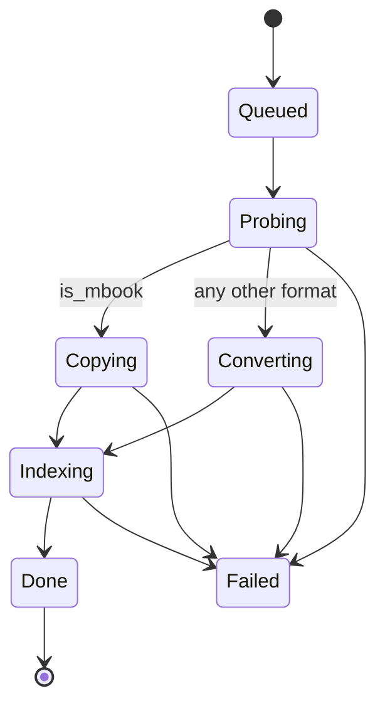
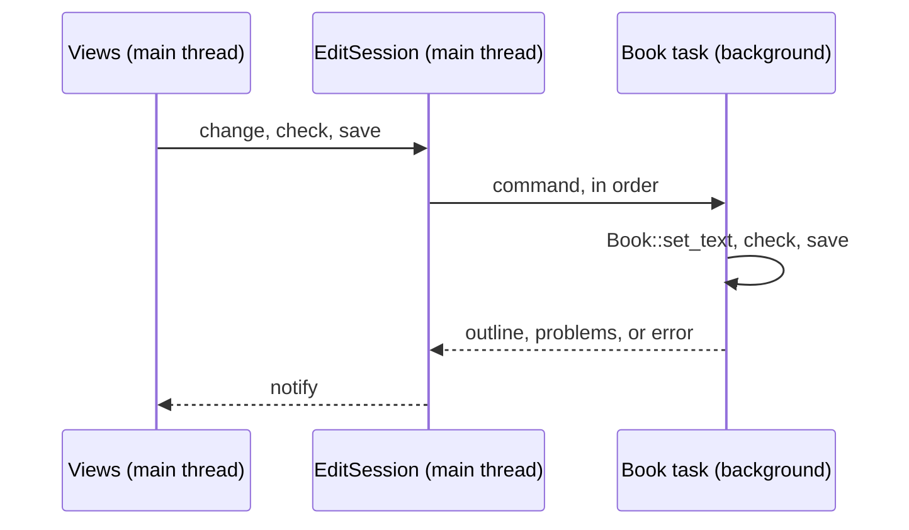

# Architecture

How the application is put together: its modules, where each piece of work
runs, what is stored where, and how a book is imported, read, edited and
updated. A sentence with "must" states an invariant of the code that a test
or a review keeps.

## Crate and workspace

`crates/mbook-ui` is one package with a library and a binary.
`crates/mbook-android` is the shell of Android.

| Target | Contains |
| --- | --- |
| Library `mbook_ui` | Every model and view, and `run(Application, Roots)`. It names no platform, except where Android has no counterpart of a desktop crate: the file picker and the insets of the window. |
| Binary `mbook` | The allocator, the platform of the desktop, the directories from `dirs`, a call to `run`. Empty when built for Android. |
| Library `mbook_android`, a `cdylib` | The allocator, `android_main`, the platform of gpui-mobile, the roots from the files of the application, a call to `run` ([Android](android.md#the-shell)). Empty on every other target. |

- A shell must stay a shell: it sets the global allocator, builds the
  `Application` and the roots, and passes them on.
- The engine is chosen per target in the manifest. On the desktop
  `gpui-kit` and `gpui-kit-markdown-editor` are used with the feature
  `gpui-fast`; on Android without it, on gpui-pre, which is the engine
  gpui-mobile implements its platform for. Cargo leaves the features of a
  target table out of a build for another target, so one build never holds
  both engines. Application code imports `gpui_kit::*` only and never names
  `gpui`, `gpui-fast` or `gpui-pre`.
- Code for one platform is chosen by `cfg(target_os = "android")`. It is kept
  to the file picker, the insets, the export that ends in the share sheet,
  and the bar of a page; the desktop counterpart is the code without the
  attribute.
- The allocator is set in the shells, not in the library, so that tests and
  other shells choose their own.
- Both packages set their own `rust-version`, 1.100, and are not published
  to crates.io. `mbook` and `mbook-converter` keep the 1.89 of the workspace.
- The lints of the workspace apply unchanged to `mbook-ui`. `mbook-android`
  repeats them with `unsafe_code` denied instead of forbidden, for the
  unmangled name of `android_main`, which has the one `#[expect]`.

The modules follow the layers of Feature-Sliced Design. A layer uses only
the layers below it.

| Layer | Slices |
| --- | --- |
| `app` | `run`, the window, the root view, menus and keys |
| `pages` | `library`, `reader`, `editor`, `settings` |
| `widgets` | `chapter_view`, the text of a chapter, which the reader and the preview of the editor share. Every other part of a screen belongs to its page until a second page needs it. |
| `features` | `import_book`, `reading_position`, `appearance`, `edit_book`, `search_library`, `search_text`, `auto_update` |
| `entities` | `book` (an open book), `catalogue` (the store), `picture` (decoding and its cache), `figure` (diagram and formula rendering) |
| `shared` | `roots` (directories), `model` (the key of a book, a place in one), `layout` (size classes), `theme` (colour tokens), `actions`, `ui` (presets over Kit components), `assets` |

State lives in model entities; a view observes a model and calls its
methods. A view holds no `BookReader`, no `Book` and no path.

## Threads

| Work | Runs on | Priority |
| --- | --- | --- |
| Drawing; changing entities; reading snapshots | Main thread | |
| Opening the catalogue; its reads and writes | Background | Medium |
| `BookReader::open`; building the snapshot of a book | Background | High |
| `read_chapter`; resolving its links and pictures | Pool | High |
| Following a link | Background | High |
| Parsing Markdown for display | Background, by the text view of GPUI Kit | |
| `read_picture`; decoding AVIF; scaling | Pool | Medium |
| Reading diagram and formula sources and drawing SVG | Pool | High for the current chapter |
| Detecting a format; copying a file; recording a book in the catalogue | Background | Medium |
| `Converter::convert` | Pool, one conversion at a time | Low |
| Making the thumbnail of a cover | Pool; the file is written on the background | Low |
| `Book::open`, every change of a `Book`, `check`, `save` | Pool, for the task that owns the book | Medium |
| Decoding a picture added in the editor and encoding it as AVIF | Pool, one at a time | Low |
| Writing a book in another format | Pool | Low |
| Filtering the library | Pool | High |
| Matching text in the reader and chapter editor | Pool | |
| Checking for an update; downloading it | Background | Low |

- Code on the main thread must not call a `read_` method of
  `BookReader`, any method of `Book` or `Converter`, a function of
  `std::fs`, the catalogue, or a decoder.
- Background work is started with the background executor of GPUI and
  returns a `Task`. The entity that asked keeps the `Task`; dropping the
  entity cancels it.
- *Pool* is the global thread pool of `rayon`, which `shared::compute`
  builds when the application starts: half the threads the system offers,
  one at least, each with a stack of 16 MiB and named `mbook-compute-N`.
  The converter and the AV1 encoder compute on the same pool. A task of the
  background executor hands its computation over with `compute::spawn` and
  awaits the future it gets, doing nothing else meanwhile; the executor
  keeps reading and writing files, the catalogue and the network.
- A step that both reads and computes runs where most of its time goes:
  preparing a chapter reads and decompresses it and then parses it, on the
  pool; an import probes, copies and records the book on the background, and
  converts it and makes its thumbnail on the pool.
- The pool has no priorities: work runs in the order it is handed over. A
  panic of the work is resumed in the task that awaits it.
- Cancelling takes effect between steps. Work the pool has not started does
  not run once its task is dropped. A conversion or a decode that has
  started runs to its end, and its result is discarded: the converter has no
  cancellation ([`mbook-converter`, Future possibilities](../mbook-converter/design.md#future-possibilities)).
- A result that arrives for a state the user has left must be dropped:
  every request carries the generation of the view that made it.
- Conversions run one at a time. The converter is built with its `rayon`
  feature and encodes the pictures of a book on every thread of the pool,
  and each
  conversion holds its source and its book in memory
  ([`mbook-converter`, Sources and memory](../mbook-converter/conversion.md#sources-and-memory)).

## Storage

The shell hands the library two directories, the *roots*. On desktop they
come from `dirs`:

```text
dirs::data_dir()/mbook/            kept; backed up with the user's data
    catalog.redb                   the catalogue
    books/<key>.mbook              one file per book
    books/.incoming/               files of imports that have not finished
dirs::cache_dir()/mbook/           may be deleted at any time
    covers/<key>.jpg               thumbnails of covers
    update/                        a downloaded update
    share/share-*/<title>.mbook    books handed to the share sheet, until the next start
```

- `<key>` is a UUID version 7 made when the book is added. It is not the
  `id` of the book's metadata: that is any string, and an edit may change it.
- A file must enter `books/` by a rename from `books/.incoming/`, which
  is on the same volume. A reader therefore never sees half a file.
- `books/.incoming/` is emptied when the application starts.
- Everything under the cache root must be reproducible from the data
  root.
- When `dirs` knows no directory for the platform, the shell supplies the
  roots itself. Tests pass temporary directories.
- On Android the roots are `mbook/` and `cache/` in the private folder of
  the files of the application ([Android](android.md#where-it-differs-from-the-desktop)).

## The catalogue

The catalogue is one `redb` database. It holds two kinds of data:

| Table | Key | Holds | Can be rebuilt |
| --- | --- | --- | --- |
| `books` | key | `id`, title, authors, language, series, the size of the file and of the cover, the time added, the format it was converted from | Yes, from the files in `books/` |
| `state` | key | The last place read, the time of the last opening, whether the book is finished | No |
| `settings` | name | Page tone, typeface, text size, the size of the window, whether updates are checked | No |

- **The mbook files are the source of truth for metadata.** A row of `books`
  is a copy that spares the application from opening every file at start.
- When the database is missing or cannot be opened, the application
  must rebuild `books` by opening every file of `books/` with
  `BookReader::open`, which reads the tables and nothing else. Reading
  places and settings are then lost; the books are not. The file that
  could not be opened is kept beside the new one as `catalog.redb.damaged`,
  and the user is told once.
- Two cases are not damage, and the file must not be replaced: a
  database written by a newer version of the application, and one that
  another running copy of the application holds open. Both end in an error
  screen that says which.
- A place is stored as the **path** of a chapter and a byte offset, not as a
  resource number: numbers change when a book is saved again
  ([`mbook`, Shared value types](../mbook/api.md#shared-value-types)), paths do not. When the
  offset is no longer at the start of a block, the reader opens the block
  that contains it; when the chapter is gone, the start of the book.
- Progress is the decoded length of the chapters before the place, plus the
  offset, over the decoded length of all chapters. Both come from the
  directory of the file; nothing is decoded for it.
- Rows are encoded with the value types of `redb`; the encoding is
  *proposed*. The database carries a schema version.

## Import



| Step | What happens |
| --- | --- |
| Probing | The first 53 bytes are given to `mbook::is_mbook`. |
| Copying | An mbook file is copied into `books/.incoming/` and opened with `BookReader::open`, which rejects a file that is not valid. |
| Converting | `Converter::convert` reads the file and writes into `books/.incoming/`. The format is detected from the content; for Markdown and plain text, which are never detected, it is taken from the extension of the file name with `Format::from_str`. |
| Indexing | The file is renamed into `books/`. Its metadata go into `books`, and its cover, decoded and scaled, into `covers/`. |

- The native picker filters by the book extensions, including ZIP
  containers for supported sources. The application checks the extension
  again after selection. Conversion and drag-and-drop still inspect the
  source content.
- The original file is neither moved nor changed.
- A book whose `id` is already in the library is not added again; the
  existing book is opened. The converter gives a source without
  an identifier an `id` computed from its bytes, so the same file is
  recognised.
- A failed import leaves nothing in `books/` and no row. The error is shown
  on the entry of the import, in the words of the converter's `Error`.
- The warnings of a `Report` are counted on the entry and listed on request.
  They are not kept after the application closes.
- Opening one file opens the reader when its import is done. Adding several
  files only adds them.
- A phone cannot hold a source of 2 GiB and its book. On a compact device
  the shell lowers `ConvertLimits` (*proposed*; the values are not chosen).

## Export

The library book menu offers **Export**. The application enables the
[converter’s `export` feature](../mbook-converter/api.md#export), so its
submenu lists all eight formats. Selecting a format opens a native save
dialog with the book title and the format extension. Dismissing the dialog
ends the action.

The background executor opens the saved library book and writes the chosen
format to a temporary file in the destination directory. The finished file
is published only if the destination name is available. The application
announces success or failure in the window.

Android has no save dialog that returns a path. There the format is written
under the same name into a folder of its own, `<cache>/share/export-*/`, and
the file goes to the share sheet as **Share** sends a book; saving to a
folder is one of its targets. A failure is announced; a shown sheet is not.

## Share

The library book menu offers **Share**. The library file,
`books/<key>.mbook`, is named by its key, and that name is what a recipient
would see. So the background executor first puts the book in a folder of its
own, `<cache>/share/share-*/<title>.mbook`, under the name **Export**
suggests: a hard link, or a copy where the cache is on another volume. The
folder of each share is new, so two books of one title do not replace each
other while an app still reads the first. The shares stay until the next
start, when `Roots::prepare` removes them: the app a book is shared with
reads the file after the sheet has closed.

Back on the main thread, the path goes to the share sheet of the platform
through [`robius-share`](https://docs.rs/robius-share), with the title of the
book as the title and the subject of the share. The call returns once the
sheet is shown:

- on macOS an `NSSharingServicePicker` shown at the content view of the key
  window, which puts it beside the window rather than at the menu;
- on Windows the `DataTransferManager` of the foreground window, with the
  file as a storage item;
- on Linux `robius-share` hands the file to the desktop portal or to
  `xdg-open`; there is no Linux build of the application yet;
- on Android an `ACTION_SEND` chooser, which `robius-share` does not take
  part in. A file of the application cannot be read by another app, so the
  interface asks `MbookActivity` through JNI to share it: the activity lends
  it through `MbookFiles`, a read-only content provider of its own that
  serves only `<cache>/share`, and starts the chooser on its own thread.
  The call returns at once ([Android](android.md#where-it-differs-from-the-desktop)).

The application learns nothing of what the reader chooses in the sheet. A
copy that cannot be made, or a sheet that cannot be shown, is announced in
the window with its cause; a shown sheet is not announced. The file is shared as it is in the library,
not converted: a reader needs an mbook reader to open it, and
**Export** gives the other formats.

## Opening files from the system

The application registers itself for the book formats, so that a file
manager offers it for a book and a double click or **Open with** starts it
with the file. The formats are those of `BOOK_FILE_EXTENSIONS`, the list
the picker filters by.

| System | Where the formats are declared | How a file arrives |
| --- | --- | --- |
| macOS | The `Info.plist` of the bundle: `assets/macos/document-types.plist`, which cargo-bundle adds (`osx_info_plist_exts`). It exports the type `io.github.m-compressors.mbook.book` for `.mbook`, which the application owns, and makes it an alternative viewer of the other extensions. | `application:openURLs:`, which GPUI hands to `on_open_urls` as `file:` URLs, also when the file starts the application. |
| Windows | The registry of the current user, written by the application at each start on the background executor, since the installer registers nothing: the program identifier `mbook.Book` with the command `"mbook.exe" "%1"`, `.mbook` owned by it, and `mbook.Book` under `OpenWithProgids` of every other extension, which adds the application to **Open with** and leaves the default program as the user chose it. | The command line of a new process. |
| Android | The manifest: `VIEW` intents of `content:` and `file:` URIs, and `SEND` and `SEND_MULTIPLE`, for the MIME types of the formats and `application/octet-stream`, the type an mbook file comes with. | `OpenActivity` opens the document and brings up `MbookActivity`; the document is copied into `<cache>/opened/<n>/<name>` on a thread of its own; the interface takes the paths once a second ([Android](android.md#opening-a-document-from-another-app)). |
| Linux | Nothing: there is no Linux build. | The command line. |

- `run` takes the files of the command line, and registers for the URLs of
  the platform. A `file:` URL is decoded to its path; a URL of another
  scheme, or a file of another host, is left out.
- The files wait in a global until the library is open, and are then added
  as dropped files are: one file opens its book once it is in the library,
  and a book whose `id` is already there is opened instead of added again.
- A second start on Windows opens a second window: nothing passes the file
  to the running application.

## Reading

An open book is an entity with two parts.

| Part | Lives | Contains |
| --- | --- | --- |
| Snapshot | Main thread, immutable | Title and authors; the contents; the landmarks; for each chapter its number, path and decoded length |
| Source | Behind a mutex that only background tasks lock | The `BookReader<File>` |

- The snapshot is built once, on the background, when the book is opened.
  The main thread must not lock the source, not even for a table lookup.
  The landmarks are read with `read_landmarks` at the same time. A table of
  landmarks that cannot be read leaves the book without them; it opens and
  reads as before.
- A book without a stored place opens at its first `start` landmark, and at
  the start of its first chapter when it marks none. A stored place always
  wins, so a book once opened reopens where it was left.
- A chapter is prepared on the background in one task: `read_chapter`, then
  `resolve` for every link and picture destination of the text, then the
  byte offset of every top-level block, found with `markdown`, the parser
  `mbook` itself uses. The main thread receives the text, a map from
  destination to `Destination`, the figure sources, and the offsets.
- The reader and editor preview use the Markdown view of GPUI Kit.
  The scrolling reader lets the list handle wheel and touchpad events.
  The list of the Kit takes no padding from outside, so a scrolling text
  is followed by one more block: a paragraph of invisible characters that a
  plugin draws as empty room as tall as the footer and the bottom inset of
  the window. Scrolled to its end, the text stops above the footer. The
  room is not one of the blocks of the text: offsets, the reading place and
  the end of the chapter leave it out, and a paged text has none.
  The optional paged reader measures the top-level blocks and gives the
  list a viewport exactly as tall as the selected page's content. A short
  last page leaves blank space below it. Page breaks and picture sizes
  are calculated from the full available sheet height.
- Paragraphs split at rendered line boundaries, avoiding a single line at
  either end of a break when there is room. A heading stays with the content
  that follows when they fit together. Other blocks move intact to the next
  page if they fit there. A block taller than a page splits on the body text
  line grid because the Kit does not expose its own internal line boundaries.
- Each chapter contributes its measured page count to the book total. Until
  a chapter has been paginated, its count is estimated from its decoded
  length and the observed density of measured, multi-page chapters. With
  no such chapter, the column size and typography supply the initial
  density. The counts are kept for the current window and typography.
- The reading slider maps its fraction back into the decoded lengths in the
  snapshot, then opens the passage at the resulting byte offset. The
  start and end include empty first or last chapters. The bottom strip
  keeps its dimensions as the slider appears and disappears.
- The stored place remains the chapter path and a byte offset. For a
  viewport or page starting inside a block, the reader estimates the byte
  offset from that block's vertical fraction. Scrolling uses the list’s
  proportional anchor on remeasurement. Pagination finds the new page from
  its block anchor. The layouts exchange the chapter source offset. After
  an in-app edit, a short quotation can relocate the source block. The
  reader writes the position at most once a second and when the book closes.
- Find starts with the current chapter and reads one chapter at a time on the
  background. It searches words shown by Markdown, including headings, link
  labels, code and alternative text. It keeps the current match and its source span for navigation and highlighting. Only the chapter shown by a match is laid out.
  Changing the query or closing the bar cancels the remaining chapter reads.
- After a change to the window or typography, the reader recalculates the
  pages and keeps the page containing the reading anchor. A contents
  entry, link or saved place does the same with its destination offset.
  A destination that resolved to `Destination::ExtraAnchor` is completed
  with `read_resolve` on the background when the link is followed.
- Turning past the last page opens the first page of the next chapter.
  Turning back from the first page opens the last page of the previous
  chapter. Page turns take effect immediately by default. The optional animation
  is subject to the reduced-motion setting.
- Editing a book closes its source first, so that the file can be replaced
  on every platform; the reader reopens the book afterwards.

## Pictures

GPUI decodes no AVIF, so the application does:

1. `read_picture` gives the bytes of the file.
2. `avif-decode` decodes them to 8-bit RGBA. It does not apply the crop,
   the rotation and the mirroring an AVIF file may ask for, so the
   application does, by the rules `mbook` reads the size of a picture with:
   the decoded picture then has the size the tables of the book give.
3. The picture is scaled down to fit the text column and the available page
   height, keeping its proportions.
4. The result is given to GPUI as a rendered image.

- A picture is requested when the Markdown view lays it out. The three
  steps run off the main thread. The AVIF decoder runs on a scoped thread
  with its own stack because native executor threads can have small stacks.
  The view reserves the picture's space from its size in the book tables.
- Decoded pictures are cached by their fitted dimensions. After a resize,
  the placeholder and the decode use the new size. The cache is bounded by
  bytes, with the least recently shown leaving first. The bound depends on the size class
  (*proposed*: 256 MiB expanded, 64 MiB compact).
- The thumbnail of a cover is made once, at import or after a save, 400 px
  wide, and stored as a JPEG file that GPUI loads by its path.
- A picture that cannot be decoded shows its alternative text. It never
  fails the chapter.

### Seeing a picture larger

The Markdown view of GPUI Kit draws a picture as an image that answers no
click. The chapter view therefore takes a paragraph that holds nothing but
one picture, written ``, away from the Kit with a block
plugin of its own. The plugin draws the picture from the same source and at
the same size as the Kit, so the layout and the pages do not change, and
tells the reader when it is clicked or tapped. A block diagram or formula
answers the same way. A picture in a line of text, a linked picture and a
reference-style picture stay with the Kit and do not answer.

- The reader shows what was clicked over the whole window, in a viewer
  that belongs to the reader page. The viewer takes the focus; the keys of
  the reader do not reach the text under it.
- A picture is read and decoded again on the background at its own size,
  not at the size of the column. A picture of more than 16,000,000 pixels
  is decoded at that many and scaled up. The decoded picture belongs to the
  viewer, not to the cache of the chapter, and is released when the viewer
  closes.
- The scale is a part of the picture's own size, in which a pixel of the
  picture is a logical pixel, as in the text. At first the picture fits the
  window, enlarged at most four times to do so. It may be reduced to the
  smaller of the fitted and its own size, and enlarged to four times the
  larger of them. A step is a factor of 1.25 and stops at the fitted and at
  the own size.
- A zoom keeps the part of the picture under the pointer, or in the middle
  for a button or a key, where it was. A drag of more than four logical
  pixels moves an enlarged picture and does not close the viewer.
- A figure is drawn for the viewer as SVG at a density that is a power of
  two, so it is rasterised again only when its size doubles or halves, with
  at most 16,000,000 pixels. The drawing before stands in while the next is
  rasterised. The viewer keeps its own drawings, apart from the one the
  text shows, and releases them when it closes.

## Diagrams and formulas

References to diagrams and formulas use the
[Markdown image syntax of RFC 0001](../rfcs/0001-mbook-format.md#diagram-and-formula-resources).
The source dialogs use GPUI Kit's code editor with Tree-sitter grammars for
Mermaid and LaTeX. The highlighting is independent of rendering.
The application draws with the `figure` module of `mbook-converter`, the
one export uses: `merman` for Mermaid and RaTeX for KaTeX. It renders the
source on a background task and passes SVG to GPUI. A bounded cache
is keyed by source, page colours and formula style.

The Markdown view centres a block figure, fits its drawing to the column
and page and displays its caption when supplied. Inline formulas follow
the baseline of the surrounding text. Unavailable drawings show the
alternative text. Figures use the page tone and scale with the text.
All drawing is local. The application does not follow links or execute
commands from figure sources.

## Editing

- The library creates new books with `Book::new`, the entered title and
  the language tag `und`. It adds an empty `ch01.md`, writes the book into
  `books/.incoming/` and uses the same install and catalogue step as an
  import. The editor opens after the file and its catalogue row are in place.



- A session starts with `Book::open` on the background. The `Book` is then
  owned by one background task for as long as the session lives.
- The session sends that task commands over a channel, and the task applies
  them **in the order they were sent**. A save therefore always includes the
  edits made before it.
- The main thread holds an *outline*: the metadata, the paths and sizes of
  chapters and pictures, the paths of diagrams and formulas, the landmarks
  and the problems last reported.
  The task sends a new outline after each command that changes it.
- The Markdown text of the chapter is in the source editor of GPUI Kit.
  Source and Split use its Tree-sitter Markdown grammar.
- Visual uses `gpui-kit-markdown-editor` with the GPUI Fast engine. Enter
  starts a paragraph, and the block editor owns selections, structured
  edits, and undo and redo. Committed transactions update the chapter's
  Markdown buffer. Opening or closing Visual leaves the source intact.
- The application compares the editor's GFM blocks before and after edits
  with `similar`. Unchanged blocks keep their original Markdown whenever
  they can be put back without changing the block structure. If the
  initial import changes the top-level block structure, the chapter is
  available in Source.
- Visual draws the pictures of the chapter: the block editor loads images,
  and their source is a resolver of the page. A destination is found as in
  the reader, relative to the chapter and percent-decoded, among the
  pictures of the last outline; nothing else is fetched. A picture is
  decoded at the width of the text of Visual as it was last laid out, no
  wider than its own, and a transparent image of that size holds its place
  until it arrives. Before the first layout the width is unknown and the
  picture is not asked for; the image asks again 200 ms later. The
  stand-ins are kept by size in a cache of their own, bounded at 16 MiB.
- The resolver answers a destination that names a diagram or a formula
  with its drawing. The figures are those Preview asks the editing task for
  after a typing pause; Visual takes the same answer and draws it on the
  background in the colours of its page, again when the page tone changes.
  A drawing is an SVG image declared at its size on the screen, the size of
  the figure scaled to the text and fitted to the column: GPUI draws such an
  image at twice that size, so it stays sharp. The parser of `markdown`
  tells which images are alone in their paragraph; a formula among them is
  drawn as a display formula. A drawing that arrives after the draft shows
  other figures is dropped.
- Visual, the picture preview and the gallery use the same bounded cache,
  32 MiB, keyed by path and size, and load pictures by book path through
  the editing task, two at a time. Adding, removing or making a cover of a
  picture empties it.
- The source text is
  sent to the task as `Chapter::set_text` when typing pauses for 400 ms,
  when another chapter is opened, and before a check or a save.
- The preview is the Markdown view of the reader, given the text of the
  editor. The text updates immediately. The editing task resolves figure
  references from the current draft after a short pause, including
  reference-style images. The view then draws them using the same code as
  the reader.
- An error of a call (`InvalidText`, `InvalidPath`, `DuplicatePath`,
  `InvalidPicture`, `InvalidDiagram`, `InvalidFormula`, `InvalidMeta`) is shown at the control that caused it,
  with the byte offset when the error has one.
- **Save** runs `Book::check`, then `Book::save` onto the file of the
  library, which writes a temporary file beside it and renames it into
  place. A book with problems is not written, and the problems are shown.
  Save sends chapter text and pending Details edits before the save command.
  After a save the row of `books` and the thumbnail are made again.
- Undo inside a chapter is the editor's own. Removing a diagram or formula
  asks for confirmation. References to a removed resource are reported by
  `Book::check` and block saving until they are updated or removed.
- Removing a chapter or a picture
  asks first and cannot be undone.
- Changes in Landmarks replace the landmark list through `Book::set_landmarks`.
  An edited landmark keeps its position and the others keep theirs. A new
  one goes after the last landmark that leads to the same place or an
  earlier one, by chapter in reading order and then by the order of the
  places in the chapter; landmarks that lead nowhere are passed over. An
  edit or a removal is dropped when the list changed under the dialog. If a
  chapter or anchor no longer exists, the next check or save reports the
  dangling landmark. The Landmarks section can retarget or remove it.
- A chapter moves to another path by being removed and inserted at the same
  position, since `Book` has no rename; the links that broke are then among
  the problems.
- A new chapter gets the first free path of the form `chNN.md` and the text
  `# Title`, followed by an empty line, when a title was entered. The title
  is escaped so that it is read back as the same words.
- The outline carries, for every chapter, the places a link or a landmark
  can name: its headings, with their level and their text without markup,
  and the lines an anchor definition names. They are found from the anchors
  `Book` keeps; only the block of each heading is parsed again, and the
  whole chapter when that block has a bracket, which may refer to a
  definition elsewhere. The list of
  chapters, the dialogs of a link and of a landmark and the Contents section
  all read them from there.
- The outline carries the contents as a reader is shown them. For automatic
  contents they are computed from those headings by the rule `Book` writes
  them with ([`mbook`](../mbook/index.md)); for a stored list they are its
  items.
- A link made with nothing selected is typed by the block editor as plain
  text, selected and then linked, so that the editor escapes the words and
  writes the destination.
- A picture is put into a chapter as ``, pasted into the
  block editor as Markdown. The path is relative to the chapter and
  percent-encoded; the description is escaped.
  - A picture chosen from a file for a chapter remembers that chapter. When
    the book has taken the picture and Visual still shows that chapter, the
    picture is put at the caret. Otherwise it stays among the pictures of
    the book and a notification says how to place it.
  - A drop on the chapter takes the files with the extension of a picture
    and leaves the others to the window, which imports books.
- A book with an empty contents list uses automatic contents when opened
  in the editor. Save builds the list from the current chapter headings
  and records the mode in the private metadata key
  `x-mbook-ui-contents` with value `headings`. Reopening such a book in
  the editor restores the mode for subsequent edits.
- A book with entries and no automatic mode keeps the contents of its file,
  item by item. Removing a heading can make an item lead nowhere, and
  moving a heading past another in the text can make one fall out of order;
  either blocks the save. The outline marks each such item
  by the walk `Book` writes the contents with, so the Contents section
  shows which entries to change. The editor also offers to switch to
  automatic contents from headings.
- The items of such a list follow their chapter.
  - Moving a chapter sorts the list again, by the rule of the sorting
    control below, when the list was in the order of the book before the
    move. A list that was out of order already is left as it is: the editor
    does not rearrange what the author has not sorted.
  - A chapter that gets another path takes the items that led into it
    along, and so do the landmarks, of every kind. The links of other
    chapters do not follow; they are reported by the check.
  - Removing a chapter removes the items that led into it, and the items
    under them move up as they do when one entry is removed. A list left
    without items gives way to automatic contents. The landmarks that led
    into the chapter are removed too, of every kind: a landmark has no
    place without its chapter, and one left behind would only block the
    save.
- A list the book keeps is changed by commands of the editing task that
  name an entry by its position in the last outline. The section takes no
  second change until the first is answered.
  - An entry needs a title and a place the contents can lead to: a chapter,
    or one of its headings. A line that an anchor definition names is not
    offered, because the format does not allow it
    ([RFC 0001](../rfcs/0001-mbook-format.md#resource-3-toc)).
  - A new entry is put after the last entry that leads to the same place or
    an earlier one, at the level of the entry above it. An entry given
    another place is taken out and put back by the same rule with the level
    it had.
  - A level is kept between what the entry above allows and what the entry
    below needs. Moving an entry in or out moves the entries under it too;
    removing one, or moving it elsewhere, brings them one level up. A list
    that follows the rules of the format therefore still follows them after
    any of these changes.
  - Sorting is stable by chapter and offset. An entry that leads nowhere
    stays behind the entry it followed, and a level the new order does not
    allow is brought up.
  - A list that loses its last entry gives way to automatic contents, as an
    empty list does when a book is opened.
- Text that `Chapter::set_text` refused stays in the editor as a draft, and
  the book is not saved while a draft exists: nothing typed is dropped.
- A picture, or a cover, is added from a file in AVIF, JPEG, PNG, GIF, WebP
  or BMP, the formats `mbook-converter` reads
  ([`mbook-converter`, Pictures](../mbook-converter/conversion.md#pictures)). The native picker and
  its selection check use the extensions of these formats.
  - The application decodes and orients every selected file, takes the first
    frame of an animation, and encodes AVIF at the chosen quality and speed
    6. Optional width and height limits fit the result without upscaling
    or changing its proportions. The encoding runs on a separate task.
    The command that adds the picture is sent when the bytes are ready.
  - The path the user gives ends in `.avif`; the editor proposes the name of
    the file with that extension.
  - A picture of more than 100,000,000 pixels, the limit of the converter,
    must be refused before it is decoded in full.
  - A save waits for the pictures that are still being encoded.
  - A file that cannot be decoded is reported at the control that added it,
    and nothing is added.
- Leaving the editor with unsaved changes asks whether to save them.
  Unsaved changes do not survive the application closing.

## Layout

- A view must take its layout from the size class of its window and
  from nothing else. It must not test the operating system.
- The size class is computed from the width of the window and the scale
  of the interface, by the entity that holds the settings; a view asks it
  while it draws.
- What a pointer reveals by hovering must also be reachable without
  one: by a tap, a long press or a visible control.
- On a touch device every control is at least 44 px in both directions.
- Views keep clear of the safe-area insets of the window, which they get
  from `shared::safe_area::insets`: the larger of what GPUI reports and, on
  Android, what gpui-mobile measures, since it does not report them to GPUI
  yet. The bar of a page and the bottom bars draw their background under
  the system bars and keep their content clear of them.

| Element | Compact | Medium | Expanded |
| --- | --- | --- | --- |
| Sections of the library | A bar at the bottom | A sidebar that slides over | A fixed sidebar |
| Columns of the shelf | As many covers of 104 px as fit | Covers of 132 px | Covers of 132 px |
| Contents of a book | A sheet | A sheet | A popover |
| Text column | Available width less 20 px per side, or 16 px at widths up to 340 px | Default 60 zero-glyph advances with at least 32 px per side | Default 60 zero-glyph advances with at least 32 px per side |
| Editor | Visual, Source or Preview; the list slides over from a menu button in the header | Visual, Source or Preview; the list slides over | The list beside Visual, Source, Split or Preview |
| Menu of a book | A long press | A long press, or `…` | A right click, or `…` |

## Languages

The interface is in English and in Russian. English is the language every
other falls back to: a text that has no translation is shown in English.

- **Where the text is.** Every text a person sees or hears — labels,
  buttons, menus, messages, the names a screen reader announces, the errors
  of this crate — is in `crates/mbook-ui/locales/*.yml`, one file per part
  of the application (`app`, `library`, `reader`, `editor`, `settings`…).
  A key has an English and a Russian text with the same `%{values}`. A
  view looks a key up with `t!` of `rust-i18n` while it draws.
- **Counts.** A text with a number, such as "3 books", has a form per
  plural category of the CLDR: `one` and `other` in English, `one`, `few`
  and `many` in Russian ("1 книга", "3 книги", "5 книг").
  `shared::i18n::count_text` asks `icu_plurals` for the category and
  replaces `%{count}`.
- **The language of the process.** There is one: the one `rust-i18n` keeps,
  which GPUI Component also translates its own controls in. `Appearance`
  sets it, from the language setting, when the settings are read and
  whenever the setting changes, and every window draws again. A test never
  sets it, so that the tests, whose threads share it, run in English.
- **At start.** Before the first screen, the application takes the first of
  the languages the system lists, in its order of preference, that the
  interface is translated into, and English when it lists none. The screen
  that says the library is opening is drawn in it. Once the settings are
  read, a chosen language replaces it.
- **A change of language** shows in every view when it is next drawn, which
  is at once. The menu bar of macOS is made again, and so are the
  placeholders of the search fields of the library, the reader and the
  editor, which observe the global `InterfaceLanguage` through
  `shared::ui::follow_language`; a dialog makes its own when it opens. Text
  made once and kept stays in the language it was made in: a message
  already on the screen, such as the status of an import or a failed
  update, and the labels of the footnotes of a chapter until the chapter is
  read again.
- **Not translated**: the names of formats, the name of the application,
  the text of a book, and the messages of the `mbook` and `mbook-converter`
  crates that an error of this crate quotes as its cause.
- **A new language** is a code in `shared::i18n::Language`, its plural rules
  there, and its text beside each key; a test fails while a key lacks it.

## Updates

Updates exist on desktop only, behind the Cargo feature `self-update`, which
a build for a store or a package manager leaves off.

- A release is a tag of the repository on GitHub, `vX.Y.Z`, where `X.Y.Z` is
  the version of the workspace. A maintainer starts
  `.github/workflows/release.yml` by hand with the tag selected as the ref.
  The tag must contain the workflow version to run. The workflow checks the
  selected tag against the workspace version and publishes `mbook` and
  `mbook-converter` to crates.io through Trusted Publishing. It skips crate
  versions already present in the registry. Once both libraries are
  published, it creates the GitHub release if needed and builds and uploads
  the application installers and update archives for that tag.
- The workflow builds for macOS on arm64 and x86-64 and for Windows on
  x86-64. There is no Linux build.
- Each platform gets two files: an installer for a person (`.dmg`, `.msi`)
  and an archive `mbook-<tag>-<target>.tar.gz` for the application to update
  itself from. The archive holds the application bundle on macOS and the
  installer on Windows.
- The bundle, the executable and the installer are signed with a
  self-signed certificate, so that the identity of the application stays
  the same from one version to the next. The systems do not trust such a
  certificate: Gatekeeper and SmartScreen warn at the first start.
- The archive is signed with zipsign. The private key and the certificate
  are secrets of the repository (`ZIPSIGN_KEY`, `BINARY_SIGN`,
  `BINARY_SIGN_PASSWORD`); the public key is
  `crates/mbook-ui/assets/update.pub`, built into the application.
- The check asks the GitHub releases of the repository for the latest
  version and compares it with the version of the package. An update is
  offered once that release has the archive for the running platform. The
  check runs at start and once a day in release builds and can be turned off
  in the settings.
- The update banner occupies a row below the title bar on every page.
  Update notifications appear at the bottom of the window.
- `self_update` is used with its blocking `ureq` transport inside a
  background task. The application has no second runtime.
- An update is offered, never installed unasked. It is downloaded to
  `update/` under the cache root.
- A downloaded archive must be verified against a public key built into
  the application before anything is replaced (the `signatures` feature).
- Installing waits while an import is running or a book is open in the
  editor, and so does the restart that follows it: it must not replace the
  application under a conversion, nor restart it over unsaved changes.

| Platform | What is replaced |
| --- | --- |
| macOS | The whole application bundle, from a `.tar.gz`, so that its signature stays valid |
| Windows | Nothing by the application: the installer from the verified archive is started, and replaces the version itself |
| Linux | Nothing: no release is built for it |

## Errors

- The library has one `Error` enum, non-exhaustive, built with `thiserror`.
  The errors of `mbook`, `mbook-converter`, the store and the decoder are its
  sources.
- An error is turned into a sentence for the user in the view that shows it,
  not where it arises.
- A failure of one book, chapter or picture must not close the
  application or another book.
- A failure is never kept to itself: a catalogue that cannot be read or
  changed is reported on the library, with a way to try again, and settings
  that cannot be saved on the settings screen.

## Security considerations

- A book is untrusted input. Its limits are those of `mbook` and
  `mbook-converter`; the application adds none of its own parsers.
- Markdown of a book has no raw HTML and no scripts
  ([ADR-0006](../rfcs/adr/0006-markdown-dialect.md)). A picture is only ever taken
  from the book; a network address in a picture is not fetched.
- An external link is opened by the system browser, and only when the user
  follows it.
- An update replaces the program. It is accepted only with a valid
  signature, over TLS, from the releases of this repository.
