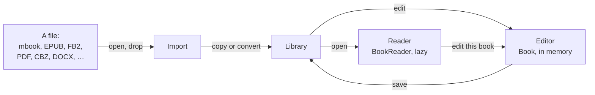

# mbook-ui

| | |
| --- | --- |
| **Package** | `mbook-ui`, the application called mbook; not published to crates.io |
| **Installers** | [GitHub Releases](https://github.com/M-Compressors/mbook/releases): macOS on arm64 and x86-64, Windows on x86-64 |
| **Source** | [`crates/mbook-ui`](https://github.com/M-Compressors/mbook/tree/main/crates/mbook-ui) |
| **Builds on** | [`mbook`](../mbook/index.md); [`mbook-converter`](../mbook-converter/index.md) |
| **Minimum Rust** | 1.100 |
| **Status** | A first version; see [Status and verification](status.md) |

`mbook-ui` is a reading application built on `mbook` and `mbook-converter`.
It has three screens:

| Screen | What it does | Built on |
| --- | --- | --- |
| **Library** | Shows the books the application keeps, as covers | The catalogue; `BookReader::open` and `read_cover` |
| **Reader** | Shows a reflowable chapter with scrolling or pagination | `BookReader`, read lazily |
| **Editor** | Changes the metadata, chapters, notes landmarks and pictures of a book | `Book`, in memory |

Opening a file that is not yet in the library adds it: an mbook file is
copied, a file in any format that
[`mbook-converter`](../mbook-converter/api.md#formats-and-features) reads is
converted first. Everything that
reads a file, decodes, parses, converts or encodes runs on the background
executor of GPUI; the main thread only draws and reacts.

The interface is built with GPUI Kit on the GPUI Fast engine. Window
width selects the compact, medium or expanded layout. The application
currently has desktop shells.

A first version exists. [What is implemented](status.md#what-is-implemented) says
what it does, where it differs from these pages, and what has not been
tried outside of tests.

```sh
cargo run -p mbook-ui
```

The AVIF decoder needs NASM at build time on x86 and x86-64.

| Page | What it answers |
| --- | --- |
| [Using the application](guide.md) | What do the library, the reader, the editor and the settings do? |
| [Architecture](architecture.md) | Where does each piece of work run, what is stored where, and how do import, reading, editing and updates work? |
| [Appearance and accessibility](appearance.md) | Which colours, type and motion does the interface use, and what does it promise to assistive technology? |
| [Status and verification](status.md) | What exists today, where does it fall short, and how was it checked? |
| [Design](design.md) | Which decisions are confirmed, which crates are used, what does the design cost, and why does it look this way? |

## The three screens



The model is Apple Books for the Mac: a quiet library where the covers carry
the colour, and a reader whose controls step aside. What is taken from it and
what is left out is listed under [Prior art](design.md#prior-art).

## What it is for

The repository has a format, a library and a converter, and no way to look at
a book. A reader is also the first real consumer of `BookReader`: the claims
of [RFC 0001](../rfcs/0001-mbook-format.md) (a book opens without being read in full;
only what is on screen is decoded) are only shown to hold by an application
that depends on them.

| Task | Screen |
| --- | --- |
| Keep books in one place and find one | Library |
| Open an EPUB, FB2 or PDF without thinking about formats | Library, through import |
| Read, and come back to the same place | Reader |
| Correct a title, a cover or a typo after a conversion | Editor |

## Goals

| Goal | How the design meets it |
| --- | --- |
| The interface never waits for a book | No call that touches a file or parses runs on the main thread ([Threads](architecture.md#threads)). |
| One code base for desktop and mobile | Layout depends on a size class of the window; platform code stays in a thin shell ([Layout](architecture.md#layout)). |
| The library survives its index | The mbook files hold the metadata; the catalogue can be rebuilt from them ([The catalogue](architecture.md#the-catalogue)). |
| A failed import or save loses nothing | A file enters the library, and replaces a book, only by a rename ([Import](architecture.md#import), [Editing](architecture.md#editing)). |
| Little own code | Components, the Markdown view, the text editor, dialogs and lists come from GPUI Kit; paths, updates and the store from established crates. |
| What is read is what was edited | The editor's preview and the reader are the same view with the same style. |
| Usable without sight, without a pointer and without fine motor control | Every screen meets WCAG 2.2 at level AA where it applies to an application ([Accessibility](appearance.md#accessibility)). |

## Non-goals

- **A store, an account or synchronisation.** The library is a folder on one
  device.
- **Two-page spreads.** See [Future possibilities](design.md#future-possibilities).
- **Annotations**: highlights, notes and bookmarks.
- **A streaming editor.** [`mbook`](../mbook/index.md#non-goals) has none;
  a book is edited as a whole `Book`.
- **Mobile shells.** The design keeps them possible; the first version ships
  for desktop.
