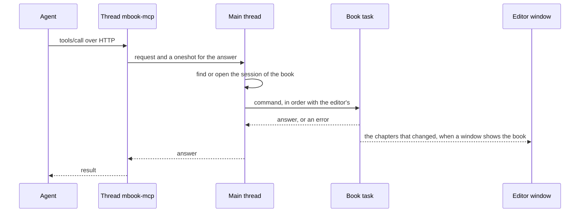

# Agents (MCP)

The application can serve the
[Model Context Protocol](https://modelcontextprotocol.io/) over HTTP, so
that an agent such as Claude Code, Cursor or Codex can write and edit the
books of the library without looking at the screen. Everything an agent
needs to see is answered as text: the structure of a book, the problems a
check finds, whether a diagram or a formula can be drawn and how large it
is. An agent that can look at pictures can ask for them as well.

The server is off until **Serve MCP** is turned on in the settings. It
edits a book through the same task as the editor
([Architecture, Editing](architecture.md#editing)), so a person can watch an
agent write, and both can edit one book at a time. The design was agreed
with the format author on 2026-11-27.

## Connecting

| | |
| --- | --- |
| Address | `http://127.0.0.1:7341/mcp`. When 7341 is taken, the first free port of 7342 to 7350, and then any free port. The settings show the address in use. |
| Transport | Streamable HTTP of MCP, served by `rmcp`. A client of a protocol version before 2026-07-28 gets an MCP session with `Mcp-Session-Id`; a later one is served without. |
| Authentication | None. Any program of this computer may connect; a web page may not ([Requests the server refuses](#requests-the-server-refuses)). |
| Platforms | macOS and Windows. The Android build has no server. |

The settings copy the configuration of each client with the address
filled in. For Claude Code it is one command:

```sh
claude mcp add --transport http mbook http://127.0.0.1:7341/mcp
```

A client that speaks only stdio needs a bridge such as `mcp-remote`.

The server lives as long as the window: closing it ends the server, and a
client then gets a refused connection.

## Requests the server refuses

A web page the user opens can send requests to any address on the
computer, so every request is checked before MCP sees it:

| Condition | Answer |
| --- | --- |
| The connection does not come from a loopback address | None: the server listens on `127.0.0.1` only |
| The request has an `Origin` header | `403`: no web page may call the server |
| `Host` is not `127.0.0.1:<port>` or `localhost:<port>` | `403`: this stops DNS rebinding |
| The body is larger than 64 MiB | Refused by `rmcp` |

The checks of `Origin`, `Host` and the size of a body are those of `rmcp`,
configured with the port in use. There is no token: a program of the user
can read the files of the library anyway, and the checks keep out what is
not a program of this computer. The format author decided this on
2026-11-27, after a first version with a token, because a token made
connecting a client hard and protected nothing the files do not expose. A book, a file an agent names, and every argument are
untrusted input: the limits of `mbook` and `mbook-converter` apply to them as
to an import.

## How the server works



- HTTP is served on a thread of its own, `mbook-mcp`, by a current-thread
  runtime of `tokio` with `axum` and the Streamable HTTP service of `rmcp`.
  The executor of GPUI is not `tokio`; the two meet through the channels of
  `futures`.
- The thread of the server touches no `Book`, no catalogue and no file of
  the library. It hands each call to the main thread and waits for the
  answer; the work runs where the [table of threads](architecture.md#threads)
  says it runs for the editor. A call of an agent is an `Op` that the task
  owning the book runs on the pool, in order with the editor's commands.
- A book has at most one editing session in the whole application. The
  sessions belong to a registry keyed by the book, not to a window: an
  agent's first call for a book opens one without a window, and an editor
  opened on that book later takes the same session.
- A session without a window ends 10 minutes after the last call of an
  agent, unless it holds unsaved changes. A session with unsaved changes
  stays until it is saved, discarded, or the window closes.
- Closing the window while a book that only agents edit has unsaved
  changes asks first: **Save and close**, **Close without saving** or
  **Cancel**. A book with problems is not written by **Save and close**.
- While a call is answered, a badge in the corner of the window says that
  an agent is at work.

### An agent and a person in one chapter

Each chapter of a session has two counters: the revision an agent reads,
which changes with every change of its text, and the last change an agent
made to it.

- When an agent changes the book, the task tells the editor which chapters
  changed. The editor asks for its outline again, through the same queue as
  its own commands, so the answer is the newest. When the open chapter
  changed and the editor holds no text it has not sent, it loads the new
  text and keeps the caret on its line.
- On the first key after it loaded the text, the editor tells the task that
  it holds the chapter, with the last change of an agent it has seen. While
  it holds a chapter, at most 400 ms after the last key, a change of that
  chapter by an agent is refused with `user_typing`. The agent tries again;
  nothing the person typed is lost.
- When an agent changed the chapter after the editor loaded it, the text the
  editor sends is refused once and stays in the editor as a draft, with a
  message, as text the book refused does
  ([Architecture, Editing](architecture.md#editing)). Typing on replaces
  what the agent wrote.
- A person who leaves the editor without saving discards the unsaved
  changes of the session, the agent's too.

### Confirmations

The calls marked 🛑 below are shown in a dialog of the window before they
run: the name the client gave in `initialize`, what it wants to do, and to
which book, chapter or file. **Allow** runs the call once; **Decline**, or
closing the dialog, answers it with `declined`. The call waits for the
answer, and the window is brought to the front.

The dialog has a box such as **Allow adding pictures from files for the
rest of this session**. Ticked when **Allow** is pressed, the kind of action
is allowed for the MCP session the call came through, for as long as it
lasts; nothing is stored. A session is numbered by the server when the
client connects, so another program cannot take the permission by giving
the same name, and a client that connects again is asked again. A client of
a protocol version without sessions (2026-07-28) is asked every time. The kinds are removing a
chapter, a picture or a figure, discarding changes, deleting a book, adding
a book from a file, adding a picture from a file, writing a new file and
writing over one.

What the server may do is not a setting: it reads and edits whatever the
library holds, and asks before what cannot be taken back and before it
touches a file of the computer outside the library. That is what a program
without a window could not do through the server unseen: the server has no
token, and every program of this computer may connect.

## What the agent is told

The rules of the format and of this server are written once, as the skill
`mbook-authoring` in `assets/mcp/`, and served five ways, because clients
differ in what they read:

| Way | Read by | Holds |
| --- | --- | --- |
| `instructions` of `initialize` | Almost every client; Claude Code puts them into the prompt of the agent | What mbook is, the order of work, the rules an agent breaks most often, and a pointer to `get_guide` |
| The skills extension of MCP (SEP-2640), `skills/list` and `skills/get` | Clients that support it | The skill: `SKILL.md` and its reference files |
| Resources `skill://mbook-authoring/…` | Clients that read resources | The same files |
| The tool `get_guide` | Every client, since every client calls tools | One topic of the same files |
| The description of each tool | The agent, always | The rule that matters at that call |

The files are part of the binary, so every way gives the same text.

| Topic | File | Says |
| --- | --- | --- |
| `overview` | `SKILL.md` | What a book is; `book` keys, paths and `href`; the order of work |
| `dialect` | `references/dialect.md` | GitHub Flavored Markdown without raw HTML, anchors, figures and captions, footnotes, paths |
| `figures` | `references/figures.md` | Diagrams and formulas written in a chapter, alternative text, previews |
| `pictures` | `references/pictures.md` | The three sources of a picture, its quality and size, the cover |
| `structure` | `references/structure.md` | Metadata, contents, landmarks, chapters |
| `errors` | `references/errors.md` | Every error code and what to do about it, problems, revisions |

The server also offers three prompts, which a client shows as commands
(`/mcp__mbook__write_chapter` in Claude Code): `write_chapter` drafts a
chapter from what it should be about, `illustrate` adds diagrams, formulas
and pictures to a chapter, and `review_book` checks the book and fixes what
it finds. Each takes an optional `book` and `about`.

## Conventions of the tools

- **A book** is named by `book`, the key of the library (a UUID). It is not
  the `id` of the book's metadata, which an edit may change.
- **A chapter, a picture, a diagram or a formula** is named by its path in
  the book: `ch01.md`, `img/fig-1.avif`, `dia/0001.mmd`.
- **A place** is named by `href`, as a link of the book names it:
  `ch01.md` or `ch01.md#the-station`.
- **Lines and columns** count from 1; a column counts characters.
- **There is no open call.** The first call that names a book opens its
  session. Changes stay in that session until `save_book` writes the book;
  a book with problems is not written.
- **Every result** has `structuredContent` that follows the tool's
  `outputSchema`, and the same JSON as text for clients that show only
  text.
- **A tool fails** with a result that has `isError: true` and
  `structuredContent` of the form `{code, message, …}`. Only an unknown tool
  or arguments that do not fit the schema are errors of the protocol.
- **Annotations.** Every tool says whether it only reads
  (`readOnlyHint`), may destroy (`destructiveHint`) or can be repeated
  (`idempotentHint`).

## Tools

### The library

| Tool | Arguments | Result |
| --- | --- | --- |
| `list_books` | `query?`, `limit = 50` | `books: [{book, title, authors, language, series, added, open_in_editor}]` |
| `create_book` | `title`, `language` | `{book, warnings}`. Made as the library makes one, with an empty `ch01.md`, then given the language and saved |
| `import_book` 🛑 | `path` | `{book, warnings}`. A book whose `id` is in the library gives the existing `book` |
| `export_book` 🛑 | `book`, `format`, `path` | `{path, bytes}`. Writes the saved file, not the unsaved changes. Writing over a file is a kind of its own |
| `delete_book` 🛑 | `book` | `{}`. Refused while the editor shows the book |

`path` of `import_book` and `export_book` is an absolute path on this
computer. `format` is `epub`, `fb2`, `pdf`, `cbz`, `docx`, `html`, `md` or
`txt`.

### Reading

| Tool | Arguments | Result |
| --- | --- | --- |
| `get_book` | `book` | The structure below |
| `read_chapter` | `book`, `chapter`, `anchor?` or `lines?: {from, to}` | `{text, revision, first_line, last_line, total_lines}` |
| `search_book` | `book`, `query`, `regex = false`, `limit = 50` | `{matches: [{chapter, line, column, snippet}], truncated}`; at most 500 |
| `read_figure` | `book`, `path` | `{kind, source, used_by}` |
| `view_picture` | `book`, `path`, `max_size = 1024` | A PNG image no larger than `max_size` on either side, at most 2048, and `{width, height, bytes, alt, used_by}` |
| `get_guide` | `topic` | `{topic, text}`: one topic of [What the agent is told](#what-the-agent-is-told) |

`get_book` gives the structure and none of the content:

```json
{
  "meta": {"title": "…", "authors": ["…"], "translators": [], "language": "en",
           "id": "urn:uuid:…", "series": null, "publisher": null, "date": null,
           "isbn": [], "genres": [], "annotation": null, "cover": "img/cover.avif"},
  "chapters": [{"path": "ch01.md", "lines": 120, "bytes": 5400, "title": "Arrival",
                "headings": [{"level": 2, "title": "The station", "anchor": "the-station"}],
                "anchors": ["fig-1"]}],
  "contents": {"automatic": false, "entries": [{"level": 1, "title": "Arrival",
               "href": "ch01.md"}]},
  "landmarks": [{"kind": "start", "title": "", "href": "ch01.md"}],
  "pictures": [{"path": "img/fig-1.avif", "width": 1600, "height": 900, "bytes": 42000,
                "alt": "The station at night", "used_by": [{"chapter": "ch01.md", "line": 14}]}],
  "figures": [{"kind": "diagram", "path": "dia/0001.mmd",
               "used_by": [{"chapter": "ch02.md", "line": 3}]}],
  "unsaved": false,
  "problems": 0,
  "open_in_editor": false
}
```

An entry of the contents that leads nowhere carries `fault`. `anchors` are
the names the anchor definitions of a chapter give. With `anchor`,
`read_chapter` gives the section that starts at that heading and ends
before the next heading of the same level or higher, or, for a named line,
before the next heading. With `lines`, it gives those lines. The text is
exactly what the chapter holds, so that a part of it can be given to
`edit_chapter` as it is.

### Text

| Tool | Arguments | Result |
| --- | --- | --- |
| `add_chapter` | `book`, `text`, `path?`, `position?`, `allow_unrendered = false` | `{path, revision, figures, warnings, problems}`. Without `path`, the first free `chNN.md`; without `position`, after the last chapter |
| `edit_chapter` | `book`, `chapter`, `edits: [{old, new, replace_all = false}]`, `allow_unrendered = false` | `{path, revision, figures, warnings, problems}` |
| `write_chapter` | `book`, `chapter`, `text`, `revision`, `allow_unrendered = false` | `{path, revision, figures, warnings, problems}` |
| `move_chapter` | `book`, `chapter`, `position?`, `new_path?` | `{path}` |
| `remove_chapter` 🛑 | `book`, `chapter` | `{}` |

- `edit_chapter` applies its edits in order to the text as it is now, and
  all of them or none. Each `old` must occur in the text exactly once,
  unless `replace_all` is set. It needs no revision: `old` is the check.
- `write_chapter` replaces the whole text and needs the revision the agent
  read; it is refused with `conflict` when the chapter changed since.
- `problems` are those of this chapter alone, as `{chapter, line, column,
  message}`, so that a broken link is fixed at once. The whole book is
  checked by `check_book`.
- `move_chapter` changes the path, the position, or both. The entries of
  the contents and the landmarks follow the chapter, as in the editor
  ([Architecture, Editing](architecture.md#editing)); the links of other
  chapters into it do not, and are among the problems.

### Diagrams and formulas in the text

The text given to `add_chapter`, `write_chapter` and `edit_chapter` may
hold diagrams and formulas the way an agent writes them; they are moved into
resources of the book before the text is stored:

````markdown


The train kept $v = s / t$ all the way.

$$
E = mc^2
$$
````

The rules are those of `inline::extract` of `mbook-converter`
([`mbook-converter`, API reference](../mbook-converter/api.md#diagrams-and-formulas-in-markdown)):

- A fenced code block whose info string is `mermaid` becomes a diagram;
  `$…$` and `$$…$$`, as the parser of `markdown` finds them with its math
  constructs on, become formulas. Code spans, other code blocks and `\$` are
  left alone. Mermaid source that is meant to be shown as code takes
  another info string, such as `text`.
- Leading lines `%% alt: …` and `%% caption: …` of a diagram give the
  alternative text and the caption, and are removed from its source. A
  formula has no room for them: its source is its alternative text.
- A diagram and a display formula become a paragraph of their own,
  ``; a formula in a line becomes a reference
  in its place. A new resource gets the first free number under `dia/` or
  `math/`; the reference is relative to the chapter.
- A formula whose source the book already has, or that the text has twice,
  names one resource.
- **Only what the call writes is moved.** A `$` is plain text in mbook, so a
  price such as `$5 and $10` that a chapter already held stays as it is:
  `add_chapter` moves from its whole text, `edit_chapter` from the text its
  edits wrote, and `write_chapter` from the part that differs from the text
  before.
- Every new diagram and formula is drawn first. One that cannot be drawn
  refuses the whole call with `invalid_figure` and its line, and nothing is
  stored, unless `allow_unrendered` is set.
- `figures` lists what was moved, as `{kind, path, line, new}`. A new
  diagram without `%% alt:` and every new formula give the warning
  `missing_alt` with its line: the alternative text is all a reader without
  a renderer has.
- The stored text holds the references, not the fences. `read_chapter`
  gives it so, and the `old` of a later edit is matched against it.

### Pictures and figures

| Tool | Arguments | Result |
| --- | --- | --- |
| `add_picture` | `book`, `source`, `path?`, `quality?`, `max_width?`, `max_height?`, `cover = false` | `{path, width, height, bytes}`. 🛑 when `source` is a file |
| `remove_picture` 🛑 | `book`, `path` | `{}` |
| `put_figure` | `book`, `kind`, `source`, `path?`, `preview = false`, `allow_unrendered = false` | `{path, render}`, and a PNG image with `preview` |
| `render_figure` | `kind`, `source`, `display = true` | A PNG image and `{ok, width, height}`, or `invalid_figure`. Needs no book |
| `remove_figure` 🛑 | `book`, `path` | `{}` |

- `source` of a picture is one of `{file: "/absolute/path.png"}`,
  `{base64, media_type?}` or `{svg: "<svg …>"}`. A file and base64 are read
  in the formats the editor reads, a file of at most 256 MiB; SVG is drawn by
  `resvg` at its own size, at most 8192 pixels on a side, with the fonts of
  the system. Every picture is encoded as AVIF at speed 6 and `quality`, 80
  when left out, fitted into `max_width` and `max_height` without being made
  larger. An AVIF file given with no size limit is stored as it is.
- Without `path`, a picture gets `img/` and the name of its file in lower
  case, or the first free `img/NNNN.avif`. With `cover`, it becomes the
  cover.
- `kind` is `diagram` or `formula`. `put_figure` adds a figure, or replaces
  the source of the one at `path`, which keeps every reference to it
  working. `render` is `{ok: true, width, height}`, the size at body text of
  16 pixels, or `{ok: false, error}` with `allow_unrendered`.
- A figure that cannot be drawn is not stored, unless `allow_unrendered` is
  set: RFC 0001 does not require a writer to check the notation, but an
  agent should know.
- Figures are drawn by `figure::diagram` and `figure::formula` of
  `mbook-converter` in the default palette, and their PNG, at twice the size
  of body text, by `Figure::png`.

### Structure

| Tool | Arguments |
| --- | --- |
| `set_meta` | A patch: `title`, `authors`, `translators`, `language`, `series: {name, index}`, `publisher`, `date`, `isbn`, `genres`, `annotation` |
| `set_contents` | `{automatic: true}`, or `{entries: [{level, title, href}]}` as the whole list |
| `set_landmarks` | `landmarks: [{kind, title, href}]` as the whole list |

- In the patch of `set_meta` a missing field is left as it is; `null`
  removes `series`, `publisher`, `date` and `annotation`, and an empty list
  removes the authors, translators, ISBNs or genres. The patch applies whole
  or not at all. The keys and their rules are those of
  [RFC 0001](../rfcs/0001-mbook-format.md#resource-1-meta).
- `set_contents` with entries keeps the list and leaves the automatic mode
  of the editor; an empty list follows the headings. The contents and the
  landmarks are set as whole lists, which is simpler for an agent than the
  editor's changes of one entry. An entry or a landmark that leads nowhere
  is accepted and reported by `check_book`, as in the editor.

`set_meta` answers with the metadata, `set_contents` with the contents and
`set_landmarks` with `{landmarks}`, as `get_book` gives them.

### Checking and saving

| Tool | Arguments | Result |
| --- | --- | --- |
| `check_book` | `book` | `{problems: [{chapter?, line?, column?, message}]}` |
| `save_book` | `book` | `{saved, problems}`. After a save the row of the library and the thumbnail are made again |
| `discard_changes` 🛑 | `book` | `{}`. The book is read again from its file; the changes of the person in the editor are lost as well |

### Working beside the person

| Tool | Arguments | Result |
| --- | --- | --- |
| `show` | `book`, `href?`, `mode: read \| edit` | `{}`. The window shows the book: the reader opens it at the place it was left, the editor at the chapter of `href` |

## Errors

| `code` | When | Also in the result |
| --- | --- | --- |
| `no_such_book` | `book` is not a key of the library | |
| `no_such_path` | No chapter, picture, figure or anchor has this path | |
| `invalid_path`, `duplicate_path` | A path or a position breaks a rule, or the path is taken | |
| `invalid_text` | A character the format does not allow | `line`, `column` |
| `invalid_meta`, `invalid_landmark` | A value of the metadata or a landmark breaks a rule | `field` for the metadata |
| `invalid_arguments` | Arguments that fit the schema but not together, an unknown topic or format, a relative path, a broken regular expression | |
| `old_not_found`, `old_ambiguous` | An `old` of `edit_chapter` is not in the text, or is there more than once | `index` of the edit, `count` |
| `conflict` | The chapter changed after the revision given | `revision` |
| `user_typing` | The editor holds text of this chapter it has not sent | |
| `invalid_picture` | The file cannot be read as a picture, or is larger than 100,000,000 pixels | |
| `invalid_figure` | A diagram or a formula cannot be drawn | `kind`, `line`, `renderer` |
| `declined` | The person declined in the dialog | |
| `limit` | A limit of `mbook` or of the server | `limit` |
| `open_failed`, `save_failed`, `io` | The book could not be opened or written; a file could not be read | |

## Settings

The settings have a section **Agents (MCP)**:

- **Serve MCP to agents on this computer** turns the server on and off; it
  is off when the application is installed. When on, the server starts with
  the window.
- The address in use, or why the server could not start.
- While the server runs, a card: the configuration of the chosen client,
  highlighted in its language (a shell command for Claude Code, JSON for
  Cursor, TOML for Codex), and below it a bar that chooses the client —
  **Claude Code**, **Cursor**, **Codex** or **Other** — and **Copy**, which
  puts the configuration on the clipboard. Under the card, where the
  configuration goes. **Other** shows the usual JSON of an MCP server over
  Streamable HTTP, with `"type": "http"` and the address, for any client the
  list does not name.
- In a compact window **Copy** is an icon, so that it stays beside the
  clients.

## Where it is written

| Part | Place |
| --- | --- |
| The thread and HTTP | `app/agent/http.rs` |
| The tools, the skill and the prompts | `app/agent/server.rs`, `app/agent/skill.rs`, `assets/mcp/` |
| The calls on the main thread and the dialog | `app/agent/dispatch.rs` |
| The badge and the question at closing | `app/agent/quit.rs` |
| What the settings show, the configurations | `features/agents` |
| The calls on a book | `features/edit_book/agent` |
| The registry of editing sessions | `features/edit_book/sessions.rs` |
| What the editor does on a change of an agent | `pages/editor/changes.rs` |
| The section of the settings | `pages/settings/agents.rs` |
| Moving figures out of Markdown; drawing a figure as PNG | `mbook-converter`: `inline`, `figure::Figure::png` |
