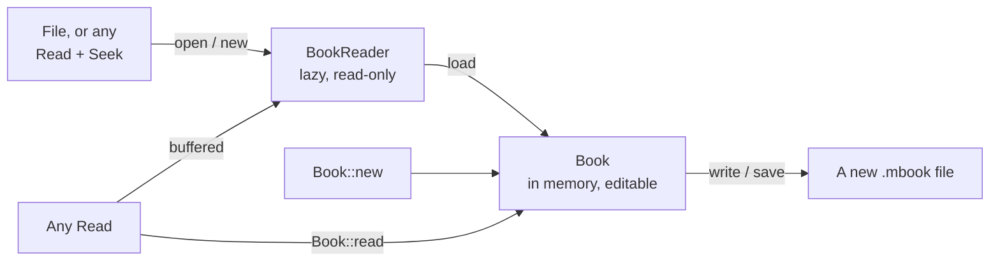

# mbook

| | |
| --- | --- |
| **Crate** | [`mbook`](https://crates.io/crates/mbook) |
| **API documentation** | [docs.rs/mbook](https://docs.rs/mbook) |
| **Source** | [`crates/mbook`](https://github.com/M-Compressors/mbook/tree/main/crates/mbook) |
| **Implements** | [RFC 0001](../rfcs/0001-mbook-format.md), format version 1.0 |
| **Minimum Rust** | 1.89 |
| **Status** | Draft: the API may still change with the format |

`mbook` is the Rust library that reads and writes mbook files. It has two
central types:

- **`BookReader<R>`** reads a book lazily from anything that can seek. Opening
  it costs the directory and five small frames; each chapter, picture,
  diagram and formula, and the anchor table of each chapter, is decoded when
  asked for.
- **`Book`** is a whole book in memory that can be changed and written out. It
  is how a book is created, and how an existing one is edited.

A source that cannot seek is served by both: `BookReader::buffered` keeps the
compressed bytes in memory and still decodes on demand, and `Book::read`
decodes everything in one pass.

```toml
[dependencies]
mbook = "0.3"
```

| Page | What it answers |
| --- | --- |
| [Guide](guide.md) | How is a book shown, read, edited and created? Each task with its code. |
| [API reference](api.md) | Which types and calls exist, what each reads from the source, and when it fails. |
| [Design](design.md) | Which crates the library is built on, what the design costs, and why it looks this way. |

## The two types



| | `BookReader<R>` | `Book` |
| --- | --- | --- |
| Holds | The four tables and the source | Every chapter, picture, diagram and formula, decoded |
| Memory | Kilobytes for a novel | The decoded size of the book |
| Can change the book | No | Yes |
| Addresses a resource by | `ChapterId`, `PictureId`, `DiagramId` or `FormulaId`, its number in the file | Path |
| Typical user | A reading application | A converter or an editor |

Resource numbers are exact and cheap for a reader, but they shift whenever a
resource is added or removed. A `Book` therefore uses paths, which are unique
and are what Markdown links already use; numbers are assigned when it is
written.

## What it is for

[RFC 0001](../rfcs/0001-mbook-format.md) defines bytes. A program that shows or
produces books should not handle typed columns, resource numbers and the
container itself. Four tasks must each take a few lines:

| Task | Who does it |
| --- | --- |
| Show a title, a cover and contents without reading the file | Library views, file managers |
| Show one chapter and its pictures | Readers |
| Change metadata or text of an existing book | Editors, library managers |
| Build a book from converted sources | Packers and converters |

## Goals

| Goal | How the design meets it |
| --- | --- |
| Reading costs what is shown | `BookReader` decodes the tables once and one resource per call. |
| One reading API for files and streams | `BookReader::buffered` turns any `Read` into the same reader type. |
| An invalid book cannot be written | `Book::write` checks every **MUST** of RFC 0001 first. |
| Edits cannot leave stale navigation | Anchors and contents offsets are computed from the text when writing. |
| The call site reads like the task | Paths, titles and link destinations as arguments; no row numbers when building. |
| mopenzl stays an implementation detail | No mopenzl type appears in a public signature. |

## Non-goals

- **Rendering Markdown, decoding AVIF, drawing diagrams or setting
  formulas.** Chapters are returned as text, pictures as AVIF bytes, and
  diagrams and formulas as their source. The crate links no Mermaid and no
  KaTeX implementation and does not check their notation.
- **Converting from other formats.** FB2, EPUB and image conversion belong to
  crates built on this one.
- **Editing in place, or without loading the book.** The format excludes the
  first. For the second, editing always goes through a `Book` in memory and
  saving always writes a new file; no streaming editor is planned.
- **Asynchronous I/O and `no_std`** in the first version. Table encoding and
  validation are kept free of I/O so that both can be added later.
