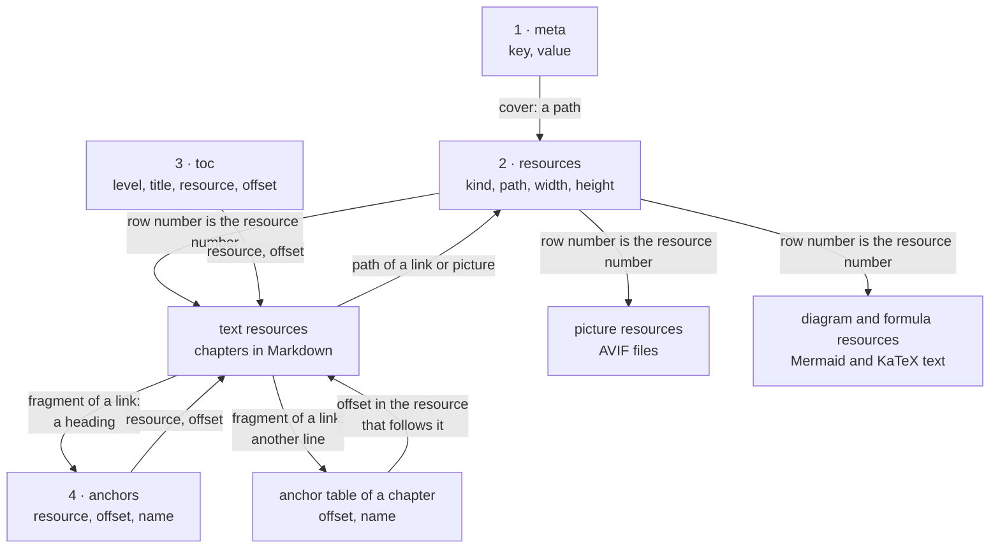
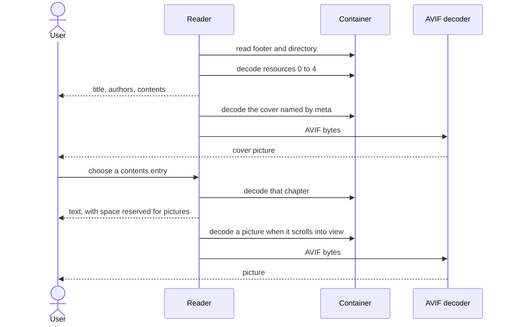
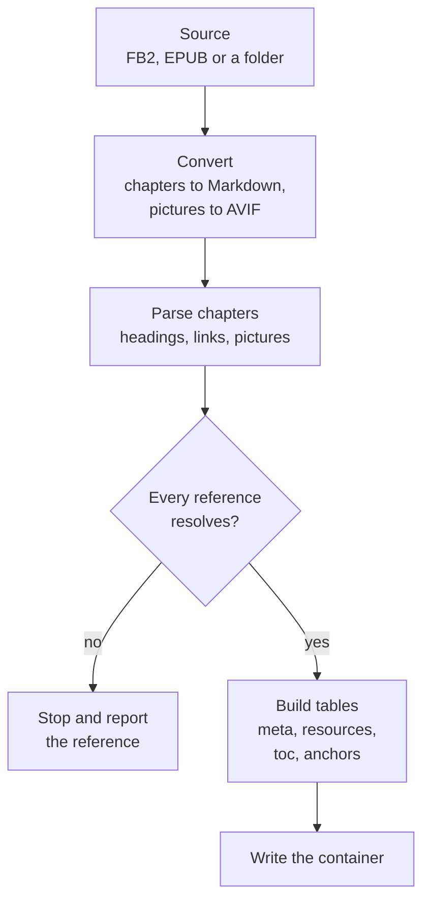
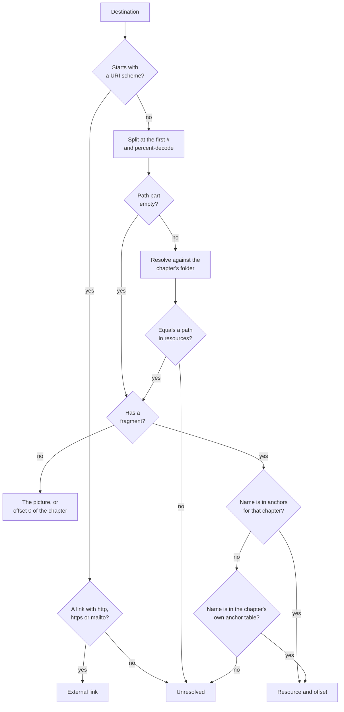

# RFC 0001: The mbook file format, version 1

| | |
| --- | --- |
| **Status** | Draft |
| **Start date** | 2026-11-21 |
| **Format version defined** | 1.0 |
| **File extension** | `.mbook` |

## Summary

An mbook file is one indexed container of independent OpenZL frames. The first
five frames are fixed: a format header, the book's metadata, a table of every
resource, the table of contents, and a table of heading anchors. Chapters
follow as GitHub Flavored Markdown without raw HTML, and pictures as AVIF
files stored without recompression. A book may also carry diagrams, described
in Mermaid notation, and formulas, written in the notation of KaTeX; a
chapter shows them the way it shows a picture. Markdown refers to pictures,
diagrams, formulas and other chapters by relative path; the resource table
maps a path to a frame. A link
into a chapter names a heading, or any other line that the chapter gives a
name to with one line of Markdown.

## Motivation

A book file should be small, open instantly, load only what is on screen, and
be readable by a small program. Each format in use gives up at least one of
these:

- **EPUB** is a ZIP of XHTML and CSS. Showing it correctly needs a web engine,
  and its metadata is spread over several XML files.
- **FB2** is a single XML document. Nothing can be read without parsing all of
  it, and pictures are Base64 text inside the XML.
- **Markdown in a folder** is easy to write and to render, but it is not one
  file, carries no metadata, and has no index.

mbook keeps the Markdown-and-pictures model and packs it into a container that
already provides random access, per-resource checksums and typed data. Two
codecs do the heavy work: [OpenZL](https://github.com/facebook/openzl)
compresses text and tables, and AVIF holds the pictures.

- **A book is a fraction of the size.** An EPUB of 7.0 MB became an mbook
  file of 1.6 MB, more than four times smaller
  ([A converted book](#a-converted-book)). Most of that is AVIF; the text is
  smaller as well, because Markdown carries less markup than XHTML.
- **A book is on screen before the eye notices.** A reader fetches the footer,
  the index and the first five frames, and can then show the title, the cover
  and the table of contents. For that book the tables were ready in 80 µs.
- **Decoding is never the slow part.** Each chapter, picture, diagram and
  formula is decoded on its own, and text decodes at more than a gigabyte per
  second: the largest chapter of that book in 0.1 ms.
- **Nothing has to be parsed to find something.** The descriptive tables are
  typed columns, so no JSON, XML or TOML parser is needed, and the container
  layer can be built for `no_std` targets.
- **No part of it is exotic.** Every frame is an ordinary OpenZL frame that
  uses only standard codecs. A stock OpenZL decoder can decode any frame
  extracted from the file, and any AVIF decoder shows a picture.

### Goals

| Goal | How the design meets it |
| --- | --- |
| A small file | Pictures are AVIF; text and tables are OpenZL frames; columns have types, so numbers are stored as numbers. A 7.0 MB EPUB became 1.6 MB ([A converted book](#a-converted-book)). |
| Open a book without reading all of it | Footer, directory and five small frames are enough for title, cover and contents: 80 µs for a book of 167 contents entries. |
| Decode only what is shown | One frame per chapter, picture, diagram and formula. |
| Decoding that is never the slow part | Text decodes at more than 1 GB/s, tens of times faster than the same text is parsed as Markdown. Pictures are stored AVIF files, read without a second decompression. |
| A page that does not jump | The `resources` table gives the size of every picture before one is decoded, so a reader lays out the page first. |
| Formulas and diagrams that follow the text | Stored as their source, not as pictures of it; the reader sets them in its own size and tone. |
| Readers without a web engine | Markdown without raw HTML; no CSS, no scripts. |
| Readers without text-format parsers | Metadata and navigation are typed columns. |
| Round trip with a plain folder | Chapters refer to pictures and chapters by relative path. |
| Recognisable by simple tools | A constant signature at fixed file offsets. |

### Non-goals

- **Fixed layout.** Fonts, margins and pagination belong to the reader.
- **Editing in place.** A file is written once; changing a book means
  repacking it.
- **Protection.** No encryption, signatures or rights management.
- **Audio and video.** Left to a later version
  ([Future possibilities](#future-possibilities)).

## Guide-level explanation

### What is in a file



Resource 0, the format header, refers to nothing and is not shown. In file
order:

```text
resource 0   format      "MBOOK\0", major, minor            8 bytes, stored
resource 1   meta        key, value                          strings
resource 2   resources   kind, path, width, height           one row per resource
resource 3   toc         level, title, resource, offset      table of contents
resource 4   anchors     resource, offset, name              heading anchors
resource 5…  landmarks, when the book has any; the cover picture; then
             chapters, then pictures, diagrams and formulas;
             a chapter that names other lines follows its own anchor table
index + footer                                               provided by the container
```

Unpacked, a book is a folder that any Markdown viewer can show:

```text
ch01.md
ch02.md
img/cover.avif
img/fig-3.avif
dia/route.mmd
math/speed.tex
```

### What a chapter looks like

```markdown
# Chapter 3. The Seventh Proof

Text with a footnote[^n1] and a [link to the first chapter](ch01.md#chapter-1).


A line of verse\
and the second line.

[^n1]: The text of the footnote.
```

- `img/fig-3.avif` is looked up in the resource table and gives the number of
  the frame that holds the picture, together with its pixel size.
- `ch01.md#chapter-1` is looked up in the resource table (the chapter) and
  then in the anchor table (the position inside it). A name that is not that
  of a heading is looked up in the anchor table of the chapter itself
  ([Anchors that are not headings](#anchors-that-are-not-headings)).
- A paragraph that contains only a picture is a figure; the link title is its
  caption.

### A complete example

A book with two chapters, a cover and one figure has nine resources. Its four
tables, as rows:

**`meta`**

| key | value |
| --- | --- |
| `title` | The Example |
| `lang` | en |
| `id` | urn:uuid:3f1c2a7e-8a54-4d0b-9c1e-6b2f0d9a7e11 |
| `author` | A. Writer |
| `cover` | img/cover.avif |

**`resources`**

| row | kind | path | width | height |
| ---: | ---: | --- | ---: | ---: |
| 0–4 | 0 | | 0 | 0 |
| 5 | 2 | `img/cover.avif` | 1200 | 1800 |
| 6 | 1 | `ch01.md` | 0 | 0 |
| 7 | 1 | `ch02.md` | 0 | 0 |
| 8 | 2 | `img/fig-1.avif` | 1600 | 900 |

**`toc`**

| level | title | resource | offset |
| ---: | --- | ---: | ---: |
| 1 | Chapter 1. Arrival | 6 | 0 |
| 2 | The station | 6 | 130 |
| 1 | Chapter 2. The letter | 7 | 0 |

**`anchors`**

| resource | offset | name |
| ---: | ---: | --- |
| 6 | 0 | `chapter-1-arrival` |
| 6 | 130 | `the-station` |
| 7 | 0 | `chapter-2-the-letter` |

The link `[the station](ch01.md#the-station)` in chapter 2 resolves to
`ch01.md` (row 6 of `resources`), then to the `anchors` row with resource 6
and name `the-station`: byte 130 of chapter 1, where the line
`## The station` begins.

Written with mopenzl 0.2.5, this file is laid out as follows. The two picture
payloads are stand-ins of 18,000 and 42,000 bytes.

| Resource | File offset | Record size | Decoded size |
| --- | ---: | ---: | ---: |
| 0 format | 8 | 56 | 8 |
| 1 meta | 64 | 181 | 103 |
| 2 resources | 245 | 209 | 123 |
| 3 toc | 454 | 157 | 77 |
| 4 anchors | 611 | 146 | 72 |
| 5 `img/cover.avif` | 757 | 18,052 | 18,000 |
| 6 `ch01.md` | 18,809 | 262 | 279 |
| 7 `ch02.md` | 19,071 | 149 | 101 |
| 8 `img/fig-1.avif` | 19,220 | 42,052 | 42,000 |

Everything a library view needs is in the first 757 bytes plus the cover.

### Anchors that are not headings

The `anchors` table names headings. A chapter can name any other line as
well, with an *anchor definition* in front of it: a link reference definition
that names itself. Here chapter 1 names its figure:

```markdown
The train was late.

[fig-1]: #fig-1

```

A Markdown renderer shows nothing for the line `[fig-1]: #fig-1`. Chapter 2
can now link to the figure as `[the figure](ch01.md#fig-1)`.

The packer records where the named line is, in a small table of the chapter's
own: the resource just before the chapter.

| row | kind | path |
| ---: | ---: | --- |
| 5 | 2 | `img/cover.avif` |
| 6 | 3 | |
| 7 | 1 | `ch01.md` |
| 8 | 1 | `ch02.md` |
| 9 | 2 | `img/fig-1.avif` |

Resource 6 is the anchor table of `ch01.md`:

| offset | name |
| ---: | --- |
| 43 | `fig-1` |

Chapter 2 names nothing besides its heading, so it has no such table. The
rows of `toc` and `anchors` now say 7 and 8 where they said 6 and 7.

A reader does not look for anchor definitions, and does not decode these
tables when it opens a book. It decodes one when a link leads to a name that
`anchors` does not have for that chapter.

### Landmarks

The contents list the parts of a book by title. *Landmarks* answer another
question: where is the place of a certain kind? A book that has them carries
one more small table:

| kind | title | resource | offset |
| --- | --- | ---: | ---: |
| `start` | | 8 | 0 |
| `glossary` | Glossary of terms | 12 | 0 |
| `index` | | 13 | 420 |

A reading application can then offer "go to the beginning" or "index"
without guessing from titles, and can open a new book at `start`, where the
text begins, instead of at its title page. The table is a resource of its
own, right after the five fixed ones; a book without landmarks does not have
it, and nothing else in the file changes.

### Diagrams and formulas

A diagram and a formula are text too, each in a notation of its own. A book
stores that text, not a picture of it: `dia/route.mmd` holds

```text
flowchart LR
  station[The station] --> letter[The letter]
```

and `math/speed.tex` holds `v = \frac{s}{t}`. A chapter shows them the way it
shows a picture:

```markdown


The train kept  all the way.
```

- The first paragraph holds nothing else, so the diagram is a figure with a
  caption. The formula stands inside a line and is set as a part of it; a
  formula alone in a paragraph is set as a display formula.
- The resource table says what a path names: `kind` 5 is a diagram and
  `kind` 6 a formula. They have no size in the table; a reader lays them out
  in the size and the tone of its text.
- The words in the brackets are shown, or spoken, by a reader that cannot
  draw the diagram or set the formula. A reader based on an earlier draft
  of version 1.0 also shows the alternative text.

| row | kind | path | width | height |
| ---: | ---: | --- | ---: | ---: |
| 9 | 5 | `dia/route.mmd` | 0 | 0 |
| 10 | 6 | `math/speed.tex` | 0 | 0 |

### How a reader opens a book



1. Check the file signature at fixed offsets ([Detection](#detection)).
2. Read the container footer and directory.
3. Decode resources 0 to 4. They are a few kilobytes even for a large book.
4. Show the title and authors from `meta`, the cover named by the `cover` key,
   and the tree from `toc`.
5. On navigation, decode the chapter frame; decode picture frames as they
   scroll into view, and the frames of the diagrams and formulas the
   chapter shows when it is laid out.
6. When a link with a fragment is followed and `anchors` has no such name
   for the target chapter, decode the anchor table in front of that chapter.

### How a packer builds a book



1. Convert every picture to AVIF. This is the only lossy step and it happens
   before anything is written to a frame.
2. Normalise chapters to the Markdown dialect below and split them at
   top-level headings.
3. Parse each chapter once to collect headings (for `toc` and `anchors`) and
   anchor definitions (for the chapter's anchor table), and to validate every
   link and picture reference.
4. Write resources 0 to 4, then the cover, the chapters, the pictures, the
   diagrams and the formulas. A chapter with anchor definitions is preceded
   by its anchor table.

### Integration points

| Concern | Provided by | Used for |
| --- | --- | --- |
| Container, directory, checksums | mopenzl `framing` (`FramedWriter`, `FramedSeekReader`) | Writing resources in order; reading one resource by number. |
| Typed columns | mopenzl `input` (`Numbers`, `Strings`) and `TypedOutput` | Building and reading the four tables. |
| Markdown | Any parser of the dialect that reports byte offsets | Writers: headings, anchor definitions, references, validation. Readers: rendering. |
| AVIF encoding | Any AV1 still-image encoder | Writers only. |
| AVIF decoding | The platform's decoder or a library | Readers only. |
| Mermaid diagrams | Any renderer of the notation | Readers only, and optional: without one the alternative text is shown. |
| KaTeX formulas | Any typesetter of the notation | Readers only, and optional in the same way. |

Reading the resource table with mopenzl (built with the `framed` feature)
takes no parsing beyond slicing the returned columns:

```rust
use mopenzl::framing::FramedDecompressor;
use std::fs::File;

fn main() -> Result<(), Box<dyn std::error::Error>> {
    let mut decoder = FramedDecompressor::new(Default::default())?;
    let mut book = decoder.framed_seek_reader(File::open("book.mbook")?)?;

    // Resource 2 is the `resources` table: kind, path, width, height.
    let table = book.read_resource(2)?;
    let [kind, path, width, height, ..] = &table.outputs[..] else {
        return Err("the resources table has too few columns".into());
    };

    let mut start = 0;
    for (row, len) in path.string_lens().iter().enumerate() {
        let end = start + *len as usize;
        let name = std::str::from_utf8(&path.content()[start..end])?;
        let w = u32::from_le_bytes(width.content()[row * 4..][..4].try_into()?);
        let h = u32::from_le_bytes(height.content()[row * 4..][..4].try_into()?);
        println!("{row}: kind {} {name:?} {w}x{h}", kind.content()[row]);
        start = end;
    }
    Ok(())
}
```

For the example book above it prints:

```text
0: kind 0 "" 0x0
…
5: kind 2 "img/cover.avif" 1200x1800
6: kind 1 "ch01.md" 0x0
7: kind 1 "ch02.md" 0x0
8: kind 2 "img/fig-1.avif" 1600x900
```

## Reference-level explanation

### Conventions

- Resources are numbered from 0 in container order.
- All integers are unsigned and little-endian.
- An *offset* is a count of bytes from the start of a decoded chapter.
- *Reader* means software that opens mbook files; *writer* means software that
  produces them.
- A reader that *rejects* a file reports an error and shows no content from it.

### Container

An mbook file **MUST** be exactly one mopenzl *framed* container of wire
version 1, as specified by
[`architecture/framing.md`](https://github.com/M-Compressors/mopenzl/blob/main/architecture/framing.md)
in mopenzl. In short, and informatively:

```text
8 bytes     "MOZFRM", version 1, reserved 0
N records   "RSRC", metadata length, frame length, decoded size,
            metadata, header checksum, one OpenZL frame
directory   "INDX", count, N × (offset, length, decoded size), checksum
32 bytes    "MOZEND", version 1, reserved 0,
            directory offset, directory length, total length
```

Requirements on every resource:

- Its frame **MUST** be a valid OpenZL frame of format version 27.
- Its frame **MUST** use only standard OpenZL codecs. Custom codecs and
  external dictionaries **MUST NOT** be used.
- Writers **SHOULD NOT** attach container metadata fields to a resource.
  Readers **MUST** ignore any that are present, except as stated for
  resource 0.

A file **MUST** contain at least five resources.

### Tables

Resources 1 to 4, and every resource of `kind` 3 or 4, are *tables*. A table is
one frame with several typed inputs; each input is a column and each element
is a row.

| Column type | OpenZL input |
| --- | --- |
| `u8` | numeric, width 1 |
| `u32` | numeric, width 4 |
| string | string; every element **MUST** be valid UTF-8 |

- The columns of a table **MUST** appear in the order given in its definition.
- All defined columns **MUST** have the same number of elements. A table
  **MAY** have zero rows unless stated otherwise.
- A reader **MUST** reject a file in which a defined column is missing or has
  another type or width.
- A reader **MUST** ignore inputs that follow the defined columns. Later minor
  versions add columns only at the end.
- Writers **MAY** choose any graph of standard codecs for a table.

### Resource 0: format header

The decoded content of resource 0 is one serial output of exactly 8 bytes:

| Bytes | Field | Value |
| --- | --- | --- |
| 0–5 | prefix | `4D 42 4F 4F 4B 00` (`MBOOK` and a zero byte) |
| 6 | `major` | `1` |
| 7 | `minor` | `0` |

Writers **MUST** encode resource 0 as follows, so that its bytes land at fixed
file offsets:

- no container metadata fields;
- the OpenZL *store* graph;
- OpenZL format version 27;
- content checksum and compressed checksum both enabled.

With this encoding the record of resource 0 occupies file bytes 8 to 63, and
the first 53 bytes of every mbook file are identical:

```text
0000  4d 4f 5a 46 52 4d 01 00 52 53 52 43 00 00 00 00   MOZFRM..RSRC....
0010  1c 00 00 00 00 00 00 00 08 00 00 00 00 00 00 00   ................
0020  8e 00 8c ba db a5 b1 d7 03 01 09 f8 01 01 08 4d   ...............M
0030  42 4f 4f 4b 00 01 00 52 f8 76 ac 1b 24 43 5c 00   BOOK...R.v..$C\.
```

The listing is the complete 64-byte prefix of a version 1.0 file, produced by
mopenzl 0.2.5. `major` is at file offset 53 and `minor` at 54. Bytes 55 to 62
are frame checksums and change with the version bytes. Resource 1 always
starts at file offset 64.

#### Detection

A file is recognised as mbook when both hold:

- bytes 0 to 5 are `MOZFRM`;
- bytes 47 to 52 are `MBOOK` followed by a zero byte.

Detection is a hint for file managers and libraries. Before showing content, a
reader **MUST** decode resource 0 through the container and reject the file
unless the result is exactly 8 bytes that begin with the prefix.

#### Versioning

| Change | Field | Reader behaviour |
| --- | --- | --- |
| Incompatible | `major` | **MUST** reject a file whose `major` is greater than the reader supports. |
| Compatible addition | `minor` | **MUST** accept a greater `minor` and skip what it does not know. |

Compatible additions are limited to: new columns at the end of a table, new
`meta` keys, and new values of `kind`. Everything else requires a new `major`.
Kinds 5 and 6 are part of version 1.0. They were added while 1.0 was still
a draft ([ADR-0011](adr/0011-diagrams-and-formulas.md)).

### Resource 1: `meta`

| # | Column | Type |
| --- | --- | --- |
| 0 | `key` | string |
| 1 | `value` | string |

- A key **MUST** match `[a-z0-9]+(-[a-z0-9]+)*`.
- A key **MAY** repeat where the table below allows it; the order of rows with
  the same key is significant (for example, the order of authors).
- Readers **MUST** ignore keys they do not know.
- Keys that begin with `x-` are reserved for private use and will never be
  defined by this format.

| Key | Count | Value |
| --- | --- | --- |
| `title` | exactly 1 | Title of the book; not empty. |
| `lang` | 1 or more | [BCP 47](https://www.rfc-editor.org/info/bcp47) language tag; the first is the main language. |
| `id` | exactly 1 | Identifier that stays the same across re-packings of the same book. A `urn:uuid:` URN is **RECOMMENDED**. |
| `author` | 0 or more | Name of one author, as displayed. |
| `translator` | 0 or more | Name of one translator, as displayed. |
| `series` | 0 or 1 | Name of the series. |
| `series-index` | 0 or 1 | Position in the series, a decimal number such as `2` or `2.5`. |
| `publisher` | 0 or 1 | Name of the publisher. |
| `date` | 0 or 1 | Publication date: `YYYY`, `YYYY-MM` or `YYYY-MM-DD`. |
| `isbn` | 0 or more | ISBN-13 or ISBN-10, digits only. |
| `genre` | 0 or more | One free-form genre or tag. |
| `annotation` | 0 or 1 | Plain-text description; paragraphs are separated by an empty line. |
| `cover` | 0 or 1 | `path` of a picture resource. |

### Resource 2: `resources`

| # | Column | Type |
| --- | --- | --- |
| 0 | `kind` | `u8` |
| 1 | `path` | string |
| 2 | `width` | `u32` |
| 3 | `height` | `u32` |

Row *i* describes resource *i*. The number of rows **MUST** equal the number of
resources in the container directory.

| `kind` | Meaning | Decoded content |
| --- | --- | --- |
| 0 | Service resource | Defined by its position. |
| 1 | Text | One serial output: a chapter ([Text resources](#text-resources)). |
| 2 | Picture | One serial output: an AVIF file ([Picture resources](#picture-resources)). |
| 3 | Chapter anchors | A table that names positions of the next resource ([Chapter anchor tables](#chapter-anchor-tables)). |
| 4 | Landmarks | A table of notable places of the book ([Landmarks](#landmarks-1)). |
| 5 | Diagram | One serial output: text in Mermaid notation ([Diagram and formula resources](#diagram-and-formula-resources)). |
| 6 | Formula | One serial output: text in the notation of KaTeX ([Diagram and formula resources](#diagram-and-formula-resources)). |

- Rows 0 to 4 **MUST** have `kind` 0. No other row may have `kind` 0 in
  version 1.0.
- A row of `kind` 3 **MUST** be followed by a row of `kind` 1. A text
  resource therefore has at most one anchor table, the resource before it.
- At most one row may have `kind` 4.
- A reader **MUST** skip a resource whose `kind` it does not know: it is not
  decoded, and references to it are treated as unresolved.
- **Reading order** is the order of rows with `kind` 1.
- `width` and `height` **MUST** be zero unless `kind` is 2.

Rules for `path`:

- It **MUST** be empty when `kind` is 0, 3 or 4 and non-empty otherwise.
- Non-empty paths **MUST** be unique within the table, compared byte for byte.
- It is one or more segments joined by `/`. A segment **MUST NOT** be empty,
  `.` or `..`, and **MUST NOT** contain `/`, `\`, or a character below U+0020.
  A path therefore never starts or ends with `/`.
- Writers **SHOULD** restrict segments to `[a-z0-9._-]` and **SHOULD** number
  generated names sequentially (`img/0001.avif`), which compresses best.

Writers **SHOULD** place the landmarks, when the book has any, at position 5,
then the resource named by `cover`, then all text resources, each directly
after its anchor table when it has one, then the remaining pictures, then
the diagrams, then the formulas. Apart from an anchor table and its chapter,
readers **MUST NOT** depend on this order.

### Resource 3: `toc`

| # | Column | Type |
| --- | --- | --- |
| 0 | `level` | `u8` |
| 1 | `title` | string |
| 2 | `resource` | `u32` |
| 3 | `offset` | `u32` |

Rows form a tree listed in pre-order.

- `level` **MUST** be at least 1. The first row **MUST** have level 1, and a
  row's level **MUST NOT** exceed the previous row's level by more than 1.
- `title` **MUST NOT** be empty. It is plain text, not Markdown.
- `resource` **MUST** be the number of a resource with `kind` 1.
- `offset` **MUST** be a [valid position](#positions) in that chapter.
- A row whose `offset` is not 0 **MUST** have the same `resource` and `offset`
  as a row of `anchors`. The target of a contents entry can therefore always
  be written as a link destination: a path and an optional fragment. A row of
  a [chapter anchor table](#chapter-anchor-tables) does not satisfy this
  rule: it is not read when a file is opened.
- Rows **MUST** be in reading order: by position of `resource` in the reading
  order, then by `offset`.

The table **MAY** be empty. It need not list every heading.

### Resource 4: `anchors`

| # | Column | Type |
| --- | --- | --- |
| 0 | `resource` | `u32` |
| 1 | `offset` | `u32` |
| 2 | `name` | string |

One row gives a name to a position inside a chapter. This table holds the
names of headings; names of other positions are in
[chapter anchor tables](#chapter-anchor-tables). Link fragments are resolved
through these tables only; readers do not derive anchor names from heading
text.

- `resource` **MUST** be the number of a resource with `kind` 1.
- `offset` **MUST** be a [valid position](#positions) in that chapter.
- `name` **MUST NOT** be empty and **MUST** be unique among rows with the same
  `resource`.
- Rows **MUST** be sorted by `resource`, then by `offset`.

Writers **SHOULD** emit one row for every heading of every chapter, with the
name GitHub would generate for that heading: the heading's text in lower case,
with punctuation removed, spaces replaced by `-`, and `-1`, `-2`, … appended to
repeated names within a chapter. For example, `Chapter 3. The Seventh Proof`
becomes `chapter-3-the-seventh-proof`. A heading whose name would be empty,
such as one made of punctuation only, gets no row.

Writers **SHOULD NOT** put a row into this table for a position that is not
the start of a heading: the table is decoded whenever a file is opened.

### Chapter anchor tables

A resource of `kind` 3 gives names to positions of the text resource that
follows it. It lets a link lead to a line that is not a heading: a paragraph,
a figure, a row of a table.

| # | Column | Type |
| --- | --- | --- |
| 0 | `offset` | `u32` |
| 1 | `name` | string |

- `offset` **MUST** be a [valid position](#positions) in the chapter that
  follows the table.
- `name` **MUST NOT** be empty, **MUST** be unique within the table, and
  **MUST NOT** equal the `name` of a row of `anchors` for the same chapter. A
  fragment therefore names one position, whichever table holds it.
- Rows **MUST** be sorted by `offset`. Two rows **MAY** have the same
  `offset`.
- The table **MAY** be empty. Writers **SHOULD NOT** write a table without
  rows: a chapter that needs no such name has no anchor table.

Writers **SHOULD** emit one row for every
[anchor definition](#anchor-definitions) of the chapter. A row **MAY** name a
position that has no anchor definition.

Readers **SHOULD NOT** decode a chapter anchor table before it is needed to
resolve a fragment.

### Landmarks

A resource of `kind` 4 lists notable places of the book. A file has at most
one.

| # | Column | Type |
| --- | --- | --- |
| 0 | `kind` | string |
| 1 | `title` | string |
| 2 | `resource` | `u32` |
| 3 | `offset` | `u32` |

- `kind` **MUST** match `[a-z0-9]+(-[a-z0-9]+)*`. Kinds that begin with `x-`
  are reserved for private use and will never be defined by this format.
- `title` is plain text and **MAY** be empty.
- `resource` **MUST** be the number of a resource with `kind` 1.
- `offset` **MUST** be a [valid position](#positions) in that chapter. An
  `offset` that is not 0 **MUST** equal the `offset` of a row of `anchors`
  for that chapter, or of a row of the chapter's
  [anchor table](#chapter-anchor-tables): the target of a landmark can then
  be written as a link destination, a path and an optional fragment.
- A kind **MAY** repeat, except `start`. The order of rows is the order in
  which an application lists them.
- The table **MAY** be empty. Writers **SHOULD NOT** write a table without
  rows.

| Kind | The place where |
| --- | --- |
| `start` | the text of the book begins |
| `title-page` | the title page is |
| `dedication` | the dedication is |
| `epigraph` | the epigraph of the book is |
| `foreword` | a foreword begins |
| `preface` | a preface begins |
| `introduction` | an introduction begins |
| `prologue` | the prologue begins |
| `epilogue` | the epilogue begins |
| `conclusion` | a conclusion begins |
| `afterword` | an afterword begins |
| `acknowledgements` | the acknowledgements are |
| `appendix` | an appendix begins |
| `notes` | the notes of the book are collected |
| `glossary` | the glossary begins |
| `bibliography` | the bibliography begins |
| `index` | the index begins |
| `list-of-figures` | the list of figures is |
| `list-of-tables` | the list of tables is |
| `about-the-author` | the author is introduced |
| `copyright` | the copyright page is |
| `colophon` | the colophon is |

There is no kind for a table of contents that is set in the text: the `toc`
table is the contents of a book.

- A reader shows a landmark by its `title`, or, when the title is empty, by
  its own name for the kind. A reader **MUST** skip a row whose kind it does
  not know and whose title is empty.
- A reader that opens a book for the first time **SHOULD** show the place of
  `start` when the book has one.
- A reader **MAY** decode the table when it opens a file or when the
  landmarks are first wanted.

### Positions

A *position* is a pair of a text resource number and an offset. An offset is
valid when it is 0, or when it is less than the chapter's decoded length and
the byte before it is a line feed (U+000A). `toc` and `anchors` offsets
**SHOULD** point at the first byte of a heading line.

Because positions are byte offsets into decoded text, a book with a given `id`
whose chapters change is a different edition: positions saved by a reader are
not guaranteed to survive it.

### Text resources

A text resource decodes to one serial output, the chapter.

#### Encoding

- UTF-8 without a byte order mark.
- Lines end with a single line feed (U+000A).
- No character below U+0020 other than line feed and tab.
- Writers **SHOULD** normalise text to Unicode NFC and **SHOULD** keep a
  chapter under 256 KiB by splitting at top-level headings.
- Typographic punctuation (quotes, dashes, ellipses) is stored as the final
  characters. Readers **MUST NOT** rewrite punctuation.

#### Dialect

A chapter is parsed as [CommonMark 0.31.2](https://spec.commonmark.org/0.31.2/)
with these extensions, as defined by the
[GitHub Flavored Markdown Spec 0.29-gfm](https://github.github.com/gfm/):

| Extension | Notes |
| --- | --- |
| Tables | |
| Task list items | Rendered as read-only checkboxes. |
| Strikethrough | One or two tildes, as in the GFM spec. Writers escape a literal tilde as `\~`. |
| Autolinks (extended) | Bare `www.` and `http(s)://` text becomes a link. |
| Footnotes | `[^label]` and `[^label]: text`, as GitHub renders them. |

The following **MUST NOT** appear in a chapter, and writers **MUST** reject or
convert input that contains them:

- HTML blocks and raw inline HTML;
- picture destinations with a URI scheme (pictures fetched from a network);
- link destinations with a scheme other than `http`, `https` or `mailto`.

Not part of the dialect, and therefore shown as literal text: math (`$…$`),
alert blocks (`> [!NOTE]`), heading attributes (`{#id}`), superscript and
subscript markers, wiki links, emoji shortcodes and metadata blocks. A code
block whose language is `mermaid` is a code block. A formula and a diagram
are resources of their own, shown with the syntax of a picture
([Diagram and formula resources](#diagram-and-formula-resources)).

A footnote definition **MUST** be in the same chapter as the references to it.

#### Anchor definitions

A chapter names a line that is not a heading with an *anchor definition*: a
link reference definition, as CommonMark defines it, whose destination is `#`
followed by its own label.

```markdown
[fig-1]: #fig-1

```

- The *name* is the destination without its `#`, percent-decoded. A link
  reference definition is an anchor definition when its name equals its
  label as written, byte for byte. It **MAY** have a title, which is ignored.
- It names the first byte of the line on which it starts. A reader that
  moves to that position shows what follows the definition, because the
  definition itself is not rendered.
- A definition whose name is that of an `anchors` row of the chapter, or of
  an earlier anchor definition of the chapter, names nothing. It stays an
  ordinary link reference definition.
- Writers **SHOULD** record every anchor definition in the
  [anchor table](#chapter-anchor-tables) of its chapter.
- Readers **MUST NOT** resolve a fragment by looking for an anchor
  definition; they resolve it through the tables. A reader needs no code for
  anchor definitions: a CommonMark renderer produces no output for a link
  reference definition.

An anchor definition is also what it looks like. A reference link in the
same chapter, `[the figure][fig-1]`, is a link with the destination `#fig-1`
and resolves to the named line.

Two rules of CommonMark matter to a writer. A link reference definition
cannot interrupt a paragraph, so it follows an empty line or starts a block.
And a line after it that holds only a quoted or parenthesised string is read
as its title, so such a line needs an empty line in front of it.

#### Resolving destinations



For every link and picture, a reader takes the destination after CommonMark
has processed escapes and entities, then:

1. If it starts with a URI scheme (`[A-Za-z][A-Za-z0-9+.-]*:`), it is
   *external*.
2. Otherwise it is *internal*. Split it at the first `#` into a path part and
   an optional fragment, and percent-decode both. An internal destination
   **MUST NOT** contain `?` or start with `/`, and **MUST** decode to valid
   UTF-8.
3. If the path part is empty, the target is the current chapter.
4. Otherwise resolve the path part against the current chapter's `path` with
   its last segment removed, applying `.` and `..` segments. A `..` that would
   leave the root is an error. The result **MUST** equal the `path` of a row
   in `resources`.

| Reference | Target | Fragment |
| --- | --- | --- |
| Picture `` | `kind` 2, 5 or 6: a picture, a diagram or a formula | not allowed |
| Link `[text](dest)` | `kind` 1 | optional; **MUST** equal, byte for byte, the `name` of an `anchors` row of the target chapter or of a row of that chapter's [anchor table](#chapter-anchor-tables) |

A link without a fragment leads to offset 0 of the target chapter.

Writers **MUST NOT** produce a file with a reference that fails these rules.
A reader that meets one anyway **SHOULD** show the link text or the picture's
alternative text and continue.

#### Rendering

- Each text resource starts a new chapter; readers **SHOULD** start it on a
  new page or screen.
- A paragraph whose only content is one picture is a *figure*: it is shown as
  a block, and the picture's title, when present, is its caption. Any other
  picture is inline.
- The same holds for a diagram and for a formula, which the syntax of a
  picture shows as well. A formula that is a figure is set as a display
  formula; any other formula is set in the style of running text, on the
  baseline of its line.
- A reader that cannot show a picture, a diagram or a formula **SHOULD**
  show its alternative text in its place.
- Readers **SHOULD** reserve space for a picture from `width` and `height`
  before decoding it.
- Readers **MUST NOT** fetch any network resource while rendering, and
  **MUST NOT** open an external link without an action by the user.
- Fonts, sizes, margins and alignment are chosen by the reader. The format
  carries no style information.

### Picture resources

A picture resource decodes to one serial output: a complete
[AVIF](https://aomediacodec.github.io/av1-avif/) file.

- The file **MUST** contain a primary image item. A reader **MAY** play an
  image sequence and **MUST** otherwise show the primary item.
- `width` and `height` in `resources` **MUST** be non-zero and equal to the
  size in pixels of the primary item as displayed, after its crop, rotation
  and mirror properties are applied.
- Writers **SHOULD** use the OpenZL *store* graph: AVIF payloads are already
  entropy-coded and do not shrink.

### Diagram and formula resources

A diagram resource (`kind` 5) and a formula resource (`kind` 6) each decode
to one serial output: text.

- The text has the [encoding](#encoding) of a chapter: UTF-8 without a byte
  order mark, lines that end with a line feed, and no character below
  U+0020 other than line feed and tab.
- The text **MUST** contain a character that is not white space.
- A diagram is described in the notation of
  [Mermaid](https://mermaid.js.org/). Mermaid 11 is the reference for
  authors. The source is the text inside a Mermaid code fence.
- A formula is written in the notation of [KaTeX](https://katex.org/). KaTeX
  0.16 is the reference for authors. The source is LaTeX in math mode,
  without the `$` or `\[` that
  surround a formula in running text. Whether it is set as a display formula
  is decided by where the chapter shows it ([Rendering](#rendering)), not by
  the resource.
- `width` and `height` in `resources` are zero. A reader lays a diagram and a
  formula out itself, in the size and the tone of its text.
- Writers **SHOULD** end the `path` of a diagram with `.mmd` and that of a
  formula with `.tex`, and **SHOULD** store a formula that a book shows more
  than once as one resource.
- Writers **SHOULD** give every reference to a diagram or to a formula an
  alternative text that says in words what it shows: it is all that a reader
  without a renderer has.

Neither notation has a specification; each is defined by its implementation.
A writer is therefore not required to check the text against the notation,
and a reader is not required to render it:

- A reader **MAY** render no diagrams, no formulas, or only a part of either
  notation. For what it does not render it shows the alternative text of the
  reference.
- A reader **MUST NOT** run a script, follow a link or fetch anything on
  behalf of a diagram or a formula: a `click` of Mermaid and `\href`,
  `\url` and `\includegraphics` of KaTeX do nothing.
- A reader **MAY** refuse a diagram or a formula that would take more time
  or memory than it allows, and then shows the alternative text.

### Conformance

A reader **MUST** reject a file when:

- the container fails its own validation;
- resource 0 is not a valid format header, or `major` is not supported;
- any of resources 1 to 4 is not a table of the defined shape, or breaks a
  **MUST** rule of its section.

A reader **MUST NOT** reject a file because of unknown `meta` keys, unknown
`kind` values, extra table columns, or errors confined to one text, picture,
diagram or formula resource, to one chapter anchor table or to the landmarks;
it reports those where they are met. A chapter anchor table that is not a table of the defined shape, or
that breaks a **MUST** rule of its section, is such an error: the chapter it
belongs to can still be shown, and a link that needs the table is unresolved.
A landmarks table of another shape, or one that breaks a **MUST** rule of
its section, is such an error too: the book is read as one without
landmarks.

One rule of the tables cannot be checked from the tables: whether a position
is preceded by a line feed needs the text of its chapter. A reader checks the
rest of a [valid position](#positions) when it opens a file, and this part
when it decodes the chapter; a failure there is an error confined to that
chapter. For a row of a chapter anchor table, a reader checks the rest when
it decodes the table, and this part when it has decoded both the table and
the chapter; a failure there is an error confined to that table.

A writer **MUST** produce files that satisfy every **MUST** in this document.

### Security considerations

- **Untrusted input.** Every length and count comes from the file. Readers
  **MUST** bound allocations before decoding and **MAY** reject files that
  exceed limits they document. The mopenzl defaults (10,000 resources, 256 MiB
  of decoded content, 1 GiB container) are too small for some picture-heavy
  books; implementations are expected to choose their own.
- **No active content.** Raw HTML is excluded, so a chapter cannot carry
  scripts, styles or embedded frames.
- **No tracking.** Pictures cannot name network locations, and readers do not
  fetch anything while rendering.
- **Path traversal.** `path` cannot contain `..`, a leading `/` or a
  backslash, so unpacking into a folder cannot write outside it. Tools
  **MUST** still validate paths before creating files.
- **Picture decoders.** AVIF decoding is the largest attack surface a reader
  inherits; pictures are untrusted input to that decoder.
- **Diagram and formula renderers.** Their source is untrusted input as
  well. Both notations can name links and, in their original
  implementations, scripts and remote pictures; a reader acts on none of
  them. A short source can ask for an unbounded layout (a macro that expands
  without end, a graph of thousands of nodes), so a reader bounds the work it
  does for one.
- **Integrity, not authenticity.** Checksums detect damage. Nothing in the
  format authenticates a file or its origin.

## Drawbacks

- **Independent frames compress text worse** than one solid archive: each
  chapter starts with an empty window. The loss is estimated at 15–20% of the
  text, which is usually small next to the pictures. See
  [Future possibilities](#future-possibilities).
- **The container is specific to mopenzl.** Individual frames are standard
  OpenZL, but the outer `MOZFRM` layout has one implementation today.
- **Per-resource overhead** is 74 to 76 bytes (a 24-byte directory entry and
  50 to 52 bytes of record and frame headers for a stored frame). It is
  negligible for pages and photographs and noticeable for thousands of
  pictures of a few hundred bytes each.
- **No HTML means no escape hatch.** Layout that Markdown cannot express
  (centred text, columns, drop capitals) cannot be stored at all.
- **Positions are byte offsets**, so editing a chapter invalidates bookmarks
  and requires rebuilding `toc`, `anchors` and the chapter's anchor table.
- **A fragment is looked up in two places.** A name that is not a heading's
  costs one more frame to decode when its link is followed, and a reader
  that opens a file lazily cannot tell such a link from a broken one before
  that.
- **Two more renderers, defined by their implementations.** A reader that
  shows diagrams and formulas needs a Mermaid renderer and a formula
  typesetter, and neither notation has a specification. Two readers may
  draw the same diagram differently, and a reader without them shows only
  the alternative text. See
  [ADR-0011](adr/0011-diagrams-and-formulas.md).
- **No size for a diagram or a formula.** A reader cannot reserve its space
  before it has laid it out.
- **Uneven parser support for one extension.** Not every CommonMark library
  implements extended autolinks; see
  [ADR-0006](adr/0006-markdown-dialect.md).

## Rationale and alternatives

Each choice below has its own decision record with the options compared, the
trade-off and the consequences.

| Decision | Main alternative rejected | Record |
| --- | --- | --- |
| One framed container, one OpenZL frame per resource | A single solid frame; a ZIP archive | [ADR-0001](adr/0001-independent-frames.md) |
| Pictures are stored AVIF files | AVIF as a custom OpenZL codec | [ADR-0002](adr/0002-stored-avif.md) |
| An 8-byte format header as resource 0 | A container metadata field | [ADR-0003](adr/0003-format-header.md) |
| Tables are typed columns, one per frame | JSON or TOML documents | [ADR-0004](adr/0004-typed-columns.md) |
| References by path through a resource table | Frame numbers in Markdown | [ADR-0005](adr/0005-paths-and-resource-table.md) |
| GitHub Flavored Markdown without raw HTML | CommonMark with heading attributes | [ADR-0006](adr/0006-markdown-dialect.md) |
| Byte offsets and a stored anchor table | Readers computing GitHub anchors | [ADR-0007](adr/0007-positions-and-anchors.md) |
| Names of lines that are not headings in a table before their chapter | All names in resource 4; links only to headings | [ADR-0008](adr/0008-chapter-anchor-tables.md) |
| A line is named by a link reference definition in its chapter | `{#id}` attributes; names given to the writer apart from the text | [ADR-0009](adr/0009-anchor-definitions.md) |
| Landmarks in an optional table of their own | A sixth fixed resource; keys of `meta` | [ADR-0010](adr/0010-landmarks.md) |
| Diagrams and formulas as resources of their own kinds, shown like pictures | ` ```mermaid ` fences and `$…$` in the dialect; pictures only | [ADR-0011](adr/0011-diagrams-and-formulas.md) |

## Prior art

| Format | Taken from it | Left behind |
| --- | --- | --- |
| EPUB | Manifest of resources, reading order, separate navigation document, landmarks, identification by a fixed first entry | XHTML and CSS, several XML metadata files |
| FB2 | Metadata vocabulary (authors, translators, series, annotation, genres), one file per book | A single XML document, Base64 pictures |
| mdBook | Chapters as Markdown files with relative links | A build step that produces HTML |
| CBZ | Pictures as independent, directly addressable entries | No metadata or text |

## Unresolved questions

- **CommonMark version.** GFM 0.29-gfm is based on CommonMark 0.29, while
  current parsers follow 0.31.2. This draft names 0.31.2 as the base; the edge
  cases that differ should be listed or declared irrelevant.
- **Footnotes** have no formal specification. The draft points at GitHub's
  behaviour; a precise definition or a reference implementation is needed.
- **Anchor names.** The GitHub algorithm is described informally and only
  recommended. Decide whether to specify it exactly for writers.
- **Resource limits.** Should the format state minimum limits every reader
  supports (resources, chapter size, picture size)?
- **`meta` vocabulary.** The key list, the required `id`, and plain-text
  `annotation` are a first proposal.
- **Media type.** `.mbook` is used as the extension; no media type is
  registered.
- **Links to pictures.** Links currently target chapters only. A link to a
  picture ("open full size") may be worth allowing.
- **Chapter anchor tables.** Their `kind` code, the tie to a chapter by
  position, and the rule that a contents row needs an `anchors` row are
  proposals of [ADR-0008](adr/0008-chapter-anchor-tables.md).
- **Landmarks.** The limit of one `start`, and what a reader does with a
  kind it does not know, are proposals of
  [ADR-0010](adr/0010-landmarks.md).
- **Anchor definitions.** The rule that tells an anchor definition from any
  other link reference definition, and what happens to a repeated name, are
  proposals of [ADR-0009](adr/0009-anchor-definitions.md).

## Future possibilities

- **A shared dictionary for text.** A Zstandard dictionary stored as its own
  resource would recover most of the compression lost to independent chapters.
  It needs a new `kind` and a rule for loading it before text frames.
- **Compact AVIF storage** for books with thousands of tiny pictures, as
  described in [ADR-0002](adr/0002-stored-avif.md), if measurements justify
  a custom codec.
- **Video and long animations.** A resource is decoded whole, so video needs a
  logical resource made of several frames (segments) and a table that lists
  them.
- **Full-text search index** as a service table of typed columns.
- **Alert blocks** as a dialect addition in a later minor version; until
  then they degrade to literal text. Formulas were once expected here too
  and became resources instead
  ([ADR-0011](adr/0011-diagrams-and-formulas.md)).
- **Other notations**, such as a table of data drawn as a chart, as further
  kinds shown with the syntax of a picture.
- **Embedded fonts and layout hints**, if a use case appears that reader
  settings cannot cover.

## Appendix: measurements

Informative. Synthetic books, encoded with mopenzl 0.2.5 at its default level
and graph on one machine; decoding time is the mean of 20 runs.

| Book | Resources | `resources` table | Per resource | Decoding |
| --- | ---: | ---: | ---: | ---: |
| Novel, 40 chapters and 30 pictures | 75 | 475 B | 6.3 B | 24 µs |
| Textbook, 3,000 formula pictures | 3,065 | 11 KB | 3.7 B | 0.14 ms |
| Comic, 5,000 pages of one size | 5,005 | 4.7 KB | 0.9 B | 0.15 ms |
| 10,000 pictures with hash-like names | 10,105 | 118 KB | 11.7 B | 0.5 ms |
| 100,000 pictures | 101,005 | 362 KB | 3.6 B | 2.7 ms |

For a sample book with 8 `meta` rows and 120 `toc` rows, the `meta` record was
398 bytes and the `toc` record 849 bytes. An empty four-column table is 77
bytes.

### A converted book

Informative. A technical book of 11 chapters, 167 contents entries and 45
pictures, published as an EPUB, was converted with `mbook-converter` 0.3.0 at
its defaults: AVIF quality 80 and speed 6, and mopenzl 0.2.6 at its default
level. AVIF at this quality is lossy; the text is unchanged by compression.

| Part | EPUB | mbook |
| --- | ---: | ---: |
| Whole file | 7,001,213 B | 1,608,479 B |
| Pictures | 6,705,021 B, 45 PNG and JPEG files | 1,382,138 B, 43 AVIF files |
| Text, metadata, navigation and index | 247,429 B of deflated XHTML, CSS and XML | 226,341 B |
| Embedded font | 40,495 B | none: fonts belong to the reader |

The chapters are 858,730 bytes of XHTML in the EPUB and 621,498 bytes of
Markdown in the mbook file. The converter kept 43 of the 45 picture files.
The conversion took 3.1 s on the machine named below.

Times are the best of repeated runs on one machine (an Apple M5 Pro), with
the file in the page cache.

| Step | Time |
| --- | ---: |
| Open the mbook file; title, contents and the list of every resource are ready | 80 µs |
| The same title and contents from the EPUB, with `rbook` 0.7 | 164 µs |
| Read the bytes of the cover | 4 µs |
| Decode the largest chapter, 174,933 B | 108 µs |
| Decode it and parse it into a tree with `markdown` 1.0 | 6.2 ms |

All chapters together decode at 1,370 MB/s. The Russian translation of the
same book, with the same pictures, went from 7,104,418 to 1,715,352 bytes;
it opens in 117 µs, against 199 µs for its EPUB, and its text decodes at
1,760 MB/s.

This is one book. The size of a converted book follows its pictures: a novel
without any shrinks far less than an illustrated manual.
