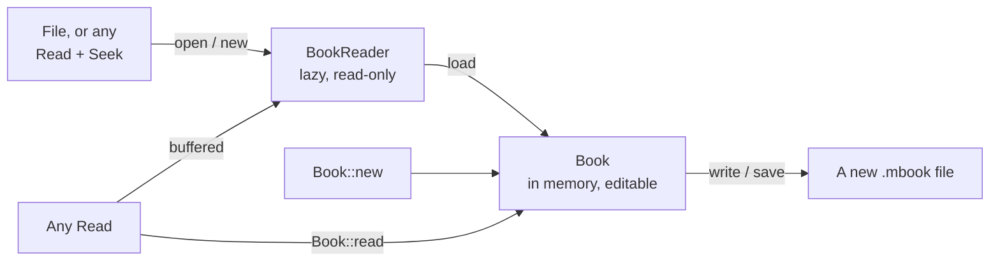

# RFC 0002: The mbook-core API

| | |
| --- | --- |
| **Status** | Draft |
| **Start date** | 2026-11-21 |
| **Crate** | `mbook-core` |
| **Implements** | [RFC 0001](0001-mbook-format.md), format version 1.0 |

## Summary

`mbook-core` is the Rust library that reads and writes mbook files. It has two
central types:

- **`BookReader<R>`** reads a book lazily from anything that can seek. Opening
  it costs the directory and five small frames; each chapter, each picture
  and the anchor table of each chapter is decoded when asked for.
- **`Book`** is a whole book in memory that can be changed and written out. It
  is how a book is created, and how an existing one is edited.

A source that cannot seek is served by both: `BookReader::buffered` keeps the
compressed bytes in memory and still decodes on demand, and `Book::read`
decodes everything in one pass.

## Motivation

[RFC 0001](0001-mbook-format.md) defines bytes. A program that shows or
produces books should not handle typed columns, resource numbers and the
container itself. Four tasks must each take a few lines:

| Task | Who does it |
| --- | --- |
| Show a title, a cover and contents without reading the file | Library views, file managers |
| Show one chapter and its pictures | Readers |
| Change metadata or text of an existing book | Editors, library managers |
| Build a book from converted sources | Packers and converters |

### Goals

| Goal | How the design meets it |
| --- | --- |
| Reading costs what is shown | `BookReader` decodes the tables once and one resource per call. |
| One reading API for files and streams | `BookReader::buffered` turns any `Read` into the same reader type. |
| An invalid book cannot be written | `Book::write` checks every **MUST** of RFC 0001 first. |
| Edits cannot leave stale navigation | Anchors of headings and contents offsets are computed from the text; anchors given by the caller are dropped when the text is replaced. |
| The call site reads like the task | Paths, titles and link destinations as arguments; no row numbers when building. |
| mopenzl stays an implementation detail | No mopenzl type appears in a public signature. |

### Non-goals

- **Rendering Markdown or decoding AVIF.** Chapters are returned as text and
  pictures as AVIF bytes.
- **Converting from other formats.** FB2, EPUB and image conversion belong to
  crates built on this one.
- **Editing in place, or without loading the book.** The format excludes the
  first. For the second, editing always goes through a `Book` in memory and
  saving always writes a new file; no streaming editor is planned.
- **Asynchronous I/O and `no_std`** in the first version. Table encoding and
  validation are kept free of I/O so that both can be added later.

## Guide-level explanation

### The two types



| | `BookReader<R>` | `Book` |
| --- | --- | --- |
| Holds | The four tables and the source | Every chapter and picture, decoded |
| Memory | Kilobytes for a novel | The decoded size of the book |
| Can change the book | No | Yes |
| Addresses a resource by | `ChapterId` or `PictureId`, its number in the file | Path |
| Typical user | A reading application | A converter or an editor |

Resource numbers are exact and cheap for a reader, but they shift whenever a
resource is added or removed. A `Book` therefore uses paths, which are unique
and are what Markdown links already use; numbers are assigned when it is
written.

### Showing a book in a library

```rust
use mbook_core::BookReader;

let mut book = BookReader::open("example.mbook")?;
let meta = book.meta();
println!("{} by {}", meta.title(), meta.authors().collect::<Vec<_>>().join(", "));

if let Some(avif) = book.read_cover()? {
    // hand the bytes to an AVIF decoder
}
```

`open` reads the footer, the directory and resources 0 to 4. `read_cover`
reads one more frame.

### Reading a chapter

```rust
use mbook_core::{BookReader, Destination};

for entry in book.toc() {
    println!("{}{}", "  ".repeat(entry.level as usize - 1), entry.title);
}

let first = book.chapters().next().expect("a book with text").id;
let text = book.read_chapter(first)?;

// While rendering: what does this link or picture destination point to?
match book.resolve(first, "img/fig-1.avif") {
    Ok(Destination::Picture(id)) => {
        let size = book.picture(id).map(|p| p.size);   // reserve space first
        let avif = book.read_picture(id)?;             // decode when visible
    }
    Ok(Destination::Chapter(position)) => { /* jump to position */ }
    Ok(Destination::ExtraAnchor(chapter)) => { /* a place in `chapter`; see below */ }
    Ok(Destination::External) => { /* open only when the user asks */ }
    Err(_) => { /* show the link text or the alternative text */ }
}
```

`resolve` reads nothing, so it can be called for every link of a chapter
while it is laid out. A link to a heading, or to the start of a chapter, is
answered in full. A link to another named line, such as
`ch01.md#fig-1`, is answered with `Destination::ExtraAnchor`: the name may be
in the anchor table of that chapter, which is not read when a book is opened.
When the user follows the link, `read_resolve` reads that table:

```rust
match book.read_resolve(first, "ch01.md#fig-1")? {
    Destination::Chapter(position) => { /* jump to position */ }
    _ => { /* as above */ }
}
```

Methods that only look into the tables take `&self` and cannot fail with an
I/O error. Methods that touch the source start with `read_` and take
`&mut self`.

A chapter and a picture have different id types, so `read_chapter` cannot be
called with the id of a picture. Ids come from the reader. To keep one outside
the program, for a bookmark, store its number and ask the reader for the id
again:

```rust
let saved = (position.chapter.number(), position.offset);
// … later, with the same book open
let chapter = book.chapter_id(saved.0);   // None: not a chapter of this book
```

### Reading from a source that cannot seek

```rust
use mbook_core::{Book, BookReader};
use std::io;

// The same lazy reader, over a buffer that holds the compressed file.
let mut book = BookReader::buffered(io::stdin().lock())?;

// Or everything decoded at once.
let book = Book::read(io::stdin().lock())?;
for chapter in book.chapters() {
    println!("{}: {} bytes", chapter.path(), chapter.text().len());
}
```

### Editing a book

```rust
use mbook_core::Book;

let mut book = Book::open("example.mbook")?;

book.meta_mut().set_title("The Example, 2nd edition")?;
book.meta_mut().add_author("B. Editor")?;

if let Some(chapter) = book.chapter_mut("ch02.md") {
    let fixed = chapter.text().replace("teh", "the");
    chapter.set_text(fixed)?;
}
book.remove_picture("img/unused.avif");

book.save("example.mbook")?;
```

`save` writes a temporary file next to the target and renames it into place,
so an interrupted save never damages the original. The byte offsets that the
contents and the anchors need are recomputed for `ch02.md`; nothing has to be
rebuilt by hand.

There is no rename. A resource moves to another path by being removed and
added again; links to the old path are then reported when the book is saved.

```rust
let index = book.chapters().iter().position(|c| c.path() == "ch02.md").unwrap();
let old = book.remove_chapter("ch02.md").unwrap();
book.insert_chapter(index, "part1/ch02.md", old.text())?;
```

### Creating a book

```rust
use mbook_core::{Book, Toc, TocItem};
use std::fs;

let mut book = Book::new("The Example", "en")?;
book.meta_mut().add_author("A. Writer")?;

book.set_cover("img/cover.avif", fs::read("img/cover.avif")?)?;
book.add_chapter("ch01.md", fs::read_to_string("ch01.md")?)?;
book.add_chapter("ch02.md", fs::read_to_string("ch02.md")?)?;
book.add_picture("img/fig-1.avif", fs::read("img/fig-1.avif")?)?;

book.save("example.mbook")?;
```

- `Book::new` gives the book a new UUID version 7 as its `id`.
- Chapters are in reading order in the order they are added.
- CRLF and CR line endings become line feeds and a byte order mark is dropped;
  `chapter.text()` returns the text as it will be stored.
- The pixel size of a picture is read from the AVIF file.
- By default the contents are built from the headings. To choose the entries,
  name them the way a link would:

```rust
book.set_toc(Toc::Explicit(vec![
    TocItem::new(1, "Arrival", "ch01.md"),
    TocItem::new(2, "The station", "ch01.md#the-station"),
    TocItem::new(1, "The letter", "ch02.md"),
]));
```

### Naming a place that is not a heading

Headings get their anchors by themselves. Any other line can be given a name,
so that a link can lead to it:

```rust
let text = fs::read_to_string("ch01.md")?;
let figure = text.find("![View of the pond]").expect("the figure is there");

let chapter = book.add_chapter("ch01.md", text)?;
chapter.add_anchor("fig-3", u32::try_from(figure)?)?;

// In another chapter: [the figure](ch01.md#fig-3)
```

The offset counts bytes of the stored text and must be the first byte of a
line. It belongs to that text: `set_text` removes the extra anchors of a
chapter, and links to them are then reported when the book is saved.

### When something is wrong

Rules about one item are checked when the item is given, so the error points
at the call that caused it. Rules that connect items are checked when the book
is written, because a book under construction is allowed to be incomplete.

```rust
use mbook_core::{Error, ProblemKind};

match book.save("example.mbook") {
    Err(Error::Invalid(problems)) => {
        for p in problems.iter() {
            if let ProblemKind::UnresolvedLink(dest) = &p.kind {
                eprintln!("{:?}, byte {:?}: link to {dest} leads nowhere", p.path, p.offset);
            }
        }
    }
    other => other?,
}
```

`Book::check` runs the same checks without writing and reports every problem,
not only the first.

## Reference-level explanation

Signatures below are the public surface of the crate as implemented. The
examples of the guide are compiled as its doc tests.

### Shared value types

```rust
pub struct ChapterId(/* private */);         // a resource of kind 1
pub struct PictureId(/* private */);         // a resource of kind 2
impl ChapterId { pub fn number(self) -> u32; }   // its number in the file
impl PictureId { pub fn number(self) -> u32; }

pub struct Size { pub width: u32, pub height: u32 }
pub struct Position { pub chapter: ChapterId, pub offset: u32 }
pub struct Version { pub major: u8, pub minor: u8 }

pub struct ChapterEntry<'a> {
    pub id: ChapterId,
    pub path: &'a str,
    pub decoded_len: u64,                    // from the container directory
}
pub struct PictureEntry<'a> {
    pub id: PictureId,
    pub path: &'a str,
    pub size: Size,
    pub decoded_len: u64,
}

pub struct TocEntry { pub level: u8, pub title: String, pub position: Position }
pub struct Anchor { pub offset: u32, pub name: String }
pub enum Destination {
    External,
    Chapter(Position),
    Picture(PictureId),
    ExtraAnchor(ChapterId),                  // only from BookReader::resolve
}

// The raw resource table, for tools that list a file.
pub enum ResourceKind { Service, Text, Picture, ChapterAnchors, Unknown(u8) }   // non-exhaustive
pub struct Resource<'a> {
    pub number: u32,
    pub kind: ResourceKind,
    pub path: &'a str,
    pub size: Option<Size>,
    pub decoded_len: u64,
}

/// The detection rule of RFC 0001; needs the first 53 bytes of a file.
pub fn is_mbook(prefix: &[u8]) -> bool;
```

- Both id types are `Copy`, ordered and hashable. They have no public
  constructor: an id is obtained from a `BookReader`, which hands out a
  `ChapterId` only for a text resource and a `PictureId` only for a picture.
- An id is a number inside one file. It is not stable across re-packings of a
  book; the stable name of a resource is its path.

### `Meta`

One type serves both `BookReader` (through `&Meta`) and `Book` (through
`&mut Meta`).

```rust
impl Meta {
    pub fn title(&self) -> &str;
    pub fn language(&self) -> &str;                          // the main language
    pub fn languages(&self) -> impl Iterator<Item = &str>;
    pub fn id(&self) -> &str;
    pub fn authors(&self) -> impl Iterator<Item = &str>;
    pub fn translators(&self) -> impl Iterator<Item = &str>;
    pub fn series(&self) -> Option<Series<'_>>;              // name and index
    pub fn publisher(&self) -> Option<&str>;
    pub fn date(&self) -> Option<&str>;
    pub fn isbns(&self) -> impl Iterator<Item = &str>;
    pub fn genres(&self) -> impl Iterator<Item = &str>;
    pub fn annotation(&self) -> Option<&str>;
    pub fn cover(&self) -> Option<&str>;                     // a path

    pub fn get(&self, key: &str) -> Option<&str>;            // any key, first value
    pub fn get_all(&self, key: &str) -> impl Iterator<Item = &str>;
    pub fn iter(&self) -> impl Iterator<Item = (&str, &str)>;

    pub fn set_title(&mut self, title: impl Into<String>) -> Result<()>;
    pub fn set_language(&mut self, tag: impl Into<String>) -> Result<()>;
    pub fn set_id(&mut self, id: impl Into<String>) -> Result<()>;
    pub fn add_author(&mut self, name: impl Into<String>) -> Result<()>;
    pub fn set_series(&mut self, name: impl Into<String>, index: Option<&str>) -> Result<()>;
    pub fn set_cover(&mut self, path: impl Into<String>) -> Result<()>;
    // … one setter or adder per key defined by RFC 0001

    pub fn set(&mut self, key: &str, value: impl Into<String>) -> Result<()>;
    pub fn add(&mut self, key: &str, value: impl Into<String>) -> Result<()>;
    pub fn remove(&mut self, key: &str) -> Result<()>;
}
```

- `set` replaces every row of a key with one row; `add` appends a row.
- A `Meta` always satisfies the counts of RFC 0001: `remove` fails for
  `title`, `lang` and `id`, and `add` fails for a key that allows one value
  and already has it.
- Unknown keys, including `x-` keys, are kept and written back unchanged.

### `BookReader<R>`

```rust
impl BookReader<File> {
    pub fn open(path: impl AsRef<Path>) -> Result<Self>;
}
impl BookReader<Cursor<Vec<u8>>> {
    pub fn buffered(reader: impl Read) -> Result<Self>;
}
impl<R: Read + Seek> BookReader<R> {
    pub fn new(source: R) -> Result<Self>;
    pub fn with_options(source: R, options: &ReadOptions) -> Result<Self>;

    // From the tables; no I/O.
    pub fn version(&self) -> Version;
    pub fn meta(&self) -> &Meta;
    pub fn toc(&self) -> &[TocEntry];
    pub fn chapters(&self) -> impl ExactSizeIterator<Item = ChapterEntry<'_>>;  // reading order
    pub fn pictures(&self) -> impl ExactSizeIterator<Item = PictureEntry<'_>>;
    pub fn chapter(&self, id: ChapterId) -> Option<ChapterEntry<'_>>;
    pub fn picture(&self, id: PictureId) -> Option<PictureEntry<'_>>;
    pub fn find_chapter(&self, path: &str) -> Option<ChapterEntry<'_>>;
    pub fn find_picture(&self, path: &str) -> Option<PictureEntry<'_>>;
    pub fn cover(&self) -> Option<PictureEntry<'_>>;
    pub fn chapter_id(&self, number: u32) -> Option<ChapterId>;     // checked
    pub fn picture_id(&self, number: u32) -> Option<PictureId>;     // checked
    pub fn anchors(&self, chapter: ChapterId) -> &[Anchor];         // of headings
    pub fn resolve(&self, from: ChapterId, destination: &str)
        -> Result<Destination, ResolveError>;
    pub fn resources(&self) -> impl ExactSizeIterator<Item = Resource<'_>>;  // every row

    // Seek, read and decode one resource.
    pub fn read_chapter(&mut self, id: ChapterId) -> Result<String>;
    pub fn read_extra_anchors(&mut self, chapter: ChapterId) -> Result<Vec<Anchor>>;
    pub fn read_resolve(&mut self, from: ChapterId, destination: &str)
        -> Result<Destination>;
    pub fn read_picture(&mut self, id: PictureId) -> Result<Vec<u8>>;
    pub fn read_cover(&mut self) -> Result<Option<Vec<u8>>>;

    pub fn load(&mut self) -> Result<Book>;      // decode everything
    pub fn into_inner(self) -> R;
}
```

| Call | Reads from the source | Fails when |
| --- | --- | --- |
| `open`, `new`, `buffered` | Footer, directory, resources 0 to 4 | The file must be rejected under [Conformance](0001-mbook-format.md#conformance), or a limit is exceeded. |
| Table accessors | Nothing | Never; unknown ids give `None` or an empty slice. |
| `resolve` | Nothing | The destination is unresolved under [Resolving destinations](0001-mbook-format.md#resolving-destinations), as far as resources 2 and 4 can tell. |
| `read_extra_anchors` | The anchor table of one chapter; nothing when it has none | I/O; a damaged frame; the table is not of the defined shape or breaks a rule of [Chapter anchor tables](0001-mbook-format.md#chapter-anchor-tables); the id came from another book. |
| `read_resolve` | That table, and only when the fragment is not the anchor of a heading | `Error::Unresolved` when the destination is unresolved; otherwise as `read_extra_anchors`. |
| `read_chapter`, `read_picture` | One record | I/O; a damaged frame; the resource exceeds its limit; the text is not UTF-8, or a stored position in it is not at the start of a line; the id came from another book. |
| `load` | Every text, picture and anchor table record | As above, for any resource; an extra anchor is not at the start of a line; or the decoded book exceeds the file limit. |

- An error in one resource does not poison the reader; other resources can
  still be read.
- `resolve` takes the destination after the Markdown parser has processed
  escapes and entities, and applies the steps of RFC 0001. With
  `read_resolve` it is all a reading application needs for links and
  pictures.
- **A fragment is resolved in two steps**, because RFC 0001 stores names in
  two places. `resolve` knows the anchors of headings. For any other
  fragment it looks at the resource table: when the target chapter has an
  anchor table it returns `Destination::ExtraAnchor`, and
  `ResolveError::UnknownAnchor` when it has none. `read_resolve` takes the
  second step and never returns `ExtraAnchor`.
- The anchor table of a chapter cannot show whether an offset is at the
  start of a line. `read_extra_anchors` and `read_resolve` check everything
  else; `load` and `Book::read`, which have the text as well, check this too.
- An anchor table that breaks a rule fails the calls that read it, and
  nothing else: its chapter is still read by `read_chapter`.
- A resource of an unknown `kind` is listed by `resources` only. It has no id
  type, so it cannot be decoded, and `load` and `Book::read` leave it behind:
  a file of a later minor version loses such resources when it is edited.
- The tables cannot show whether a stored position is at the start of a line;
  that needs the text. `read_chapter` checks the positions of the chapter it
  decodes, and fails for that chapter only.
- The types rule out reading a picture as a chapter. They cannot rule out an
  id taken from another book: such an id gives `None` from the table
  accessors and `Error::NoSuchResource` from the `read_` calls.
- A `BookReader` is `Send` when `R` is. To decode on several threads, open one
  reader per thread.

### `Book`

```rust
impl Book {
    pub fn new(title: impl Into<String>, language: impl Into<String>) -> Result<Self>;
    pub fn open(path: impl AsRef<Path>) -> Result<Self>;
    pub fn read(reader: impl Read) -> Result<Self>;
    pub fn read_with(reader: impl Read, options: &ReadOptions) -> Result<Self>;

    pub fn check(&self) -> Result<(), Problems>;
    pub fn write(&self, writer: impl Write) -> Result<()>;
    pub fn write_with(&self, writer: impl Write, options: &WriteOptions) -> Result<()>;
    pub fn save(&self, path: impl AsRef<Path>) -> Result<()>;

    pub fn meta(&self) -> &Meta;
    pub fn meta_mut(&mut self) -> &mut Meta;

    pub fn chapters(&self) -> &[Chapter];                    // reading order
    pub fn chapter(&self, path: &str) -> Option<&Chapter>;
    pub fn chapter_mut(&mut self, path: &str) -> Option<&mut Chapter>;
    pub fn add_chapter(&mut self, path: impl Into<String>, text: impl Into<String>)
        -> Result<&mut Chapter>;
    pub fn insert_chapter(&mut self, index: usize, path: impl Into<String>,
        text: impl Into<String>) -> Result<&mut Chapter>;
    pub fn move_chapter(&mut self, path: &str, index: usize) -> Result<()>;
    pub fn remove_chapter(&mut self, path: &str) -> Option<Chapter>;

    pub fn pictures(&self) -> &[Picture];
    pub fn picture(&self, path: &str) -> Option<&Picture>;
    pub fn add_picture(&mut self, path: impl Into<String>, avif: impl Into<Vec<u8>>)
        -> Result<&Picture>;
    pub fn remove_picture(&mut self, path: &str) -> Option<Picture>;
    pub fn set_cover(&mut self, path: impl Into<String>, avif: impl Into<Vec<u8>>)
        -> Result<&Picture>;                                 // add_picture + meta cover

    pub fn toc(&self) -> &Toc;
    pub fn set_toc(&mut self, toc: Toc);
}

impl Chapter {
    pub fn path(&self) -> &str;
    pub fn text(&self) -> &str;
    pub fn anchors(&self) -> &[Anchor];                  // of headings
    pub fn extra_anchors(&self) -> &[Anchor];            // of other lines
    pub fn set_text(&mut self, text: impl Into<String>) -> Result<()>;
    pub fn add_anchor(&mut self, name: impl Into<String>, offset: u32) -> Result<()>;
    pub fn remove_anchor(&mut self, name: &str) -> Option<Anchor>;
}

impl Picture {
    pub fn path(&self) -> &str;
    pub fn size(&self) -> Size;
    pub fn data(&self) -> &[u8];
}
```

`Book::new` creates the three required `meta` rows and fails only for an
empty title. `id` is `urn:uuid:` followed by a UUID version 7 generated by the
`uuid` crate. A converter that has a stable identifier replaces it with
`meta_mut().set_id`.

`add_chapter`, `insert_chapter` and `set_text` normalise the text before
storing it: CRLF and lone CR become a line feed, and a leading byte order mark
is removed. Nothing else is changed.

#### Navigation

```rust
pub enum Toc {
    FromHeadings { max_level: u8 },     // Book::new uses 6: every heading
    Explicit(Vec<TocItem>),             // what a loaded book has
}
pub struct TocItem {
    pub level: u8,
    pub title: String,
    pub chapter: String,                // a path
    pub anchor: Option<String>,         // None is the start of the chapter
}

impl TocItem {
    /// `href` is a link destination: `ch01.md` or `ch01.md#the-station`.
    pub fn new(level: u8, title: impl Into<String>, href: &str) -> Self;
}
```

A `Book` computes every byte offset it can, so that the caller does not have
to keep them correct:

- **Anchors of headings belong to their chapter.** `add_chapter` and `set_text` compute
  them from the headings with the naming rule of RFC 0001. The rule is
  defined by GitHub's implementation, so the names come from a port of it,
  the `github-slugger` crate. A heading whose name would be empty, such as
  `# ***`, gets no anchor, because the format does not allow an empty name. A
  chapter loaded from a file keeps the anchors stored in that file until its
  text is replaced, so links written against another writer's names keep
  working.
- **Contents entries name their target** by chapter path and anchor, exactly
  as a link does. The offset is looked up when the book is written.
- **Every stored contents row can be named this way**, because RFC 0001
  requires a contents row with a non-zero offset to match an anchor row
  ([Resource 3: `toc`](0001-mbook-format.md#resource-3-toc)). A loaded row
  becomes the chapter's path and the name of the first anchor at that
  position.

#### Extra anchors

A heading names itself. Any other line gets a name from the caller, with
`Chapter::add_anchor`; a converter uses it for the targets of links that do
not lead to headings. The extra anchors of a chapter are written as its
[anchor table](0001-mbook-format.md#chapter-anchor-tables), and a chapter
without them gets no table.

- **An offset given by the caller lives as long as the text it was given
  for.** This is the one place where a `Book` holds an offset it did not
  compute. `set_text` removes the extra anchors of the chapter, because an
  offset that is still the start of a line after an edit would point at
  another line without any error. Links to the removed names are reported by
  `check`.
- `add_anchor` keeps the anchors sorted by offset; anchors with the same
  offset stay in the order they were added. Two names may share an offset.
- The anchor of a heading cannot be added or removed by hand: it follows
  from the text. `remove_anchor` removes extra anchors only.
- **A contents item leads to a chapter or to a heading**, not to an extra
  anchor: RFC 0001 wants a contents row inside a chapter to match a row of
  `anchors`. An item that names an extra anchor is reported as
  `DanglingTocItem`.
- A loaded chapter keeps the extra anchors stored in its file, under the same
  rule as its heading anchors: until its text is replaced.

#### Where each rule is checked

| Rule of RFC 0001 | Checked by | Reported as |
| --- | --- | --- |
| Path syntax, path uniqueness | `add_chapter`, `insert_chapter`, `add_picture`, `set_cover` | `Error::InvalidPath`, `Error::DuplicatePath` |
| A position in the reading order exists | `insert_chapter`, `move_chapter` | `Error::IndexOutOfRange` |
| The chapter to move exists | `move_chapter` | `Error::NoSuchPath` |
| Text encoding: no control characters other than line feed and tab | `add_chapter`, `insert_chapter`, `set_text`, after normalising | `Error::InvalidText`, with the byte offset |
| The same rule, for a chapter that was loaded and never replaced | `check`, `write` | `Problems` |
| An extra anchor has a name that is not empty and not used in its chapter, at the start of a line | `add_anchor` | `Error::InvalidAnchor`, with an `AnchorError` as its source |
| The picture is an AVIF file with a primary item | `add_picture` | `Error::InvalidPicture` |
| `meta` key syntax and counts | `Meta` setters | `Error::InvalidMeta` |
| No raw HTML, allowed URI schemes | `check`, `write` | `Problems` |
| Every link and picture reference resolves, a fragment against the anchors of headings and the extra anchors of its chapter | `check`, `write` | `Problems` |
| `cover` names a picture | `check`, `write` | `Problems` |
| Contents entries resolve; levels form a tree | `check`, `write` | `Problems` |

- `write` runs `check` first and writes nothing if it fails.
- Loading is lenient where RFC 0001 tells readers to be: a chapter with a
  broken link loads. The problem is reported when that book is written,
  because a writer **MUST NOT** produce such a file.
- Line endings and a byte order mark are the only things the crate repairs.
  Raw HTML and control characters are the converter's job; the error or the
  problem says where the offence is.

#### What `write` produces

Resources 0 to 4, then the cover, then chapters in reading order, each
directly after its anchor table when it has extra anchors, then the remaining
pictures, as RFC 0001 recommends. Pictures use the *store* graph.
The same `Book` written twice with the same options gives identical bytes.

### Options and limits

```rust
#[non_exhaustive]
pub struct Limits {
    pub max_resources: usize,
    pub max_resource_bytes: u64,    // decoded size of one resource
    pub max_file_bytes: u64,
}
#[non_exhaustive] pub struct ReadOptions  { pub limits: Limits }
#[non_exhaustive] pub struct WriteOptions { pub level: Option<i32>, pub limits: Limits }
```

`Limits` are applied before allocating, as RFC 0001 requires of readers. They
replace the mopenzl defaults, which are too small for picture-heavy books.

| Limit | `Limits::default()` | Reason |
| --- | ---: | --- |
| `max_resources` | 1,000,000 | Ten times the largest book measured in RFC 0001; the directory is then 24 MB. |
| `max_resource_bytes` | 64 MiB | The default frame limit of mopenzl. |
| `max_file_bytes` | 16 GiB | Room for a comic of several thousand large pages. |

- A lazy reader decodes one resource at a time, so `max_resource_bytes` is
  all that bounds its memory. A resource above the limit fails when it is
  read, not when the file is opened.
- A `Book` holds everything decoded. `max_file_bytes` therefore also bounds
  the decoded size of a book that `Book::read` or `BookReader::load` builds.
- `WriteOptions::level` outside the range of the compressor is brought into
  that range.

### Errors

One `Error` enum, non-exhaustive, with `Result<T> = Result<T, Error>`.

| Variant | Meaning |
| --- | --- |
| `Io` | The source or the sink failed. |
| `NotMbook` | No valid format header. |
| `UnsupportedVersion(Version)` | `major` is newer than this crate. |
| `Container` | The container or a frame is damaged. The mopenzl error is the `source()`, as a boxed `dyn Error`. |
| `Malformed { resource, reason }` | A table breaks a **MUST** of RFC 0001. |
| `Limit` | A configured limit was exceeded. |
| `NoSuchResource` | A `read_` call was given an id from another book. |
| `Unresolved` | `read_resolve` was given a destination that leads nowhere. The `ResolveError` is the `source()`. |
| `InvalidPath`, `DuplicatePath`, `InvalidText`, `InvalidPicture`, `InvalidMeta`, `InvalidAnchor` | An argument to a `Book`, `Chapter` or `Meta` method broke a rule. |
| `NoSuchPath`, `IndexOutOfRange` | `move_chapter` or `insert_chapter` named a chapter or a position that does not exist. |
| `Invalid(Problems)` | `write` or `save` refused the book. |

### Dependencies and features

| Feature | Default | Enables | Brings in |
| --- | --- | --- | --- |
| `read` | yes | `BookReader`, `Book::read`, `Book::open` | mopenzl decoding |
| `write` | yes | `Book::new` and every call that changes, checks or saves a `Book` | mopenzl encoding, `markdown`, `github-slugger`, `uuid`, `bytes`, `tempfile` |

`thiserror` and `percent-encoding` are used with either feature.

- At least one of the two must be enabled. With `read` alone a `Book` is a
  fully loaded book that can be looked at but not changed.
- A reading application that builds with `read` only gets no Markdown parser
  from this crate; `resolve` needs none.
- `markdown` 1.0.0 is the parser that
  [ADR-0006](adr/0006-markdown-dialect.md) found to cover the whole dialect
  and to report byte offsets.
- **A mechanism comes from an established crate; only the rules of the
  format are written here.**

  | Need | Crate |
  | --- | --- |
  | Heading and link analysis | `markdown` 1.0.0 |
  | Anchor names by GitHub's rule | `github-slugger` |
  | Percent-decoding of destinations | `percent-encoding` |
  | Reading and writing integers in byte buffers | `bytes` |
  | Saving through a temporary file | `tempfile` |
  | Book identifiers | `uuid` |
  | Error types | `thiserror` |

- **The pixel size of a picture is the one thing read by code of this
  crate**, about 150 lines over `bytes` that walk the AVIF boxes to the
  properties of the primary item. The crates looked at, and what stands in
  the way of each:

  | Crate | Why it does not fit |
  | --- | --- |
  | `image` 0.25 | AVIF needs the C library libdav1d; the picture is decoded in full to learn its size; the size is that of the decoded frame, before crop and rotation. |
  | `imagesize` 0.15 | Takes the largest `ispe` box of the file: ignores the crop and which item a property belongs to. |
  | `avif-parse` 2 | Needs Rust 1.90, above the minimum of this crate, and is MPL-2.0. |
  | `zenavif-parse` 0.6 | Gives the right size on the test files, but is MPL-2.0 and brings about 25 crates for three properties. The format author decided on 2026-11-21 to keep the code of this crate. |

  No image decoder is linked.

### Required from mopenzl

`BookReader` needs mopenzl 0.2.6 or later. Earlier versions offered random
access only through `FramedSeekReader<'a, R>`, which borrows its decoder, so
one struct could not hold the decoder, the source and the directory.
Version 0.2.6 adds a directory that owns its data and two calls on the
decoder:

```rust
/// A validated directory, detached from the source and the decoder.
pub struct FramedIndex { /* base offset, entries */ }
impl Deref for FramedIndex { type Target = [ResourceInfo]; }

impl FramedDecompressor {
    /// Reads the header, the footer and the directory; decodes nothing.
    pub fn framed_index<R: Read + Seek>(&self, source: R)
        -> Result<FramedIndex, FramedError>;

    /// Seeks to one record, reads it and decodes it.
    pub fn read_indexed_resource<R: Read + Seek>(
        &mut self, source: R, index: &FramedIndex, resource: usize,
    ) -> Result<DecodedResource, FramedError>;
}
```

`BookReader` holds a `FramedDecompressor`, a `FramedIndex` and the source as
three plain fields.

## Drawbacks

- **Two types to learn.** A program that reads and then edits meets both, and
  resources are addressed by number in one and by path in the other.
- **Editing loads the whole book.** Changing the title of a 2 GB comic decodes
  2 GB into memory and writes 2 GB back. This cost is accepted.
- **Unchanged chapters are compressed again on save.** Pictures are stored, so
  they cost a copy and a checksum; text costs a real compression pass.
- **The write side carries a Markdown parser**, although the crate renders
  nothing.
- **Two calls resolve a link.** `resolve` cannot say where a fragment leads
  when it is not a heading's, and a reading application has to handle
  `Destination::ExtraAnchor`.
- **Extra anchors do not survive an edit of their chapter.** A program that
  changes text has to place them again.
- **`buffered` waits for the end of the stream** before anything can be shown,
  because the directory is at the end of the file.

## Rationale and alternatives

| Decision | Chosen | Rejected | Why |
| --- | --- | --- | --- |
| Shape of the API | `BookReader` for lazy reading, `Book` for the editable model | One type generic over its storage | A lazy read can fail and needs `&mut`; an in-memory read cannot and does not. One type would force the weaker signature on both. |
| | | A `BookSource` trait implemented by both | Same problem, plus a trait in every caller's signatures. |
| Streams that cannot seek | `buffered` gives the ordinary reader; `Book::read` gives the model | A third, forward-only reader type | Reading applications get one API. Memory is the compressed size instead of the decoded size. |
| Editing | Load into `Book`, change, write a new file | Nothing else was considered | Decided by the format author: one in-memory model serves both creating and editing. |
| Addressing in `Book` | Path | Resource number; opaque handles | Numbers shift on every insertion. Paths are stable, unique, and already what chapters use. |
| Navigation data | Derived from text at write time | Editable `toc` and `anchors` tables with offsets | An offset that is still a valid position after an edit points at the wrong heading without any error. |
| Anchors of lines that are not headings | Given by the caller as a name and an offset; dropped when the text is replaced | Kept across `set_text` when the offset is still the start of a line | The same silent error: the anchor would name another line. |
| | | Marked in the text and found by the crate | The dialect has no syntax for it; [ADR-0006](adr/0006-markdown-dialect.md) dropped heading attributes. |
| Resolving a fragment that is not a heading's | `resolve` without I/O returns `ExtraAnchor`; `read_resolve` reads the table | `resolve` reads the table itself | Table lookups take `&self` and do no I/O; a renderer calls `resolve` for every link of a page. |
| | | The reader keeps every anchor table it has read | Memory would grow with the chapters visited, for a table of a few hundred bytes that sits next to the chapter. |
| When rules are checked | One-item rules at the call, cross-item rules at `write` | Everything at `write` | The error names the call that caused it. |
| | | Everything at the call | A chapter could not be added before the pictures it shows. |
| Ids in `BookReader` | `ChapterId` and `PictureId` | One `ResourceId` | Reading a picture as a chapter becomes a compile error instead of `WrongKind` at run time. |
| | | A UUID for every resource | The format has nowhere to store one, and the path is already a stable unique name. UUID version 7 is used for the book's `id` only. |
| Line endings and byte order marks | Normalised silently | Rejected with an error | The meaning of the text does not change, and every caller would write the same replacement. |
| Moving a resource to another path | Remove and add | A `rename` that rewrites links | The crate would start editing chapter text it was given. |
| Helpers | Established crates for mechanisms; own code for the rules of the format | Hand-written cursors, decoders and temporary files | Less code to test and to keep correct; the exception is listed under [Dependencies and features](#dependencies-and-features). |
| mopenzl in the API | Hidden behind `Error::Container` and `Limits` | Re-exporting `FramedError` and `FramingConfig` | A mopenzl major version would become an mbook-core major version. |

## Prior art

| Crate | Taken from it | Left behind |
| --- | --- | --- |
| `zip` | A reader generic over `Read + Seek`; entries decoded on request | Entries borrowed from the archive, which makes holding two at once awkward |
| `epub` | `EpubDoc::new(path)` as the one-line entry point; typed metadata getters | A cursor ("current page") inside the document object |
| `std::fs` | `open` for a path, `new` for a value; `read_` for calls that do I/O | |
| `toml_edit` | A document model that is loaded, changed and written back | |

## Unresolved questions

The questions raised by the first draft were settled by the format author on
2026-11-21:

| Question | Decision |
| --- | --- |
| How is a book edited? | Only through a `Book` in memory. |
| Which Markdown parser does the write side use? | `markdown` 1.0.0. |
| Where does the `id` of a new book come from? | `Book::new` generates a UUID version 7 with the `uuid` crate. |
| Are resources identified by UUID as well? | No. Only the book's `id` is a UUID. |
| CRLF line endings and a byte order mark? | Normalised silently. |
| A contents row at a position without an anchor? | Forbidden by RFC 0001; a contents target is a chapter and an optional anchor. |
| Renaming a resource? | Not provided; remove and add. |
| One id type or two? | `ChapterId` and `PictureId`. |
| `Limits::default()`? | 1,000,000 resources, 64 MiB per resource, 16 GiB per file. |
| Can a link lead to a line that is not a heading? | Yes, through the anchor table of its chapter ([ADR-0008](adr/0008-chapter-anchor-tables.md)). |

The change required from mopenzl
([Required from mopenzl](#required-from-mopenzl)) is a dependency, not an open
question of this design.

Still *proposed*, and not confirmed by the format author:

- the names `extra_anchors`, `add_anchor`, `remove_anchor`,
  `read_extra_anchors`, `read_resolve` and `Destination::ExtraAnchor`;
- that `set_text` removes the extra anchors of a chapter;
- that a contents item cannot lead to an extra anchor.

## Future possibilities

- **Reusing buffers.** `read_chapter_into` and `read_picture_into` for readers
  that decode many resources in a row.
- **Asynchronous sources**, for books opened over a network with range
  requests.
- **`no_std` reading** from a byte slice, using the container layer's
  `no_std` build.
- **Packing and unpacking a folder**, as a small crate on top: the model
  already maps one to one onto files.
