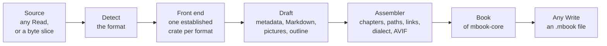

# RFC 0003: The mbook-converter API

| | |
| --- | --- |
| **Status** | Draft |
| **Start date** | 2026-11-21 |
| **Crate** | `mbook-converter` |
| **Builds on** | [RFC 0001](0001-mbook-format.md), format version 1.0; [RFC 0002](0002-mbook-core-api.md) |

## Summary

`mbook-converter` turns books in other formats into mbook files. It has one
central type, **`Converter`**, with two kinds of source and two kinds of
result:

| | Result: an mbook file written to any `Write` | Result: a `Book` in memory |
| --- | --- | --- |
| **Source: any `Read`** | `convert` | `load` |
| **Source: a byte slice** | `convert_slice` | `load_slice` |

Every source format is one Cargo feature, and all of them are enabled by
default. A format is read by an established crate (`unpdf` for PDF, `rbook`
for EPUB, and so on); this crate adds what is a rule of mbook: which chapter
a piece of text belongs to, what a link or a picture is called after
conversion, what the Markdown dialect allows, and that every picture becomes
AVIF.

Signatures below are the public surface of the crate as implemented.
[What is implemented](#what-is-implemented) lists, format by format, what the
crate does today.

## Motivation

[RFC 0001](0001-mbook-format.md#how-a-packer-builds-a-book) describes a
packer that starts from FB2, EPUB or a folder, and
[RFC 0002](0002-mbook-core-api.md#non-goals) leaves conversion to "crates
built on this one". Without such a crate every application that imports books
writes the same code: parse the source, produce Markdown without raw HTML,
re-encode pictures, rename every reference, build the contents.

| Task | Who does it |
| --- | --- |
| Convert a file on disk | A command-line tool, a library manager |
| Convert an upload or a download without a temporary file | A server, a reading application |
| Convert, then correct the metadata before saving | A library manager |
| Ship only the formats an application needs | An embedded or mobile reader |

### Goals

| Goal | How the design meets it |
| --- | --- |
| No file paths in the API | Sources are `Read` or `&[u8]`; the result goes to `Write` or stays a `Book`. |
| A sink that cannot seek is enough | The file is written in one forward pass by `Book::write`. |
| Pay only for the formats used | One feature per format; a disabled format costs no dependency. |
| The rules of mbook are written once | Every front end hands over the same draft; one assembler builds the book. |
| A converted book is always valid | The book goes through `Book::check` before a byte is written. |
| Losses are visible | Whatever cannot be represented is reported as a `Warning`, not dropped silently. |
| Parsers are not written here | Each format is read by an established crate. |

### Non-goals

- **Converting from mbook** to another format.
- **Keeping the layout.** Fonts, colours, CSS, page geometry and fixed
  positions are dropped; [RFC 0001](0001-mbook-format.md#non-goals) excludes
  them from the format.
- **Removing protection.** A protected source is refused.
- **Recognising text in pictures.** The pages of a scanned PDF are stored as
  pictures.
- **Fetching anything.** A picture or a stylesheet named by a network address
  is never downloaded.
- **Asynchronous I/O**, as in `mbook-core`.

## Guide-level explanation

### How a conversion runs



1. The format is detected from the content, unless the caller names it.
2. The *front end* of that format parses the source with its crate and hands
   over a *draft*: metadata, Markdown in source order with the source's own
   names in links and pictures, the pictures, and an outline when there is
   one.
3. The *assembler* is the same for every format. It cuts the text into
   chapters, gives chapters and pictures their paths, re-targets links, brings
   the Markdown into the dialect of RFC 0001, and encodes pictures as AVIF.
4. The result is a `Book` of `mbook-core`. `convert` writes it; `load`
   returns it.

### Converting a file

```rust
use mbook_converter::Converter;
use std::fs::File;
use std::io::BufWriter;

let source = File::open("book.epub")?;
let sink = BufWriter::new(File::create("book.mbook")?);

let report = Converter::new().convert(source, sink)?;

println!("converted from {}", report.format);
for warning in &report.warnings {
    eprintln!("{warning}");
}
```

The source may be anything that implements `Read`: a file, standard input, a
network stream, an entry of an archive. It is never asked to seek.

### Converting bytes that are already in memory

```rust
let bytes: &[u8] = /* an upload, a memory-mapped file, include_bytes! */;
let mut mbook = Vec::new();

Converter::new().convert_slice(bytes, &mut mbook)?;
```

`convert_slice` exists because a slice can be read at any position: formats
that need random access use it in place, where a `Read` has to be buffered
first ([Sources and memory](#sources-and-memory)).

### Correcting the book before it is written

```rust
use std::io;

let mut converted = Converter::new().load(io::stdin().lock())?;

let book = &mut converted.book;
book.meta_mut().set_title("The Example")?;
book.meta_mut().set_language("en")?;
book.save("example.mbook")?;
```

`converted.book` is an ordinary [`Book`](0002-mbook-core-api.md#book): every
call of RFC 0002 works on it.

### Choosing formats and settings

```toml
# Cargo.toml: only EPUB and FB2
mbook-converter = { version = "0.1", default-features = false, features = ["epub", "fb2"] }
```

```rust
use mbook_converter::{ConvertOptions, Converter, Format};

let mut options = ConvertOptions::default();
options.format = Some(Format::Fb2);      // do not detect
options.pictures.quality = 60;           // smaller pictures

let converter = Converter::with_options(options);
```

A source in a format whose feature is off is still recognised, so the error
names it:

```rust
match converter.convert_slice(bytes, &mut mbook) {
    Err(Error::FormatDisabled(format)) => eprintln!("built without support for {format}"),
    other => { other?; }
}
```

### What is lost

A conversion that succeeds may still have dropped something: a table with
merged cells, a picture in a format that cannot be decoded, a link into the
middle of a paragraph. Each loss is one `Warning` in the report, with the
place in the source where the front end knows it. An application decides
whether to show them.

## Reference-level explanation

### What is settled

The format author settled the points below on 2026-11-21. Every other detail
of this document is *proposed* and listed again under
[Unresolved questions](#unresolved-questions) where a choice is open.

| Decision | Status |
| --- | --- |
| The crate converts EPUB, FB2, PDF, CBZ, DOCX, HTML, Markdown and plain text into mbook | Confirmed |
| Mobipocket is not converted until a maintained crate reads it | Confirmed |
| One Cargo feature per format; every feature enabled by default | Confirmed |
| Conversion from an I/O source and from a byte slice | Confirmed |
| Formats are read by established crates such as `unpdf` | Confirmed |
| Pictures are encoded as AVIF by `image` with its `avif` feature, which uses `ravif` and `rav1e`; dependencies under BSD licenses are accepted | Confirmed |
| A link to an element that is not a heading keeps its target: the converter writes an anchor definition in front of it ([ADR-0008](adr/0008-chapter-anchor-tables.md), [ADR-0009](adr/0009-anchor-definitions.md)) | Confirmed |
| A source without an identifier gets a UUID version 5 computed from its bytes as `id` | Confirmed |
| A source without a title or a language gets `Untitled` and `und`, each with a warning | Confirmed |
| A PDF without a text layer is converted page by page into pictures | Confirmed |
| A comic archive has one chapter per folder | Confirmed |
| Two kinds of source, `Read` and a slice; no entry point for `Read + Seek` | Confirmed |
| Pictures are encoded with quality 80 and speed 6 unless the options say otherwise | Confirmed |
| A contents entry of the source that does not lead to a heading leads to the nearest heading above its target | Confirmed |
| Streaming means a `Read` as the source and a `Write` as the sink; the book is held in memory while it is converted ([Sources and memory](#sources-and-memory)) | Confirmed |

### Public surface

```rust
pub struct Converter { /* options */ }

impl Converter {
    pub fn new() -> Self;                                   // also Default
    pub fn with_options(options: ConvertOptions) -> Self;

    // Source to file.
    pub fn convert(&self, source: impl Read, sink: impl Write) -> Result<Report>;
    pub fn convert_slice(&self, source: &[u8], sink: impl Write) -> Result<Report>;

    // Source to model.
    pub fn load(&self, source: impl Read) -> Result<Converted>;
    pub fn load_slice(&self, source: &[u8]) -> Result<Converted>;
}

#[non_exhaustive]
pub struct Converted { pub book: mbook_core::Book, pub report: Report }

#[non_exhaustive]
pub struct Report { pub format: Format, pub warnings: Vec<Warning> }

#[non_exhaustive]
pub enum Format { Epub, Fb2, Pdf, Cbz, Docx, Html, Markdown, Text }

impl Format {
    pub const ALL: &'static [Format];
    pub const fn is_enabled(self) -> bool;                  // was its feature compiled in?
}
impl Display for Format { /* "epub", "fb2", … */ }
impl FromStr for Format { /* the same names, and common file extensions */ }

// The four structs of options and limits; see "Options and limits".

pub use mbook_core;
```

- `convert(source, sink)` is `load(source)` followed by
  `book.write_with(sink, &options.write)`. Nothing is written to the sink
  unless the whole conversion succeeded.
- A `Converter` holds only its options. It is `Send + Sync`, and one value
  serves any number of conversions.
- `Format` has every variant whatever features are enabled, so a `match` on
  it does not depend on the feature set.
- `mbook_core` is re-exported: `Book`, `WriteOptions`, `Limits` and
  `mbook_core::Error` appear in this API. No type of any other dependency
  does; the rule of RFC 0002 applies to this crate as well.

### Formats and features

| Feature | Source format | Front-end crate | Status |
| --- | --- | --- | --- |
| `epub` | EPUB 2 and 3 | `rbook` | Confirmed format; crate *proposed* |
| `fb2` | FictionBook 2, plain and inside a ZIP (`.fb2.zip`) | `quick-xml`, `zip` | Confirmed |
| `pdf` | PDF | `unpdf` | Confirmed |
| `cbz` | Comic book archive: a ZIP of pictures | `zip`, `alphanumeric-sort` | Confirmed |
| `docx` | Word documents | `undoc` | Confirmed format; crate *proposed* |
| `html` | One HTML document | `htmd` | Confirmed format; crate *proposed* |
| `md` | One Markdown document | `markdown`, `github-slugger` | Confirmed |
| `txt` | Plain text | none | Confirmed |

- `default` enables every feature of the table.
- A build **MUST** enable at least one of them; otherwise compilation fails
  with a message, as in `mbook-core`.
- A feature enables only the dependencies its format needs. Shared mechanisms
  have no feature of their own: the HTML-to-Markdown crate comes with `epub`
  and `html`, the picture codecs with every format that carries
  pictures. The build script of the crate tells the compiler which of these
  groups is in use, so that the list of formats in a group is written once.
- `zip` and `markdown` are dependencies of every build: the first is needed
  to tell the formats that are ZIP archives apart, the second reads every
  chapter.
- Every single-feature build **MUST** compile without warnings, including its
  documentation.
- `mbook-core` is used with its `write` feature only.

Not in the first version, for lack of a maintained crate that meets the
license and the minimum Rust version: Mobipocket, KF8/AZW3, DjVu, RTF, CBR
([Future possibilities](#future-possibilities)).

### Sources and memory

The converter accepts a forward-only `Read` and a slice.

- **A `Read` is read to its end into memory** before anything else happens,
  bounded by `ConvertLimits::max_source_bytes`. Three things need all of it:
  the format is detected from the content, an `id` may be computed from every
  byte, and most front-end crates want the whole source.
- **A slice is used in place.** No copy of the source is made by this crate.
  A front-end crate may still make one: `rbook` wants an owned source.
- After that, every front end starts from the same thing, the bytes of the
  source.

Consequences that hold for every format:

- **Peak memory is about the source plus the converted book.** The result is
  a `Book`, and a `Book` holds every chapter and picture
  ([RFC 0002](0002-mbook-core-api.md#drawbacks)). Conversion is streaming at
  its edges, a `Read` in and a `Write` out; it is not a constant-memory
  pipeline.
- The pictures of the source are held, as the front end extracted them,
  until the book is assembled.

### Detection

When `ConvertOptions::format` is `None`, the format is taken from the
content.

| Format | Recognised by |
| --- | --- |
| PDF | `%PDF-` within the first 1,024 bytes |
| EPUB | A ZIP whose `mimetype` entry is `application/epub+zip`, or that contains `META-INF/container.xml` |
| DOCX | A ZIP that contains `word/document.xml` |
| FB2 in a ZIP | A ZIP with exactly one entry whose name ends in `.fb2` |
| CBZ | Any other ZIP in which every entry is a picture, a folder or `ComicInfo.xml` |
| FB2 | An XML document whose root element is `FictionBook` |
| HTML | A document that starts with `<!DOCTYPE html` or `<html`, in any letter case |
| Markdown, text | Never detected; only when named |

- Rows are tried in this order; the first match wins.
- A file name is never used: a stream has none.
- A source that matches no row fails with `Error::UnknownFormat`. A source
  that matches a format whose feature is off fails with
  `Error::FormatDisabled`.

### The draft

A front end is private code. It produces the same things for every format,
and nothing else crosses into the assembler:

| Part | Content |
| --- | --- |
| Metadata | Values for the keys of [`meta`](0001-mbook-format.md#resource-1-meta), unchecked |
| Sections | Markdown in reading order; each section has the source's name for it (a file of an EPUB, a section of an FB2 document) and may contain raw HTML and destinations in the source's own terms |
| Marks | An element of the source that a link may lead to is marked in the Markdown of its section with an [anchor definition](0001-mbook-format.md#anchor-definitions) in front of its block, named by the identifier it has in the source |
| Pictures | For each source name: the picture as the source has it |
| Cover | The source name of the picture that is the cover |
| Outline | Optional: level, title and a destination in the source's own terms |
| Warnings | What the front end itself could not keep |

A front end **MUST NOT** build chapters, paths or tables itself.

### Assembling the book

The steps below are the conversion rules of this crate. They do not depend on
the source format.

#### Chapters and paths

- One section becomes one chapter. A front end chooses its sections so that
  each starts at a top-level division of the source
  ([Rules per format](#rules-per-format)).
- A chapter above 256 KiB **MUST** be split, as RFC 0001
  [recommends](0001-mbook-format.md#encoding): at its top-level headings
  first, then at the paragraph boundary nearest to the limit.
- A section without text and without a picture produces no chapter.
- Chapters are named `ch0001.md`, `ch0002.md`, … in reading order. Pictures
  are named `img/0001.avif`, `img/0002.avif`, … in the order of their first
  use, and the cover `img/cover.avif`.

#### Markdown

Every chapter is parsed with `markdown` 1.0.0, configured for the
[dialect](0001-mbook-format.md#dialect) as in `mbook-core`, and changed at the
positions the parser reports:

| Found | Becomes | Warning |
| --- | --- | --- |
| Inline `<br>` | A hard line break, written `\` and a line feed | No |
| Any other raw inline HTML tag | Nothing; the text between the tags stays | `MarkupDropped`, once per tag name |
| An HTML block | Nothing | `MarkupDropped` |
| A picture whose source name the draft knows | A picture with the new path | No |
| A picture the draft does not have, cannot decode, or that names a network address | Its alternative text | `PictureDropped` |
| A link with scheme `http`, `https` or `mailto` | Unchanged | No |
| A link with any other scheme | Its text | `LinkDropped` |
| A link into the book | See [Links and footnotes](#links-and-footnotes) | |
| A character below U+0020 other than line feed and tab | Nothing | No |

Text is normalised to Unicode NFC.

#### Links and footnotes

Source formats link to any element. mbook names a heading by itself and any
other line through an
[anchor definition](0001-mbook-format.md#anchor-definitions) in front of it
([ADR-0009](adr/0009-anchor-definitions.md)), so the target of a link is kept
to the line.

| Target in the source | Destination after conversion | Warning |
| --- | --- | --- |
| A file, a section or a page | The chapter that starts there | No |
| A heading | That heading: the chapter's path and the anchor `mbook-core` computed | No |
| Any other block: a paragraph, a figure, a list item, a block quote, a table | That block, named by an anchor definition in front of it | No |
| An element inside a block, such as a word of a paragraph or a row of a table | The block that contains it, named the same way | No |
| Nothing that was converted | The link becomes its text | `LinkDropped` |

- A front end marks every element that has an identifier. The assembler
  keeps a mark only when a link of the book, or an entry of the contents,
  leads to it, and removes the others. `mbook-core` finds the definitions
  that are kept and fills the anchor table of the chapter; the converter
  handles no byte offsets.
- The name is the identifier of the source, with everything but letters,
  digits, `-`, `_` and `.` replaced by `-`. When the chapter already has an
  anchor with that name, of a heading for example, `-2`, `-3`, … is
  appended; every link is rewritten anyway, so a name need not survive.
- When an identifier is used twice in a section, the first element that
  carries it is the target.
- Links are re-targeted after every chapter has its final text: the anchor
  of a heading is known only then.
- A link that the source marks as a note reference (`epub:type="noteref"` in
  EPUB, `<a type="note">` in FB2) becomes a footnote: `[^n]` at the
  reference and `[^n]: text` at the end of the same chapter, as RFC 0001
  [requires](0001-mbook-format.md#dialect). The text of the note is copied
  into every chapter that refers to it and is removed from where it stood.

#### Pictures

| Source picture | Stored as |
| --- | --- |
| An AVIF file that `Book::add_picture` accepts | The same bytes |
| JPEG, PNG, GIF, WebP, BMP | Decoded, turned upright by its orientation tag, encoded as AVIF |
| An animated GIF or WebP | Its first frame, encoded the same way |
| Anything else (SVG, JPEG 2000, TIFF, WMF) | Not stored; see [Markdown](#markdown) |

- A picture is stored once, however often it is used. Two source names with
  the same bytes share one resource.
- A picture that no chapter shows and that is not the cover is not stored.
- Before decoding, the pixel count declared by the picture **MUST** be
  compared with `ConvertLimits::max_picture_pixels`.
- Encoding uses `PictureOptions::quality` and `PictureOptions::speed`.

#### Metadata

Values come from the front end and are passed to the setters of
[`Meta`](0002-mbook-core-api.md#meta). A value that a setter refuses is
dropped with a `MetadataDropped` warning; it does not fail the conversion.

| Key | Rule |
| --- | --- |
| `title` | The source's title; otherwise the text of the first top-level heading; otherwise `Untitled`, with a `MetadataMissing` warning |
| `lang` | The source's language tags; otherwise `und`, with a `MetadataMissing` warning |
| `id` | The source's identifier: a UUID becomes `urn:uuid:` and the UUID in lower case, anything else is kept. Without one: a UUID version 5 computed from the source bytes, so that converting the same file twice gives the same `id` |
| `date` | Shortened to `YYYY`, `YYYY-MM` or `YYYY-MM-DD` |
| `isbn` | Digits only; an identifier of the source that is a valid ISBN also fills this key |
| `annotation` | Plain text: markup is removed and paragraphs are separated by an empty line |
| `cover` | Set by `Book::set_cover` when the source names a cover picture that could be stored |

Where each key comes from:

| Key | EPUB | FB2 | PDF | CBZ (`ComicInfo.xml`) | DOCX | HTML |
| --- | --- | --- | --- | --- | --- | --- |
| `title` | `dc:title` | `book-title` | `Title` | `Title` | Title | `title` |
| `lang` | `dc:language` | `lang` | | `LanguageISO` | `dc:language` | `lang` of `html` |
| `id` | The unique `dc:identifier` | `document-info/id` | | | | |
| `author` | `dc:creator` | `title-info/author` | `Author` | `Writer` | Creator | `meta` `author` |
| `translator` | `dc:contributor` with role `trl` | `translator` | | `Translator` | | |
| `series`, `series-index` | `belongs-to-collection` and `group-position`, or `calibre:series` | `sequence` | | `Series`, `Number` | | |
| `publisher` | `dc:publisher` | `publish-info/publisher` | | `Publisher` | | |
| `date` | `dc:date` | `publish-info/year`, otherwise `title-info/date` | | `Year`, `Month`, `Day` | | |
| `isbn` | An identifier that is an ISBN | `publish-info/isbn` | | | | |
| `genre` | `dc:subject` | `genre` | `Keywords` | `Genre` | Keywords | `meta` `keywords` |
| `annotation` | `dc:description` | `annotation` | `Subject` | `Summary` | Subject and description | `meta` `description` |
| `cover` | The manifest's cover image | `coverpage` | The first page of a scan | The first page | | |

Markdown and plain text carry no metadata that is read.

A cell is filled only as far as the front-end crate exposes the field.

#### Contents

- With an outline in the draft, the contents are `Toc::Explicit`: one item
  per outline entry. An entry leads to a chapter or to a heading, because a
  contents item cannot name an extra anchor
  ([RFC 0002](0002-mbook-core-api.md#extra-anchors)): an entry whose target
  is another element leads to the nearest heading above it, or to the start
  of its chapter, with a `LinkRetargeted` warning.
- An entry whose target was not converted is left out with a `LinkDropped`
  warning.
- Without one, the contents are `Toc::FromHeadings`.

#### The final check

The assembled book **MUST** pass `Book::check` before it is returned or
written. A failure is reported as `Error::Book` and means a defect of this
crate, not of the source.

### Rules per format

| Format | Sections | Outline | Notes |
| --- | --- | --- | --- |
| EPUB | One per spine item, in spine order | The navigation document, otherwise the NCX | A page that only shows the cover picture is skipped. A picture in the spine is a figure. |
| FB2 | One per top-level `section` of the main body; what stands between them gets sections of its own | None; headings are used | See the table below. The main body is the first one not named `notes` or `comments`. |
| PDF | One per first-level entry of the document outline, rendered from its pages; otherwise cut at top-level headings | The document outline | Markdown is rendered by `unpdf` with Markdown tables, without front matter and page markers. A document without a text layer becomes one section in which every page is a figure, rendered at 150 dpi or less. |
| CBZ | One per folder of the archive, headed by the name of the folder; one for an archive without folders | None; headings are used | Entries in natural order of their names; every page is a figure, and the first page is the cover. `ComicInfo.xml` fills the metadata. |
| DOCX | Cut at top-level headings | None; headings are used | Markdown is rendered by `undoc`. A footnote is moved into the section that refers to it. |
| HTML | Cut at top-level headings | None; headings are used | The encoding is taken from a byte order mark, from the document, or guessed. Only pictures given as `data:` addresses can be stored. |
| Markdown | Cut at top-level headings | None; headings are used | The encoding is detected. Every heading is marked with the name GitHub derives from it, so that `[see](#the-heading)` keeps working across chapters. A metadata block at the start (front matter) is removed with `MarkupDropped`. Pictures cannot be found from a stream and become their alternative text. |
| Text | One | None | The encoding is detected; paragraphs are separated by empty lines; Markdown punctuation is escaped. |

HTML, and the HTML inside an EPUB, is converted the same way:
`script`, `style`, forms and embedded objects are dropped; `sub`, `sup` and
`u` keep their text and are reported once as `MarkupDropped`; a table with
merged cells is flattened and reported; every element with an `id` is marked;
a note reference of EPUB (`epub:type="noteref"`) whose note is in the same
document becomes a footnote.

FictionBook is converted element by element by this crate:

| FB2 | Markdown |
| --- | --- |
| `title` of a section at depth *n* | A heading of level *n*, at most 6 |
| `subtitle` | A heading one level below its section's |
| `p` | A paragraph |
| `emphasis`, `strong`, `strikethrough`, `code` | The matching inline markup |
| `sub`, `sup`, `style` | The text alone, with `MarkupDropped` |
| `epigraph`, `cite`, the `annotation` of a section | A block quote; `text-author` is its last paragraph |
| `poem` | One paragraph per `stanza`, with a hard line break after every `v`; its title is a bold line |
| `empty-line` | A paragraph boundary |
| `table` | A table; merged cells are split, with `MarkupDropped` |
| `image` | A picture; alone in a paragraph, it is a figure |
| `a` | A link, or a footnote when its type is `note` or its target is in the notes body |
| `body` named `notes` or `comments` | The source of footnote texts; it produces no section |
| `binary` | A picture |
| An element the format does not define | Its text |

A source that is protected, with a password or by rights management, fails
with `Error::Protected` for every format. A source with no text and no
picture that could be stored fails with `Error::Empty`.

### What is implemented

Every format of [Formats and features](#formats-and-features) is implemented
and tested against sources built in memory by its tests. What each front end
does not do:

| Format | Limits of the front end |
| --- | --- |
| EPUB | XHTML in an encoding other than UTF-8 and UTF-16 is read as UTF-8. A plain-text description loses its paragraph breaks, because `rbook` joins its lines. A note in another file than its reference stays a link. An archive entry declared larger than the resource limit refuses the book, even an entry the book does not use. |
| FB2 | A table keeps no alignment. The `style` and `lang` attributes are ignored. The document is decoded as a whole before it is parsed. Elements nested deeper than 256 levels are refused with `Error::Limit`. |
| PDF | Headings are what `unpdf` finds: per page, by font size, at most four levels. A picture stands at the end of its page, not where it is drawn, and one narrower or lower than 64 pixels is left out. An outline entry with a named destination has no page and joins the entry before it. A scanned document has no contents. Every page of a scan is held as pixels until the book is assembled. Whether `unpdf` escapes a lone `~` was not verified. |
| CBZ | `ComicInfo.xml` is read in UTF-8 only; of its fields the title, series, number, writer, translator, publisher, date, language, genre and summary are used. |
| DOCX | A link to a bookmark of the document becomes its text: `undoc` does not read bookmarks. A heading is found only when its style has an outline level. A note is plain text. Underline, superscript and subscript reach the assembler as raw HTML and are removed with `MarkupDropped`. The language is read from the core properties only. `undoc` unpacks entries under its own bound, 100 times their packed size, not under the limits of this crate. |
| HTML | A `form` and what it contains is dropped. CDATA sections of XHTML are not read. A document nested deeper than 128 levels becomes one paragraph of text, with `MarkupDropped`: `htmd` walks the tree recursively. An element with a name HTML does not define cannot be a link target. |
| Markdown | Front matter is removed, not read. Pictures are dropped: a stream has no folder to find them in. |
| Text | No structure is recognised: no headings, no lists. |

The assembler implements every rule of
[Assembling the book](#assembling-the-book).

### Options and limits

```rust
#[non_exhaustive]
pub struct ConvertOptions {
    pub format: Option<Format>,             // None: detect
    pub pictures: PictureOptions,
    pub limits: ConvertLimits,
    pub write: mbook_core::WriteOptions,    // used by convert and convert_slice
}

#[non_exhaustive]
pub struct PictureOptions {
    pub quality: u8,                        // 1 to 100
    pub speed: u8,                          // 1 (smallest file) to 10 (fastest)
}

#[non_exhaustive]
pub struct ConvertLimits {
    pub max_source_bytes: u64,
    pub max_picture_pixels: u64,
    pub book: mbook_core::Limits,
}
```

| Setting | Default | Reason |
| --- | ---: | --- |
| `pictures.quality` | 80 | Decided by the format author; not measured yet. |
| `pictures.speed` | 6 | Decided by the format author; not measured yet. |
| `limits.max_source_bytes` | 2 GiB | *Proposed.* Bounds the buffer of a source that cannot seek. |
| `limits.max_picture_pixels` | 100,000,000 | *Proposed.* A page scanned at 600 dpi is about 35 million pixels. |
| `limits.book` | `Limits::default()` | The same limits the written file is read with. |

- All three structs implement `Default` and are changed by assigning their
  fields, like `ReadOptions` of `mbook-core`.
- A value outside its range is brought into the range.
- `limits.book.max_resource_bytes` also bounds one unpacked entry of an
  archive and one decoded Base64 picture; `limits.book.max_file_bytes` bounds
  the sum of everything unpacked.

### Errors and warnings

One `Error` enum, non-exhaustive, built with `thiserror`, and
`Result<T> = Result<T, Error>`.

| Variant | Meaning |
| --- | --- |
| `Io` | The source or the sink failed. |
| `UnknownFormat` | The content matches no format of [Detection](#detection). |
| `FormatDisabled(Format)` | The format was recognised or named, and its feature is off. |
| `Source { format, .. }` | The front-end crate could not parse the source. Its error is the `source()`, as a boxed `dyn Error`. |
| `Protected(Format)` | The source is encrypted or under rights management. |
| `Empty` | Nothing in the source could be converted. |
| `Limit` | A limit of `ConvertLimits` was exceeded. |
| `Book` | `mbook-core` refused a call, the final check or the write. Its error is the `source()`. |

```rust
#[non_exhaustive]
pub struct Warning {
    pub kind: WarningKind,
    pub location: Option<String>,   // the source's name for the place, when known
}

#[non_exhaustive]
pub enum WarningKind {
    MarkupDropped(String),          // what: "sub", "table with merged cells", …
    PictureDropped(String),         // the source's name of the picture
    LinkRetargeted(String),         // a contents entry: its destination in the source
    LinkDropped(String),
    MetadataDropped(String),        // the key
    MetadataMissing(String),        // the key that got a stand-in value
}

impl Display for Warning { /* one line, without a trailing full stop */ }
```

Warnings are in the order in which the assembler met them.

### Dependencies

Every dependency was checked on 2026-11-21 against crates.io and its
repository: the version in use is the latest one, and the column "Last
release" shows how alive the crate is.

| Need | Crate | License | Last release | Notes |
| --- | --- | --- | --- | --- |
| PDF to Markdown, pictures, outline, pages as pictures | `unpdf` 0.55, without default features, with `raster` | MIT | 2026-11 | Headings are found per page, by font size. Pictures are listed per page, not where they are drawn, and those under 64 pixels are left out. |
| EPUB package, spine, navigation, resources | `rbook` 0.7, without default features | Apache-2.0 | 2026-11 | Reads EPUB only; Mobipocket and KF8 are announced. |
| HTML to Markdown (EPUB, HTML) | `htmd` 0.6 | Apache-2.0 | 2026-11 | Writes the Markdown, with its own escaping; see below. |
| XML events (FictionBook, `ComicInfo.xml`) | `quick-xml` 0.42 with `encoding` | MIT | 2026-08 | |
| Word to Markdown | `undoc` 0.28, with `docx` only | MIT | 2026-11 | Headings need an outline level in their style. Bookmarks are not read, so links inside a document become text. Notes are plain text. |
| ZIP archives | `zip` 9 | MIT | 2026-11 | |
| Dialect parsing with byte offsets | `markdown` 1.0.0 | MIT | 2025-04 | Already used by `mbook-core`. |
| Picture decoding and AVIF encoding | `image` 0.25 with `avif`, which encodes through `ravif` 0.13 and `rav1e` 0.8 | MIT OR Apache-2.0; BSD-3-Clause; BSD-2-Clause | 2026-03 | |
| Base64 (pictures of FictionBook and of `data:` addresses) | `base64` 0.23 | MIT OR Apache-2.0 | 2026-08 | |
| Names of headings by GitHub's rule (Markdown) | `github-slugger` 0.1 | MIT | 2023-06 | One release; a port of a frozen algorithm. Already used by `mbook-core`. |
| The order of the pages of a comic | `alphanumeric-sort` 1.5 | MIT | 2026-07 | |
| Unicode NFC | `unicode-normalization` 0.1 | MIT OR Apache-2.0 | 2026-10 | |
| Text encodings | `encoding_rs` 0.8, `chardetng` 1 | Apache-2.0 OR MIT | 2026-10, 2026-03 | |
| Name-based UUID | `uuid` 1 with `v5` | Apache-2.0 OR MIT | 2026-11 | Already in the workspace. |
| Error types | `thiserror` 2 | MIT OR Apache-2.0 | 2026-09 | Already in the workspace. |

The format author accepted dependencies under BSD-2-Clause and BSD-3-Clause
on 2026-11-21: they ask only that the license text is kept. `image` itself
contains no AV1 encoder, so its `avif` feature cannot be had without `ravif`
and `rav1e`.

**One mechanism is written in this crate: escaping text as Markdown**, about
forty lines in `markdown.rs`, used where a front end writes Markdown itself
(FictionBook, plain text, comic archives). What must be escaped is a rule of
the mbook dialect, not of Markdown in general: a single tilde marks
strikethrough, and the parser that decides is `markdown` 1.0.0. The function
is tested against that parser. `comrak` and `pulldown-cmark-to-cmark` write
Markdown for their own parsers and dialects, and would add a second Markdown
implementation to the dependency tree.

**HTML is written as Markdown by `htmd`**, including its escaping, which was
checked against the dialect: a lone tilde, emphasis marks, the starts of
headings, lists and quotes, brackets and literal tags all come back as text.
`xhtml.rs` adds what Markdown output would otherwise lose, as handlers of
`htmd` and as edits of the Markdown it wrote:

| Added here | Why `htmd` alone is not enough |
| --- | --- |
| `script`, `style`, forms and embedded objects are skipped | Their content would be written as text. |
| `s`, `strike`, `del` as `~~…~~` | Written as plain text. |
| Marks for elements with an `id` | Identifiers are dropped. |
| Footnotes of EPUB | Not recognised. |
| A caption of a figure as the title of its picture | Written as a separate paragraph. |
| A table without a header row | Written as paragraphs; here its first row becomes the header. |
| `pre` without `code`, and pictures inside `svg` | Not handled. |
| `MarkupDropped` for `sub`, `sup`, `u` and merged cells | Dropped silently. |
| A line break inside a heading or a cell becomes a space | It would break the heading or the row. |

Two properties of `htmd` shape that code. A handler is registered for a list
of element names, there is no handler for every element, so the same handler
is registered for about a hundred names, and an element with a name outside
that list cannot be marked. And a handler must be `'static`, so it cannot
call the mappings of links and pictures that a front end supplies: handlers
leave the addresses as they are, and the mappings are applied afterwards, to
the Markdown, by the same code that the assembler uses.

**Mobipocket is not converted** (decided by the format author on
2026-11-21). A front end was written on `mobi` 0.8 and removed again. The
crate has had no release since 2022 and depends on the unmaintained
`encoding` 0.2. Writing against it showed more: its record access slices
without checking and panics on a damaged file, its text accessor drops the
last text record, and its PalmDOC decompressor shortens a match that is
longer than its distance, which shifts every byte offset after it. Only its
header parser could be used; cutting the records and unpacking the text had
to be written here, which is a parser of a binary format in all but name.
No other crate with a permissive license reads the format: `boko` is under
the GPL, and `rbook` has only announced it.

**The structure of FictionBook is read by this crate**, as events of
`quick-xml` (decided by the format author on 2026-11-21). The `fb2` crate was
used first and dropped: it has had no release since 2023, pins `quick-xml`
0.30, fails on a whole document for a series number such as `1.5` or for an
empty `body`, and loses the order between the text of a section and its
subsections.

Crates that were looked at and ruled out:

| Crate | Why it does not fit |
| --- | --- |
| `fb2` 0.4 | Unmaintained since 2023; the defects above. |
| `mobi` 0.8 | Unmaintained since 2022; the defects above. |
| `palmdoc-compression` 0.3 | Would replace one of the three parts `mobi` gets wrong; last release 2024, about 200 recent downloads. Not evaluated. |
| `natord` 1 | No release since 2015; replaced by `alphanumeric-sort`. |
| `ebook-rs` 0.19 | Reads FictionBook, Mobipocket and KF8, but is three months old with 66 releases, cannot switch formats off, and always brings `aes`, `regex`, `whatlang`, `serde_json` and `parking_lot`. Its source was not read. |
| `epub` 2.1 | GPL-3.0-or-later. |
| `html2md` 0.2 | GPL-3.0-or-later. |
| `boko` 0.6 | GPL-3.0-or-later, and needs Rust 1.91. |
| `html-to-markdown-rs` 3 | Needs Rust 1.99. |
| `kreuzberg` 4, `hayro` 0.9 | Need Rust 1.91 and 1.92. |
| `mdka` 3.3 | No hook to rewrite a link or a picture; writes raw `<a id>` and `<br>`. |
| `anytomd` 1.3 | No EPUB, FB2 or PDF; no hook for links; brings an HTTP client by default. |
| `pdf-extract`, `lopdf` | Plain text without headings, tables or an outline; `unpdf` gives all three. |

### Security considerations

- **A source is untrusted input** to this crate, to its front-end crate and
  to the picture decoders. The converter has no `unsafe` code of its own;
  its dependencies are not covered by that statement.
- **Limits cover what the converter allocates**: the buffered source,
  unpacked entries, decoded pictures and the book. Memory that a front-end
  crate allocates while it parses is bounded only through the size of the
  source handed to it.
- **Archives.** An entry is unpacked only up to its limit, whatever size its
  header declares.
- **Nothing is fetched.** Network addresses in a source are never opened.
- **No path of the source reaches the book.** Chapters and pictures get
  generated names, so a hostile entry name cannot become a resource path.
- **No active content survives.** Scripts and styles are dropped with the raw
  HTML, and the final check rejects a book that still contains any.

## Drawbacks

- **Memory is the size of the book, not of a window.** The whole `Book`
  exists before the first byte is written, and for most formats the source
  is held as well.
- **AVIF encoding dominates the time.** The pure-Rust encoder needs seconds
  for a large page; a comic of several hundred pages takes minutes.
- **The dependency tree is large with default features**: an AV1 encoder,
  an HTML parser, two versions of `quick-xml`, a PDF parser.
- **The quality of a conversion is the quality of the front-end crate.** A
  PDF has no chapters or paragraphs of its own; what `unpdf` reconstructs is
  what the book contains.
- **A link is kept to the block, not to the word.** A link to an element
  inside a paragraph leads to the start of that paragraph, a link to a row
  of a table to the table, and a contents entry that does not name a heading
  to the heading above its target.
- **One build per feature.** The completion checks of the repository run
  Clippy, the tests and the documentation once for every format alone.
- **Four entry points for one operation**, because Rust cannot choose
  between a `Read` and a slice by itself.

## Rationale and alternatives

| Decision | Chosen | Rejected | Why |
| --- | --- | --- | --- |
| Where formats are parsed | An established crate per format | Parsers of this crate over `zip` and `quick-xml` | Decided by the format author. Less code to keep correct; the cost is memory and a larger tree. |
| What a front end returns | A draft in the source's terms; one assembler | Each front end builds a `Book` | Paths, links, the dialect and pictures would be implemented once per format. |
| Result of a conversion | A `Book`, then `Book::write` | A writer that emits resources while the source is read | Decided by the format author: a `Read` in and a `Write` out is enough. The tables are the first resources of a file and describe everything after them; `mbook-core` writes only from a `Book`. |
| Sources | `Read` and `&[u8]` | Paths | A caller opens a file in one line; a stream has no path. |
| | | One entry point over a `Source` enum | `&[u8]` is itself a `Read`, so a conversion from both cannot be chosen by a trait. |
| Sources that could seek | Buffered like any `Read` | A third entry point for `Read + Seek` | Decided by the format author: the API stays at two kinds of source. A caller that minds the copy maps the file into memory and passes the slice. |
| Finding the format | From the content | From a file extension | Streams have no names, and extensions are wrong often enough. |
| A disabled format | The variant stays; `Error::FormatDisabled` | Variants behind `cfg` | A `match` on `Format` would change with the feature set, and the error could not say what is missing. |
| Pictures | Encoded by this crate | An encoder supplied by the caller | Works without setup. A trait for other encoders can be added without breaking the API. |
| AVIF encoder | `rav1e`, through `ravif` and the `avif` feature of `image`; pure Rust | `libavif` or `libaom` | Decided by the format author. No C toolchain, and one crate both decodes the source pictures and encodes the result; slower than the C encoders, which are under BSD licenses as well. |
| Constructs that cannot be kept | Dropped with a warning | An error | A book without one table is more useful than no book. |
| Links to elements that are not headings | Kept, as anchor definitions in the target chapter | Sent to the nearest heading | Decided by the format author, who changed the format for it ([ADR-0008](adr/0008-chapter-anchor-tables.md), [ADR-0009](adr/0009-anchor-definitions.md)). |
| Missing title or language | A stand-in value and a warning | An error | The caller can correct a `Book`; it cannot correct a failed conversion. |
| Final validation | `Book::check` of `mbook-core` | Checks of this crate | One definition of a valid book. |

## Prior art

| Tool | Taken from it | Left behind |
| --- | --- | --- |
| Calibre `ebook-convert` | Input plugins that produce one intermediate book; one output stage | An intermediate of XHTML and CSS |
| Pandoc | Readers, one document model, writers | A model that covers every construct of every format |
| `unpdf`, `undoc`, MarkItDown | Markdown as the result of extraction; pictures as separate resources | Raw HTML as a fallback |
| `mbook-core` | `open`-like entry points, `Limits`, non-exhaustive options and errors | |

## Unresolved questions

The questions of the first draft were settled by the format author on
2026-11-21; see [What is settled](#what-is-settled). Two were settled by the
implementation:

| Question | Outcome |
| --- | --- |
| Which crate writes Markdown for FB2 and text? | None: escaping is a function of this crate, tested against `markdown` 1.0.0 ([Dependencies](#dependencies)). |
| How does this crate keep its `markdown` configuration equal to that of `mbook-core`? | Both call `markdown::ParseOptions::gfm()`, and every converted book passes `Book::check`, which parses each chapter with the configuration of `mbook-core`. |

Still *proposed*: the names of the public items, and every front-end crate
marked so in [Formats and features](#formats-and-features).

## Future possibilities

- **Conversion in bounded memory**: a writer in `mbook-core` that spools
  encoded resources to a temporary file and writes the tables last, fed by
  front ends that emit sections as they parse.
- **Progress and cancellation**, for the minutes a large comic takes.
- **A caller-supplied picture encoder**, for hardware or C encoders.
- **More formats** when a suitable crate exists: Mobipocket and KF8/AZW3
  (announced for `rbook`, which already reads EPUB here), DjVu, RTF, CBR.
- **SVG and JPEG 2000 pictures**, rendered or decoded before encoding.
- **A strict mode** that turns chosen warnings into errors.
- **Metadata from the front matter of a Markdown document**, and pictures
  given to a Markdown or HTML document as `data:` addresses or by a caller.
- **A command-line tool** on top of this crate and `mbook-core`.
