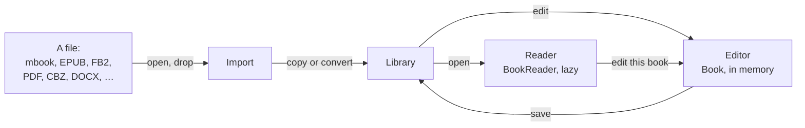
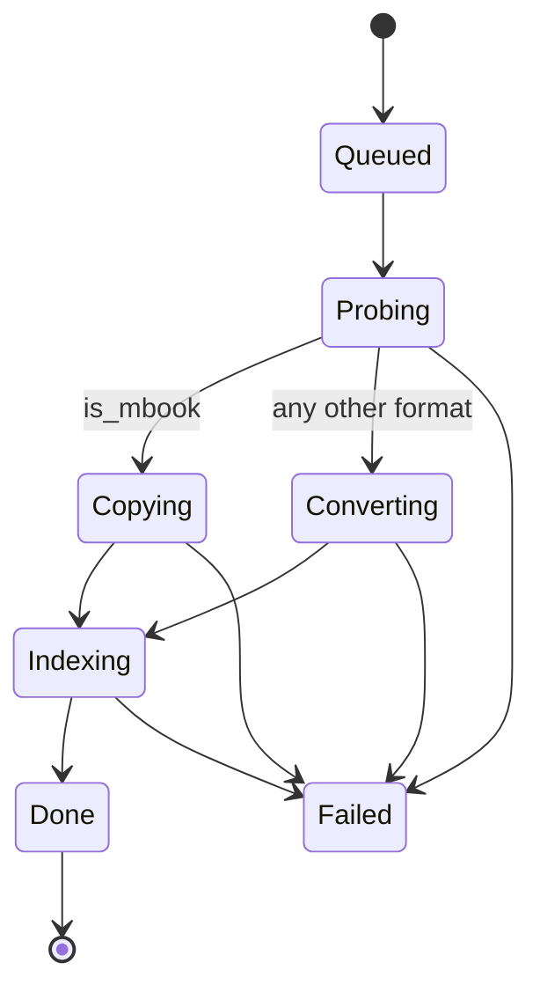
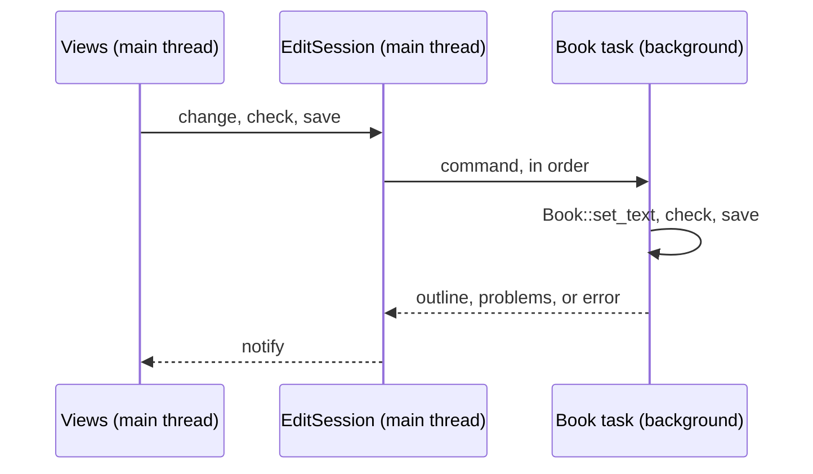

# RFC 0004: The mbook application

| | |
| --- | --- |
| **Status** | Draft |
| **Start date** | 2026-11-21 |
| **Crate** | `mbook-ui` |
| **Builds on** | [RFC 0002](0002-mbook-api.md); [RFC 0003](0003-mbook-converter-api.md) |

## Summary

`mbook-ui` is a reading application built on `mbook` and `mbook-converter`.
It has three screens:

| Screen | What it does | Built on |
| --- | --- | --- |
| **Library** | Shows the books the application keeps, as covers | The catalogue; `BookReader::open` and `read_cover` |
| **Reader** | Shows one book, a chapter at a time | `BookReader`, read lazily |
| **Editor** | Changes the metadata, chapters and pictures of a book | `Book`, in memory |

Opening a file that is not yet in the library adds it: an mbook file is
copied, a file in any format of RFC 0003 is converted first. Everything that
reads a file, decodes, parses, converts or encodes runs on the background
executor of GPUI; the main thread only draws and reacts.

The interface is built with GPUI Kit on the GPUI Fast engine. One layout
serves a phone, a tablet and a desktop window: it is chosen from the width of
the window, never from the platform.

A first version exists. [What is implemented](#what-is-implemented) says
what it does, where it differs from this document, and what has not been
tried outside of tests.

## Motivation

The repository has a format, a library and a converter, and no way to look at
a book. A reader is also the first real consumer of `BookReader`: the claims
of [RFC 0001](0001-mbook-format.md) (a book opens without being read in full;
only what is on screen is decoded) are only shown to hold by an application
that depends on them.

| Task | Screen |
| --- | --- |
| Keep books in one place and find one | Library |
| Open an EPUB, FB2 or PDF without thinking about formats | Library, through import |
| Read, and come back to the same place | Reader |
| Correct a title, a cover or a typo after a conversion | Editor |

### Goals

| Goal | How the design meets it |
| --- | --- |
| The interface never waits for a book | No call that touches a file or parses runs on the main thread ([Threads](#threads)). |
| One code base for desktop and mobile | Layout depends on a size class of the window; platform code stays in a thin shell ([Layout](#layout)). |
| The library survives its index | The mbook files hold the metadata; the catalogue can be rebuilt from them ([The catalogue](#the-catalogue)). |
| A failed import or save loses nothing | A file enters the library, and replaces a book, only by a rename ([Import](#import), [Editing](#editing)). |
| Little own code | Components, the Markdown view, the text editor, dialogs and lists come from GPUI Kit; paths, updates and the store from established crates. |
| What is read is what was edited | The editor's preview and the reader are the same view with the same style. |
| Usable without sight, without a pointer and without fine motor control | Every screen meets WCAG 2.2 at level AA where it applies to an application ([Accessibility](#accessibility)). |

### Non-goals

- **A store, an account or synchronisation.** The library is a folder on one
  device.
- **Pages and two-page spreads.** The first version scrolls a chapter; see
  [Future possibilities](#future-possibilities).
- **Annotations**: highlights, notes and bookmarks.
- **A visual (WYSIWYG) editor.** A chapter is edited as Markdown next to its
  preview.
- **Converting from mbook**, as in RFC 0003.
- **A streaming editor.** [RFC 0002](0002-mbook-api.md#non-goals) has none;
  a book is edited as a whole `Book`.
- **Mobile shells.** The design keeps them possible; the first version ships
  for desktop.

## Guide-level explanation

### The three screens



The model is Apple Books for the Mac: a quiet library where the covers carry
the colour, and a reader whose controls step aside. What is taken from it and
what is left out is listed under [Prior art](#prior-art).

### Size classes

The layout follows the width of the window. A narrow desktop window gets the
phone layout, and a tablet in landscape gets the desktop one.

| Class | Window width | Navigation | Typical device |
| --- | --- | --- | --- |
| Compact | below 600 px | A stack of screens; a bar at the bottom | Phone; a narrow window |
| Medium | 600 to 959 px | A stack; panels slide over the content | Tablet in portrait; half a screen |
| Expanded | 960 px and more | A sidebar beside the content; panels dock | Desktop; tablet in landscape |

### Library

```text
Expanded
+----------------+----------------------------------------------------------+
| [ Search     ] |  Continue reading                                        |
|                |  +------+  The Master and Margarita                      |
| Library        |  |cover |  Mikhail Bulgakov                              |
|  All books     |  |      |  Chapter 7, 38%                     [ Read ]   |
|  Reading       |  +------+                                                |
|  Finished      | -------------------------------------------------------- |
|                |  All books                        Sort: Recent v   [+]   |
|                |  +-----+  +-----+  +-----+  +-----+  +-----+  +-----+    |
|                |  |     |  |     |  |     |  |     |  |     |  |     |    |
|                |  |     |  |     |  |     |  |     |  | ... |  |     |    |
|                |  +-----+  +-----+  +-----+  +-----+  +-----+  +-----+    |
|                |  ===--     NEW      =====-            Converting         |
|                |  Title    Title    Title    Title    Title    Title      |
| [ Import  ^2 ] |  Author   Author   Author   Author   Author   Author     |
+----------------+----------------------------------------------------------+

Compact
+---------------------------+
| Library             [+]   |
| [ Search               ]  |
| +-----+ +-----+ +-----+   |
| |     | |     | |     |   |
| +-----+ +-----+ +-----+   |
| ===--    NEW     ====-    |
| Title   Title   Title     |
| +-----+ +-----+ +-----+   |
| |     | |     | |     |   |
+---------------------------+
| Reading   Library  Search |
+---------------------------+
```

- A cover keeps its own proportions; covers are aligned at the bottom of a
  row, as on a shelf. A book without a cover gets one drawn from its title.
- Under a cover: a line of progress, or `NEW` for a book never opened.
- A book that is still being converted is already on the shelf, with its
  file name and the state of the import.
- The menu of a book (right click, the `…` button, or a long press): Open,
  Edit, Show the file, Remove.
- Files are added with `+`, by dropping them on the window, or by opening
  them with the application from the system.

### Reader

```text
Expanded, controls shown                      Compact
+----------------------------------------+    +-------------------------+
| <  Library    Contents   Aa    Edit    |    | <      Contents   Aa    |
|                                        |    |                         |
|         Chapter 7                      |    |  Chapter 7              |
|                                        |    |                         |
|         It was then that the           |    |  It was then that the   |
|         second act began. The          |    |  second act began. The  |
|         text column is at most         |    |  column fills the       |
|         38 em wide and stays in        |    |  width, with a margin   |
|         the middle of the window.      |    |  of 20 px.              |
|                                        |    |                         |
|         ---------o--------------       |    |  ------o--------------  |
|         Chapter 7, 38%                 |    |  Chapter 7, 38%         |
+----------------------------------------+    +-------------------------+
```

- Controls are hidden while reading. Moving the pointer, or a tap in the
  middle of the text, shows them; they hide again after a few seconds.
- **Contents** lists the entries of the book, the current one marked. It is a
  popover on an expanded window and a sheet from the bottom on a compact one.
- **Aa** sets the page tone and the size of the text, and switches between
  the typefaces used last. Every typeface is in the settings.
- Space, Page Down and the arrow keys move by a screen; on touch, a tap on
  the left or right edge does the same.
- A link to another place of the book jumps there, and Back returns. A link
  to the web opens in the browser, only when it is followed.
- The place in the book is kept: a book reopens where it was left.

### Editor

```text
Expanded
+--------------+---------------------------+---------------------------+
| <  Library   | ch07.md        Source | Split | Preview      [ Save ] |
|              +---------------------------+---------------------------+
| Details      | # Chapter 7               |  Chapter 7                |
| Cover        |                           |                           |
| Chapters     | It was then that the      |  It was then that the     |
|   ch01.md    | **second** act began.     |  second act began.        |
|   ch02.md    |                           |                           |
| > ch07.md  * |    |  [ picture ]              |
|   [ + ]      |                           |                           |
| Pictures     |                           |                           |
| Problems  2  |                           |                           |
+--------------+---------------------------+---------------------------+

Compact: a stack. Sections, then a chapter with Source | Preview.
```

- **Details** is a form over the metadata of RFC 0001: title, authors,
  language, series, publisher, date, annotation.
- **Chapters** are a list in reading order: add, remove, move up and down.
- **Pictures** and the **Cover** take a file in AVIF, JPEG, PNG, GIF, WebP or
  BMP. Anything but AVIF is encoded as AVIF when it is added; the list shows
  the picture as being encoded until it is ready.
- **Problems** lists what `Book::check` reports, each with its chapter and
  place; choosing one opens that place. A book with problems is not saved.
- **Save** replaces the book in the library. Until then the library and the
  reader see the book as it was.

### Settings

One screen, reached from the library: a page on an expanded window, a pushed
screen on a compact one.

| Setting | Choices | Default |
| --- | --- | --- |
| Typeface of books | Literata, or any font family installed on the device | Literata |
| Size of the text | 12 to 32 px | 18 px; 17 px on a compact window |
| Line height of the text | 1.2 to 2.0 | 1.6 |
| Page tone | Paper, Sepia, Dusk, Night, or the one that follows the system | Follows the system |
| Size of the interface | 100% to 200% | 100% |
| Controls of the reader | Hide while reading, or always shown | Hide while reading |
| Motion | As the system says, or reduced | As the system says |
| Check for updates | On, off | On |

A change shows at once in an open book. A page tone that follows the system
is Paper while the system is light and Night while it is dark.

### Using the application without a pointer or without sight

- **Keyboard.** Every action has a key or is reached with Tab and the arrow
  keys; what has the focus is outlined. The shelf is a grid the arrows move
  through; Return opens a book, and the menu key opens its menu.
- **Screen readers.** A cover is announced as "The Master and Margarita, by
  Mikhail Bulgakov, 38 percent read". A chapter is read as headings,
  paragraphs, lists and tables; a picture is read by its alternative text.
  The end of an import, and a failed one, are spoken.
- **Low vision.** The interface scales to 200%, at which a desktop window
  takes the compact layout instead of cutting anything off. Text and
  controls keep the contrast of level AA in every page tone.
- **Touch and tremor.** Nothing needs a drag, a hover or a timed gesture: a
  chapter is moved with "Move up" and "Move down", and the controls of the
  reader can be kept on screen.

### Visual direction

The covers are the only saturated colour of the library; the reader shows
nothing but the page. One accent marks what is selected and how far a book
has been read.

| Token | Light | Dark | Used for |
| --- | --- | --- | --- |
| Canvas | `#F4F5F7` | `#15161A` | The background of the library |
| Surface | `#FFFFFF` | `#1E2026` | Sidebars, sheets, menus |
| Ink | `#16181D` | `#ECEDEF` | Text |
| Ink, muted | `#5F6673` | `#9AA0AB` | Authors, captions |
| Line | `#E3E5EA` | `#2C2F37` | Separators, which carry no meaning |
| Outline | `#7C8390` | `#747B89` | The border of a field, the track of a progress line, the edge of a control |
| Iris (accent) | `#4650D8` | `#8C93FF` | Selection, progress, the primary button |

| Page tone | Page | Text |
| --- | --- | --- |
| Paper | `#FFFFFF` | `#1B1B1B` |
| Sepia | `#F4ECD8` | `#3A2E1F` |
| Dusk | `#2A2C31` | `#D5D7DB` |
| Night | `#000000` | `#B8B8B8` |

- **Type.** The interface uses the system font of the platform. The text of
  a book is set in Literata unless the reader chooses another typeface: it
  was drawn for reading on screens and has Latin, Cyrillic and Greek.
- **Measure.** A line of a book is at most 38 em, about 70 characters, at a
  line height of 1.6.
- **Icon.** An open book on the navy of these design documents:
  `crates/mbook-ui/assets/icon.svg`, drawn once and rendered to the PNG the
  bundle and the Windows executable take.
- **Motion** answers an action: a screen is pushed, a sheet rises, the
  controls of the reader fade. Nothing moves by itself, and the system
  setting that reduces motion turns the transitions off.

## Reference-level explanation

### What is settled

The format author settled the points below on 2026-11-21. Every other detail
of this document is *proposed*, and listed under
[Unresolved questions](#unresolved-questions) where a choice is open.

| Decision | Status |
| --- | --- |
| The interface is built with `gpui-kit` on the `gpui-fast` engine | Confirmed |
| The allocator is `mimalloc3` | Confirmed |
| The application has a library of books | Confirmed |
| It opens every format `mbook-converter` converts | Confirmed |
| A book that is not mbook is converted when it is opened, and the result is kept in the library | Confirmed |
| A book can be edited | Confirmed |
| All CPU-bound work runs on the background executor | Confirmed |
| The prototype is modelled on Apple Books for the Mac | Confirmed |
| The layout is responsive, so that desktop and mobile share it | Confirmed |
| The directories of the application come from the `dirs` crate | Confirmed |
| Updates are installed from GitHub releases with the `self_update` crate | Confirmed |
| The crate is `mbook-ui`, and the application is called mbook | Confirmed |
| An import leaves the original file where it is; the library gets a copy | Confirmed |
| A book whose `id` is already in the library is not added again; the existing one is opened | Confirmed |
| Pictures are decoded by `avif-decode`; the package requires Rust 1.100 | Confirmed |
| Books are set in Literata, shipped with the application; the typeface is chosen in the settings | Confirmed |
| The modules follow Feature-Sliced Design | Confirmed |
| A release is a tag on GitHub; its binaries are built by a workflow started by hand for that tag | Confirmed |
| Releases are signed with keys generated for the project and kept as secrets of the repository | Confirmed |
| The icon is an open book on the navy of the design documents | Confirmed |
| Saving an edit replaces the book in the library | Confirmed |
| The editor accepts pictures that are not AVIF and encodes them with the `image` crate | Confirmed |
| The catalogue is a `redb` database | Confirmed |

### Crate and workspace

`crates/mbook-ui` is one package with a library and a binary.

| Target | Contains |
| --- | --- |
| Library `mbook_ui` | Every model and view, and `run(Application, Roots)`. It names no platform. |
| Binary | The allocator, the platform of the desktop, the directories from `dirs`, a call to `run`. |

- The binary **MUST** stay a shell: it sets the global allocator, builds the
  `Application`, and passes it on. A mobile shell is a second small crate
  that supplies its own platform to the same `run`.
- `gpui-kit` is used with the feature `gpui-fast`; application code imports
  `gpui_kit::*` only and never names `gpui` or `gpui-fast`.
- The allocator is set in the binary, not in the library, so that tests and
  other shells choose their own.
- The package sets its own `rust-version`, 1.100, and is not published to
  crates.io. `mbook` and `mbook-converter` keep the 1.89 of the workspace.
- The lints of the workspace apply unchanged.

The modules follow the layers of Feature-Sliced Design. A layer uses only
the layers below it.

| Layer | Slices |
| --- | --- |
| `app` | `run`, the window, the root view, menus and keys |
| `pages` | `library`, `reader`, `editor`, `settings` |
| `widgets` | `chapter_view`, the text of a chapter, which the reader and the preview of the editor share. Every other part of a screen belongs to its page until a second page needs it. |
| `features` | `import_book`, `reading_position`, `appearance`, `edit_book`, `search_library`, `auto_update` |
| `entities` | `book` (an open book), `catalogue` (the store), `picture` (decoding and its cache) |
| `shared` | `roots` (directories), `model` (the key of a book, a place in one), `layout` (size classes), `theme` (colour tokens), `actions`, `ui` (presets over Kit components), `assets` |

State lives in model entities; a view observes a model and calls its
methods. A view holds no `BookReader`, no `Book` and no path.

### Threads

| Work | Runs on | Priority |
| --- | --- | --- |
| Drawing; changing entities; reading snapshots | Main thread | |
| Opening the catalogue; its reads and writes | Background | Medium |
| `BookReader::open`; building the snapshot of a book | Background | High |
| `read_chapter`; resolving its links and pictures | Background | High |
| Parsing Markdown for display | Background, by the text view of GPUI Kit | |
| `read_picture`; decoding AVIF; scaling | Background | Medium |
| Detecting a format; copying a file | Background | Medium |
| `Converter::convert` | Background, one conversion at a time | Low |
| Making the thumbnail of a cover | Background | Low |
| `Book::open`, every change of a `Book`, `check`, `save` | Background, by the task that owns the book | Medium |
| Decoding a picture added in the editor and encoding it as AVIF | Background, one at a time | Low |
| Filtering the library | Background | High |
| Checking for an update; downloading it | Background | Low |

- Code on the main thread **MUST NOT** call a `read_` method of
  `BookReader`, any method of `Book` or `Converter`, a function of
  `std::fs`, the catalogue, or a decoder.
- Background work is started with the background executor of GPUI and
  returns a `Task`. The entity that asked keeps the `Task`; dropping the
  entity cancels it.
- Cancelling takes effect between steps. A conversion or a decode that has
  started runs to its end, and its result is discarded: the converter has no
  cancellation ([RFC 0003](0003-mbook-converter-api.md#future-possibilities)).
- A result that arrives for a state the user has left **MUST** be dropped:
  every request carries the generation of the view that made it.
- Conversions run one at a time. The AVIF encoder already uses every core,
  and each conversion holds its source and its book in memory
  ([RFC 0003](0003-mbook-converter-api.md#sources-and-memory)).

### Storage

The shell hands the library two directories, the *roots*. On desktop they
come from `dirs`:

```text
dirs::data_dir()/mbook/            kept; backed up with the user's data
    catalog.redb                   the catalogue
    books/<key>.mbook              one file per book
    books/.incoming/               files of imports that have not finished
dirs::cache_dir()/mbook/           may be deleted at any time
    covers/<key>.jpg               thumbnails of covers
    update/                        a downloaded update
```

- `<key>` is a UUID version 7 made when the book is added. It is not the
  `id` of the book's metadata: that is any string, and an edit may change it.
- A file **MUST** enter `books/` by a rename from `books/.incoming/`, which
  is on the same volume. A reader therefore never sees half a file.
- `books/.incoming/` is emptied when the application starts.
- Everything under the cache root **MUST** be reproducible from the data
  root.
- When `dirs` knows no directory for the platform, the shell supplies the
  roots itself. Tests pass temporary directories.

### The catalogue

The catalogue is one `redb` database. It holds two kinds of data:

| Table | Key | Holds | Can be rebuilt |
| --- | --- | --- | --- |
| `books` | key | `id`, title, authors, language, series, the size of the file and of the cover, the time added, the format it was converted from | Yes, from the files in `books/` |
| `state` | key | The last place read, the time of the last opening, whether the book is finished | No |
| `settings` | name | Page tone, typeface, text size, the size of the window, whether updates are checked | No |

- **The mbook files are the source of truth for metadata.** A row of `books`
  is a copy that spares the application from opening every file at start.
- When the database is missing or cannot be opened, the application
  **MUST** rebuild `books` by opening every file of `books/` with
  `BookReader::open`, which reads the tables and nothing else. Reading
  places and settings are then lost; the books are not. The file that
  could not be opened is kept beside the new one as `catalog.redb.damaged`,
  and the user is told once.
- Two cases are not damage, and the file **MUST NOT** be replaced: a
  database written by a newer version of the application, and one that
  another running copy of the application holds open. Both end in an error
  screen that says which.
- A place is stored as the **path** of a chapter and a byte offset, not as a
  resource number: numbers change when a book is saved again
  ([RFC 0002](0002-mbook-api.md#shared-value-types)), paths do not. When the
  offset is no longer at the start of a block, the reader opens the block
  that contains it; when the chapter is gone, the start of the book.
- Progress is the decoded length of the chapters before the place, plus the
  offset, over the decoded length of all chapters. Both come from the
  directory of the file; nothing is decoded for it.
- Rows are encoded with the value types of `redb`; the encoding is
  *proposed*. The database carries a schema version.

### Import



| Step | What happens |
| --- | --- |
| Probing | The first 53 bytes are given to `mbook::is_mbook`. |
| Copying | An mbook file is copied into `books/.incoming/` and opened with `BookReader::open`, which rejects a file that is not valid. |
| Converting | `Converter::convert` reads the file and writes into `books/.incoming/`. The format is detected from the content; for Markdown and plain text, which are never detected, it is taken from the extension of the file name with `Format::from_str`. |
| Indexing | The file is renamed into `books/`. Its metadata go into `books`, and its cover, decoded and scaled, into `covers/`. |

- The original file is neither moved nor changed.
- A book whose `id` is already in the library is not added again; the
  existing book is opened. The converter gives a source without
  an identifier an `id` computed from its bytes, so the same file is
  recognised.
- A failed import leaves nothing in `books/` and no row. The error is shown
  on the entry of the import, in the words of the converter's `Error`.
- The warnings of a `Report` are counted on the entry and listed on request.
  They are not kept after the application closes.
- Opening one file opens the reader when its import is done. Adding several
  files only adds them.
- A phone cannot hold a source of 2 GiB and its book. On a compact device
  the shell lowers `ConvertLimits` (*proposed*; the values are not chosen).

### Reading

An open book is an entity with two parts.

| Part | Lives | Contains |
| --- | --- | --- |
| Snapshot | Main thread, immutable | Title and authors; the contents; for each chapter its number, path and decoded length |
| Source | Behind a mutex that only background tasks lock | The `BookReader<File>` |

- The snapshot is built once, on the background, when the book is opened.
  The main thread **MUST NOT** lock the source, not even for a table lookup.
- A chapter is prepared on the background in one task: `read_chapter`, then
  `resolve` for every link and picture destination of the text, then the
  byte offset of every top-level block, found with `markdown`, the parser
  `mbook` itself uses. The main thread receives the text, a map from
  destination to `Destination`, and the offsets.
- The text is shown by the Markdown view of GPUI Kit in its scrolling form,
  which lays out only the blocks near the window. The reader does not render
  Markdown itself.
- The block at the top of the window, through its offset, is the place that
  is stored. It is written at most once a second, and when the book is
  closed.
- A contents entry, a link or a stored place is shown by revealing the block
  at its offset. A destination that resolved to `Destination::ExtraAnchor`
  is completed with `read_resolve` on the background when the link is
  followed.
- The reader shows one chapter. At its end it offers the next one, and the
  keys that move by a screen continue into it.
- Editing a book closes its source first, so that the file can be replaced
  on every platform; the reader reopens the book afterwards.

### Pictures

GPUI decodes no AVIF, so the application does:

1. `read_picture` gives the bytes of the file.
2. `avif-decode` decodes them to 8-bit RGBA. It does not apply the crop,
   the rotation and the mirroring an AVIF file may ask for, so the
   application does, by the rules `mbook` reads the size of a picture with:
   the decoded picture then has the size the tables of the book give.
3. The picture is scaled down to the width it is shown at, in device pixels.
4. The result is given to GPUI as a rendered image.

- A picture is requested when the view first draws it, and the three steps
  run on the background. Until then the view reserves its place: the size is
  in the tables of the book.
- Decoded pictures are kept in a cache bounded by their bytes, the least
  recently shown leaving first. The bound depends on the size class
  (*proposed*: 256 MiB expanded, 64 MiB compact).
- The thumbnail of a cover is made once, at import or after a save, 400 px
  wide, and stored as a JPEG file that GPUI loads by its path.
- A picture that cannot be decoded shows its alternative text. It never
  fails the chapter.

### Accessibility

The application conforms to WCAG 2.2 at level AA, read for a native
application. GPUI reports its elements to the platform through AccessKit; an
element is reported when it has an identifier and a role.

**What assistive technology is told**

- Every control **MUST** have a role and a name. A control that shows only
  an icon gets its name as a label, and shows the same words as a tooltip.
- The name of a book on the shelf is its title, its authors and its state:
  the percentage read, `new`, or the step of its import. The progress line
  under a cover is not a separate element.
- A state that colour shows **MUST** also be in the name or in text beside
  it: selected, current chapter, unsaved, failed, has problems.
- The text of a chapter is reported with its structure, which the Markdown
  view of GPUI Kit provides: headings with their level, lists, tables,
  links, code.
- A picture of a book is reported as an image named by its alternative
  text. A picture with an empty alternative text is not reported.
- The language of a book, from its metadata, is given to the elements that
  show its text, so that a screen reader speaks it in the right voice.
- A change the user did not cause in the focused element **MUST** be
  announced: an import that finished or failed, problems found by a save, an
  update that is ready. A change that follows from an action is announced by
  the element that changed. GPUI has no live regions: an announcement is a
  notification with the alert role, and text that changes in place has the
  status role.
- An identifier of an element **MUST** stay the same while the element
  means the same thing: the identifier of a book is its key, of a chapter
  its path. Assistive technology then does not hear a list as replaced when
  it is redrawn.

**Keyboard and focus**

- Every action **MUST** be reachable from the keyboard alone, and no
  element may hold the focus without a way to leave it by key.
- The order of focus follows the order of reading: sidebar, then content,
  then panels.
- The focused element **MUST** show an outline of at least 2 px in the
  accent colour, with a contrast of 3:1 against what is beside it. The
  outline appears for focus that came from the keyboard.
- A dialog, a sheet and a popover keep the focus inside while they are
  open, close with Escape, and return the focus to the control that opened
  them.
- In the Markdown editor Tab indents. Escape followed by Tab leaves the
  editor, and the editor says so in its description.
- Opening a screen moves the focus to its heading or its first control;
  going back returns it to the control that led there.
- Keys are bound through the key map of GPUI, so that they are listed in the
  menus and can be changed in one place.

| Key | Action |
| --- | --- |
| Tab, Shift+Tab | Next and previous control |
| Arrows | Move inside a grid, a list or a menu |
| Return, Space | Activate; in the reader, Space moves by a screen |
| Escape | Close a panel; leave the editor; go back |
| The platform's Open, Save, Find, Settings | The same in the application |
| Page Up, Page Down, Home, End | Move in a chapter |
| The platform's bracket keys | Previous and next chapter |

**Seeing**

- Text **MUST** have a contrast of at least 4.5:1 against its background,
  and the border or glyph that identifies a control at least 3:1. The
  tokens of [Visual direction](#visual-direction) meet this in both
  appearances and in every page tone; a test computes it.
- The colour `Line` is for decoration only. Whatever must be seen to use a
  control uses `Outline`.
- The size of the interface is one setting that scales every length of the
  interface. The size class is computed from the width of the window
  divided by that scale, so that a scaled window reflows instead of
  clipping.
- The text of a book is never justified and never set narrower than the
  reader chose. Its size, line height and typeface are settings; no text is
  drawn as a picture.
- Nothing flashes.

**Pointer and touch**

- A control is at least 24 px in both directions for a pointer and 44 px on
  a touch device.
- Whatever a drag does **MUST** also be possible without one: a chapter has
  "Move up" and "Move down".
- Whatever a hover or a long press reveals **MUST** also have a visible
  control or a menu entry.

**Time and motion**

- The controls of the reader hide only while nothing inside them has the
  focus and the pointer is not over them, and never when the setting keeps
  them shown. They return on any key.
- No message disappears by itself while it still asks for an action.
- When the system, or the setting, asks for reduced motion, every
  transition is replaced by an immediate change. GPUI Kit reads the system
  setting on macOS, Windows and Linux.

**Words**

- An error names what went wrong and what can be done, in text, at the
  control it belongs to.
- A field of a form has a visible label, which is also its name.

### Appearance

- The typeface, the size and line height of the text and the page tone are
  rows of `settings`. A change is applied to every open reader and to the preview of
  the editor without reopening the book.
- Literata is part of the application: its files are embedded and registered
  with the text system at start. Its license, the SIL Open Font License 1.1,
  is shipped with it.
- The other choices are the font families the text system of GPUI reports
  for the device. The list is read once, on the background.
- A stored typeface that the device no longer has **MUST** fall back to
  Literata; the setting is kept, so that it applies again when the font
  returns.
- A typeface without the letters of a book is not refused: the text system
  substitutes another font for them.
- The setting changes the text of books only. The interface keeps the
  system font, and code keeps a monospaced one.

### Editing



- A session starts with `Book::open` on the background. The `Book` is then
  owned by one background task for as long as the session lives.
- The session sends that task commands over a channel, and the task applies
  them **in the order they were sent**. A save therefore always includes the
  edits made before it.
- The main thread holds an *outline*: the metadata, the paths and sizes of
  chapters and pictures, the contents, the problems last reported. The task
  sends a new outline after each command that changes it.
- The text of the chapter being edited is in the editor of GPUI Kit. It is
  sent to the task as `Chapter::set_text` when typing pauses for 400 ms,
  when another chapter is opened, and before a check or a save.
- The preview is the Markdown view of the reader, given the text of the
  editor. It does not wait for the task.
- An error of a call (`InvalidText`, `InvalidPath`, `DuplicatePath`,
  `InvalidPicture`, `InvalidMeta`) is shown at the control that caused it,
  with the byte offset when the error has one.
- **Save** runs `Book::check`, then `Book::save` onto the file of the
  library, which writes a temporary file beside it and renames it into
  place. A book with problems is not written, and the problems are shown.
  After a save the row of `books` and the thumbnail are made again.
- Undo inside a chapter is the editor's own. Removing a chapter or a picture
  asks first and cannot be undone.
- A chapter moves to another path by being removed and inserted at the same
  position, since `Book` has no rename; the links that broke are then among
  the problems.
- A book that was opened keeps the contents of its file, item by item.
  After a chapter is removed or moved, an item may lead nowhere or stand out
  of order, and the book cannot be saved. The editor then offers to build
  the contents from the headings again, as a new book has them.
- Text that `Chapter::set_text` refused stays in the editor as a draft, and
  the book is not saved while a draft exists: nothing typed is dropped.
- A picture, or a cover, is added from a file in AVIF, JPEG, PNG, GIF, WebP
  or BMP, the formats `mbook-converter` reads
  ([RFC 0003](0003-mbook-converter-api.md#pictures)).
  - An AVIF file is passed to `Book::add_picture` or `Book::set_cover` as it
    is.
  - Any other file is decoded, turned upright by its orientation tag, and
    encoded as AVIF by the `image` crate, with quality 80 and speed 6, the
    defaults of the converter. Of an animated file the first frame is kept. This happens in a
    task of its own, not in the task that owns the book, so that typing and
    saving do not wait for an encoder. The command that adds the picture is
    sent when the bytes are ready.
  - The path the user gives ends in `.avif`; the editor proposes the name of
    the file with that extension.
  - A picture of more than 100,000,000 pixels, the limit of the converter,
    **MUST** be refused before it is decoded in full.
  - A save waits for the pictures that are still being encoded.
  - A file that cannot be decoded is reported at the control that added it,
    and nothing is added.
- Leaving the editor with unsaved changes asks whether to save them.
  Unsaved changes do not survive the application closing.

### Layout

- A view **MUST** take its layout from the size class of its window and
  from nothing else. It **MUST NOT** test the operating system.
- The size class is computed from the width of the window and the scale
  of the interface, by the entity that holds the settings; a view asks it
  while it draws.
- What a pointer reveals by hovering **MUST** also be reachable without
  one: by a tap, a long press or a visible control.
- On a touch device every control is at least 44 px in both directions.
- Views keep clear of the safe-area insets the window reports.

| Element | Compact | Medium | Expanded |
| --- | --- | --- | --- |
| Sections of the library | A bar at the bottom | A sidebar that slides over | A fixed sidebar |
| Columns of the shelf | As many covers of 104 px as fit | Covers of 132 px | Covers of 132 px |
| Contents of a book | A sheet | A sheet | A popover |
| Text column of the reader | The width, less 20 px on each side | At most 38 em | At most 38 em |
| Editor | A stack; source or preview | Source or preview; sections slide over | Sections, source and preview side by side |
| Menu of a book | A long press | A long press, or `…` | A right click, or `…` |

### Updates

Updates exist on desktop only, behind the Cargo feature `self-update`, which
a build for a store or a package manager leaves off.

- A release is a tag of the repository on GitHub, `vX.Y.Z`, where `X.Y.Z` is
  the version of the workspace. Its binaries are built by the workflow
  `.github/workflows/release.yml`, which a maintainer starts by hand for
  that tag; the workflow refuses a tag that is not the version, creates the
  release when the tag has none, and attaches the files. No push builds a
  release. The workflow has not been run yet.
- The workflow builds for macOS on arm64 and x86-64 and for Windows on
  x86-64. There is no Linux build.
- Each platform gets two files: an installer for a person (`.dmg`, `.msi`)
  and an archive `mbook-<tag>-<target>.tar.gz` for the application to update
  itself from. The archive holds the application bundle on macOS and the
  installer on Windows.
- The bundle, the executable and the installer are signed with a
  self-signed certificate, so that the identity of the application stays
  the same from one version to the next. The systems do not trust such a
  certificate: Gatekeeper and SmartScreen warn at the first start.
- The archive is signed with zipsign. The private key and the certificate
  are secrets of the repository (`ZIPSIGN_KEY`, `BINARY_SIGN`,
  `BINARY_SIGN_PASSWORD`); the public key is
  `crates/mbook-ui/assets/update.pub`, built into the application.
- The check asks the GitHub releases of the repository for the latest
  version and compares it with the version of the package. A tag whose
  binaries are not built yet has no release, and is not offered. It runs at start
  and once a day, never in a debug build, and can be turned off in the
  settings.
- `self_update` is used with its blocking `ureq` transport inside a
  background task. The application has no second runtime.
- An update is offered, never installed unasked. It is downloaded to
  `update/` under the cache root.
- A downloaded archive **MUST** be verified against a public key built into
  the application before anything is replaced (the `signatures` feature).
- Installing waits while an import is running or a book is open in the
  editor, and so does the restart that follows it: it must not replace the
  application under a conversion, nor restart it over unsaved changes.

| Platform | What is replaced |
| --- | --- |
| macOS | The whole application bundle, from a `.tar.gz`, so that its signature stays valid |
| Windows | Nothing by the application: the installer from the verified archive is started, and replaces the version itself |
| Linux | Nothing: no release is built for it |

### Errors

- The library has one `Error` enum, non-exhaustive, built with `thiserror`.
  The errors of `mbook`, `mbook-converter`, the store and the decoder are its
  sources.
- An error is turned into a sentence for the user in the view that shows it,
  not where it arises.
- A failure of one book, chapter or picture **MUST NOT** close the
  application or another book.
- A failure is never kept to itself: a catalogue that cannot be read or
  changed is reported on the library, with a way to try again, and settings
  that cannot be saved on the settings screen.

### Dependencies

Checked on 2026-11-21 against crates.io. A crate only this package uses is
declared in its own manifest; the manifest of the workspace keeps what
several packages share.

| Crate | Version, last release | License | Used for |
| --- | --- | --- | --- |
| `gpui-kit`, feature `gpui-fast` | 0.10.0, 2026-11-16 | Apache-2.0 | The interface; brings GPUI Fast 0.1 |
| `mimalloc3` | 0.1.61, 2026-11-17 | MIT | The allocator of the binary |
| `dirs` | 7.0.0, 2026-09-05 | MIT OR Apache-2.0 | The roots on desktop |
| `self_update` | 1.3.3, 2026-10-27 | MIT | Updates; Rust 1.88 |
| `redb` | 5.0.0, 2026-11-18 | MIT OR Apache-2.0 | The catalogue; Rust 1.90 |
| `avif-decode` | 3.0.0, 2026-09-20 | BSD-3-Clause | Decoding pictures; Rust 1.98 |
| `image` | The version and features of the workspace; GPUI brings the same crate | MIT OR Apache-2.0 | Decoding and AVIF encoding of pictures added in the editor; scaling |
| `futures` | already in the tree of GPUI | MIT OR Apache-2.0 | The channel of the editing task |
| `uuid`, `tempfile`, `thiserror`, `markdown` | The versions of the workspace | | Keys; files of imports; errors; block offsets |

`avif-decode` brings `rav1d` (BSD-2-Clause, a port of dav1d to Rust; last
release 1.1.0 of 2025-05-07) and `avif-parse` (MPL-2.0). Literata is not a
crate: its font files are added to the repository under the SIL Open Font
License 1.1.

Ruled out:

| Crate | Reason |
| --- | --- |
| `image` with `avif-native` | Needs the C library dav1d on the machine that builds and on the one that runs |
| `zenavif`, `rav1d-safe` | AGPL-3.0, or a commercial license |
| `rusqlite` | See [Rationale and alternatives](#rationale-and-alternatives) |

### Testing

- Logic sits in models and in plain functions: the size class, the import
  state machine, the catalogue, progress, block offsets, the outline. Each
  has unit tests beside it.
- Models and views are tested in headless windows with the `test-support`
  feature of `gpui-kit`: a test imports a book built in a temporary root,
  opens it, edits it and saves it.
- The rule of [Threads](#threads) is tested: with the background executor
  held back, a view **MUST** still draw, showing its loading state.
- Every layout is drawn at 390, 800 and 1280 px of width. With the Cargo
  feature `visual`, `cargo test -p mbook-ui --features visual --test visual`
  renders every screen without a window, in these widths and in a light
  and a dark page tone, into `target/visual/`: 104 pictures for a person to
  look at. The renderer exists on macOS; elsewhere the test says so and
  passes.
- Accessibility is tested, not reviewed:
  - a unit test computes the contrast of every pair of tokens that
    [Accessibility](#accessibility) puts together;
  - for each screen a test reads the accessibility tree of a headless
    window and checks that every control has a role and a name;
  - for each screen a test completes its main task with keys alone: add a
    book, open it, move to another chapter, edit and save.

### What is implemented

The first version implements the sections above with the differences below.
Its tests run in headless windows, and its screens were looked at as
rendered pictures; a person has not yet used it with a pointer, a keyboard
or a screen reader, and it has not been built or run on Windows or Linux.

Seen in the pictures and left as it is: a notification stays over the right
end of the header for a while; the scroll bar of the reader stands at the
edge of the text column, over the text on a narrow window; a long word on a
cover drawn from a title breaks in its middle; the message of a book that
cannot be opened is the one of the library, not a sentence for a reader.

| Part | State |
| --- | --- |
| Library | As designed. The card of the book being read shows how far it was read, not the name of its chapter: the catalogue stores the path of a chapter, not its title. A change of the catalogue that failed is followed by a reload, and a reload that succeeds clears the message, so that failure may pass unseen. |
| Import | As designed. A file is added by the "Add a book…" control, the Open key, or a drop on the window. Opening a file with the application from the system, and a file named on the command line, are not handled. |
| Reader | One chapter at a time, as designed. A picture is requested at the width it was first drawn at and is not requested again when the window or the size of the text changes. Hiding the controls does not fade. |
| Editor | As designed, with "Move up" and "Move down" and no drag. The preview shows the alternative text of a picture, not the picture. Syntax of Markdown is not highlighted in the source. |
| Settings | As designed. The size of the interface is applied when the slider is released, because it moves the slider. |
| Updates | The check and the installation are written and tested against scripted releases and signed archives made by the tests. No real release exists, so neither has met the network; the Windows part has never been compiled. |
| Release workflow | Written; never run. A local `cargo bundle` on macOS produces the application with its icon. |
| Typeface | **Literata is not shipped.** Its files are not in the repository, so "Literata" falls back to the font of the interface unless the device has it. Every installed family can be chosen. |
| Transitions | None: a screen replaces another at once, which also meets reduced motion. |

Where assistive technology gets less than [Accessibility](#accessibility)
asks:

- **The structure of a chapter is not reported.** The Markdown view of GPUI
  Kit gives its headings, lists and tables no roles. The text of a chapter
  is one element with the article role, named by the title of the chapter.
- **The language of a book is not reported**: GPUI has no property for it.
- **The link in the About dialog cannot be reached by keyboard**: the link
  of GPUI Kit takes no focus.
- A few parts of Kit controls are reported without a role: the frame of a
  text field, the search field inside a select, the track of a slider. The
  controls they belong to have roles and names.

### Security considerations

- A book is untrusted input. Its limits are those of `mbook` and
  `mbook-converter`; the application adds none of its own parsers.
- Markdown of a book has no raw HTML and no scripts
  ([ADR-0006](adr/0006-markdown-dialect.md)). A picture is only ever taken
  from the book; a network address in a picture is not fetched.
- An external link is opened by the system browser, and only when the user
  follows it.
- An update replaces the program. It is accepted only with a valid
  signature, over TLS, from the releases of this repository.

## Drawbacks

- **A large dependency.** GPUI and its component library are far larger
  than the rest of the workspace together, and the engine is young: GPUI Fast
  is at version 0.1.
- **The checks of the repository grow.** Clippy, tests and documentation of
  the workspace now build GPUI, and continuous integration needs a display
  server's libraries on Linux.
- **An editing session holds the whole book decoded**, as `Book` does. A
  comic of several hundred pages may not fit on a phone.
- **Accessibility depends on a young integration.** What a screen reader
  hears is what GPUI and AccessKit pass on; a gap there is a gap here.
- **A running conversion cannot be stopped**, only ignored. Neither can the
  encoding of a picture, which takes seconds for a large one.
- **No pages.** A reader used to Apple Books gets a scrolling chapter.
- **Two copies of a book** after import: the original and the one in the
  library.
- **A stored place is approximate after an edit** of its chapter.
- **A second minimum Rust version** in the workspace.
- **Android has no backend** in this stack today; see
  [Unresolved questions](#unresolved-questions).

## Rationale and alternatives

| Decision | Chosen | Rejected | Why |
| --- | --- | --- | --- |
| Toolkit | GPUI Kit on GPUI Fast | | Decided by the format author. |
| Where CPU-bound work runs | The background executor of GPUI | A separate thread pool | Decided by the format author. One scheduler, with priorities, whose tasks are cancelled by dropping them. |
| What decides a layout | The width of the window | The platform | A narrow desktop window and a phone need the same layout; a platform test gives two code paths that drift apart. |
| Reading | `BookReader`, lazily | `Book` for everything | A `Book` decodes every chapter and picture before the first line is shown. |
| Access to the reader | A snapshot on the main thread; the source behind a mutex for background tasks | Table lookups on the main thread | A lookup would wait for a mutex that a read holds during I/O. |
| Rendering Markdown | The Markdown view of GPUI Kit | A renderer of this crate | It virtualises, selects text, parses off the main thread, and is built on the same `markdown` crate as `mbook`. |
| Splitting a chapter for display | Left to that view | One view per block | Footnotes and reference definitions connect blocks; a split would have to copy them. |
| Stored place | Chapter path and byte offset | Resource number and offset | Numbers change when a book is written again. |
| Editing | One background task owns the `Book`; commands in order | A `Book` behind a mutex, one task per change | Separate tasks may run out of order: a save could miss the edit before it. |
| Where an edit is saved | Over the book in the library, by a rename | Always a new copy | Decided by the format author. The library is the working copy; the original file was never touched. |
| Catalogue | `redb` | SQLite through `rusqlite` | Decided by the format author. Pure Rust: nothing to cross-compile for a phone. The price is no SQL; a library is filtered in memory. |
| | | No catalogue; open every file at start | Reading places and settings need a store anyway, and a shelf of thousands should not wait for thousands of files. |
| Source of truth for metadata | The mbook files | The catalogue | An edit changes the file; a lost catalogue then costs no book. |
| Key of a book | A UUID made at import | The `id` of the metadata | That `id` is any string and may be edited. |
| Directories | `dirs`, handed in by the shell | Paths built in the library | Decided by the format author; handing them in keeps tests and mobile shells possible. |
| Installing updates | `self_update`, blocking transport on the background | Its asynchronous transport | Decided by the format author to use the crate. The blocking transport needs no Tokio runtime beside GPUI. |
| AVIF decoder | `avif-decode` on `rav1d` | dav1d in C | Decided by the format author. No C toolchain; the same reason as for the encoder in RFC 0003. |
| Minimum Rust version | 1.100 for this package | The 1.89 of the workspace | Decided by the format author. `avif-decode` needs 1.98 and `redb` 1.90; an application is built by its maintainers, not by users of a library. |
| Typeface of books | Literata by default; any installed family in the settings | A fixed list of shipped fonts | Decided by the format author. One shipped font gives the same page on every device; the rest costs no bytes. |
| Building a release | A workflow started by hand for a tag | Building on every tag | Decided by the format author. A tag also marks versions of the libraries, which have no binaries. |
| Pictures added in the editor | Encoded here, with `image` | A public encoder in `mbook-converter` | Decided by the format author. RFC 0003 stays as it is; the price is that quality and speed are written in two crates. |
| Size class under a scaled interface | Width divided by the scale | Width in pixels | At 200% a desktop window has room for the compact layout only; clipping or a horizontal scroll bar fails WCAG 1.4.10. |
| Reordering chapters | A drag, and "Move up" and "Move down" | A drag alone | WCAG 2.5.7: a drag needs an alternative. |
| Thumbnails | JPEG files in the cache | Decoding every cover at start | The shelf then needs no AVIF decoder to appear. |

## Prior art

| Application | Taken from it | Left behind |
| --- | --- | --- |
| Apple Books for the Mac | The shelf of covers with progress; a reader without chrome; contents and appearance as two small panels; page tones | The store; pages and spreads; collections; annotations |
| Calibre | A library that owns copies of the books; converting on import; an editor with source and preview | A database as the source of truth; a window per tool |
| Zed | Entities as models; tasks owned by their entity; nothing blocking on the main thread | |

## Unresolved questions

*Proposed* by this draft and not confirmed by the format author:

| Question | Proposed |
| --- | --- |
| How a row of the catalogue is encoded | The value types of `redb`, without a serialisation crate |
| Notarising the macOS build, and a certificate of an authority for Windows | Not done: the certificate is self-signed |
| A release for Linux | Not built |
| The typefaces offered beside Literata | Every family the device has |
| The limits of conversion and of the picture cache on a compact device | Not chosen |

Needs a change outside this crate:

- **Progress and cancellation of a conversion** are future possibilities of
  RFC 0003; until then an import shows no percentage. The same holds for a
  picture being encoded in the editor.

The first version answered the questions a spike was to answer:

| Question | Answer |
| --- | --- |
| Do the macros of GPUI compile under the lints of the workspace? | Yes, with `unsafe_code = "forbid"` and Clippy's `pedantic` denied. |
| Does the Markdown view of GPUI Kit tell which block is at the top? | It lays out one item per top-level block, in the order of the source, but does not give its offset. The application keeps the offsets `markdown` finds and maps one to the other. |
| Does it reserve the size of a picture that is loading? | No: a pending picture is measured as a small square. The application hands it a transparent picture of the final size first. |
| Can GPUI announce a message, and give an element a language? | It has no live regions and no language. See [Accessibility](#accessibility) and [What is implemented](#what-is-implemented). |
| Is there a GPUI backend for Android? | Not looked at: the first version is for desktop. |

Not answered: how the Markdown view behaves with one chapter of several
megabytes, and whether the system's setting for more contrast reaches the
application.

## Future possibilities

- **Pages and two-page spreads**, which need text broken into columns of a
  fixed height.
- **Scrolling from one chapter into the next.**
- **Shells for iOS and Android.**
- **Search inside a book**, chapter by chapter on the background.
- **Highlights, notes and bookmarks**, stored beside the reading place.
- **Collections** in the library.
- **A journal of unsaved edits**, replayed after a crash.
- **Undo for changes of structure.**
- **Exporting** a book of the library as a file.
- **Conversion progress and cancellation**, when RFC 0003 has them.
